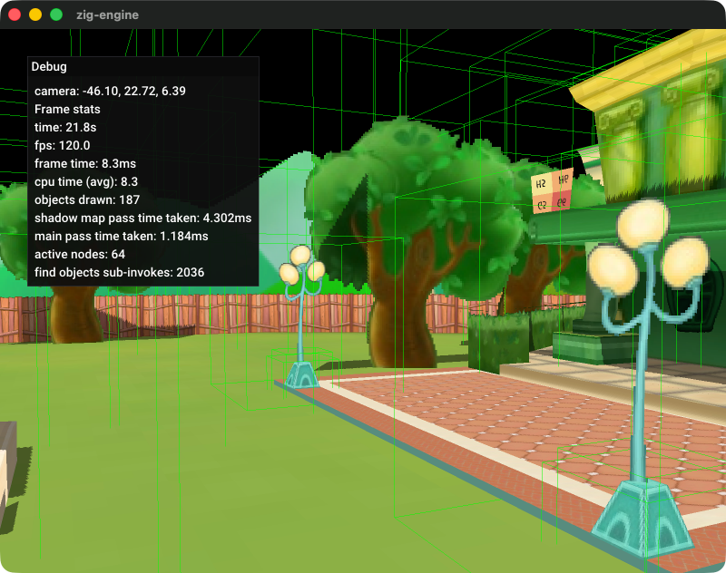
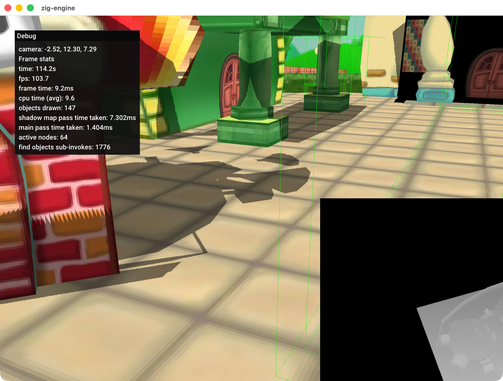
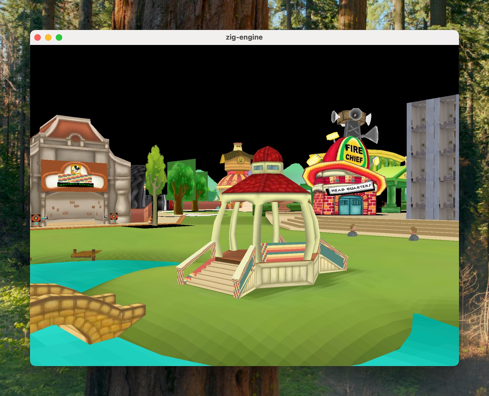
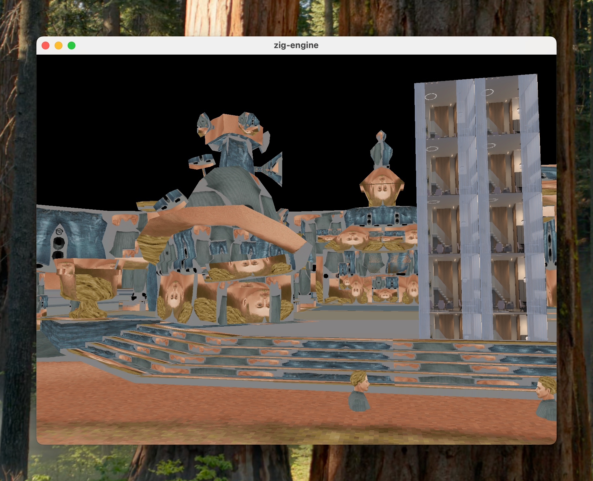
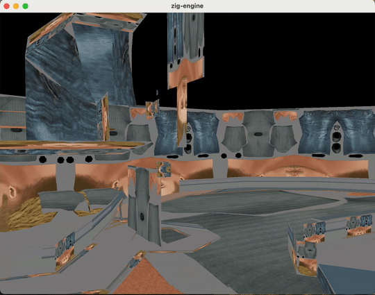

# zig-engine

A Zig 3D engine with a demo application and a voxel-world application. The engine renders scene objects, animated meshes, terrain, skyboxes, and voxels through WebGPU, with cascaded directional shadows and screen-space ambient occlusion (SSAO).

## Build and run

The package declares Zig 0.16.0 as its minimum version. External dependencies are pinned in `build.zig.zon`; the glTF loader is a local package.

```shell
zig build             # Build/install the library, both applications, and content
zig build run         # Run the demo application
zig build run_voxel -- --create-world saves/my-world # Create a saved voxel world
zig build run_voxel -- --world saves/my-world        # Reopen it
zig build run_voxel -- --ephemeral                   # Run without saving
zig build test        # Run registered unit/regression tests
zig build test-persistence # Run CPU persistence format/storage tests
zig build test-generation # Run geography/topology/regeneration regressions
zig build generation-map -Doptimize=ReleaseFast -- /tmp/world.ppm 12345 3
zig build benchmark-generation -Doptimize=ReleaseFast -- 12345 3
zig build test-gpu    # Optional headless Dawn GPU checks (requires graphics adapter)
```

The applications load installed content relative to the executable directory. See [architecture](docs/architecture.md) for the build and startup flow.

## Documentation

The game vision describes the long-term direction and open design questions that should inform technical and gameplay decisions. It is a living reference, not a final requirements specification or a release plan.

The subsystem documents describe the current implementation, extracted from existing docs and source. The initial extraction is for review; it does not establish that every implementation choice is intended behavior.

| Document | Contents |
| --- | --- |
| [Game vision](docs/game-vision.md) | Long-term gameplay, world, logistics, construction, progression, simulation direction, and open decisions. Start here for intent. |
| [Architecture and review points](docs/architecture.md) | Subsystem map, engine/application boundaries, state ownership, concurrency, startup, and frame order. Start here for implementation. |
| [Scenes, objects, and input](docs/scenes.md) | Scene contents, transform hierarchy, instance updates, current visibility index, controls, and lifetime. |
| [Rendering](docs/rendering.md) | Pass sequence, geometry paths, shadows, SSAO, GPU layouts, and current rendering limitations. |
| [Assets and animation](docs/assets-animation.md) | glTF subset, shared models, textures, per-object playback, and resource ownership. |
| [Persistence](docs/persistence.md) | Save selection, lifecycle, durability, memory, and validation commands. |
| [Voxel world](docs/voxel-world.md) | Generation, service protocol, optimistic edits, streaming, masks, revisions, persistence, and capacity. |
| [Coordinates and rendering precision](docs/coordinates.md) | f64 CPU positions, signed chunks, camera-relative GPU coordinates, wrapping, and regression coverage. |
| [World configuration](docs/world-configuration.md) | Runtime dimensions, compile-time optional x wrapping, immutable layouts, shader specialization, and validation. |
| [World configuration research](docs/world-configuration-options.md) | Original tradeoff analysis and isolated compiler measurements. |

The [world generation specification](specs/features/world-generation.md) defines the natural
world: 2048×1024×32 chunks, connected continents and islands, climate belts, mountain ranges,
finite deposits, forests, and an immutable deeprock floor. Climate queries are shared by
generation, rendering, and future simulation. Old saves using generator IDs 0/1 are rejected.
Current support targets X:Y = 2:1 at the default size and at half/double every dimension;
[world configuration](docs/world-configuration.md#creating-a-world) lists all three sizes
and their validation status.
The [validation report](docs/validation/world-generation/README.md) records seed maps,
regeneration benchmarks, memory bounds, and CPU/GPU results.

The subsystem docs link to implementing modules and existing tests. The [Zig/WGSL type naming agreement](docs/rendering.md#zigwgsl-type-naming-agreement) requires `GPU_` for Zig shader payload types. [TODO.md](TODO.md) is a task list. [Agent session logs](agent-sessions/README.md) are historical records.

## Controls

The voxel app starts in player mode: W/A/S/D walk, mouse movement looks around, and Space jumps up to 1.05 blocks to cross holes or reach a one-block elevation. Holding Space for 0.25 seconds enables automatic climbing of one-block steps and catching nearby hole edges without ground support. Pressing Space while airborne enables climbing immediately, only while held; releasing Space or movement cancels an ascent and resumes gravity. Grounded ascents ease over 0.25 seconds while moving forward, and small airborne lip catches use shorter ascents to preserve walking speed. A hole with a far edge one block higher requires jumping first; keep holding Space to enable climbing after 0.25 seconds, or release and press it again in flight to enable climbing immediately. Terrain blocks stop movement, gravity is 10 m/s², and one block is one metre.

Q switches between player and debug spectator modes. Each spectator excursion starts at the player's eyes; the player freezes and returning restores its position and view. Spectator controls are W/A/S/D, Space/C for up/down, and looking by moving the mouse without holding a button, as in player mode. The demo app uses these spectator controls by default. Escape opens or closes the in-game menu. Resume closes the menu; Exit quits through the normal save-on-exit flow. The menu pauses single-player gameplay, including world timers and the simulation example, and releases the cursor. Ctrl+E toggles SSAO, Ctrl+R toggles its debug view, and B toggles blur.

In player mode, inventory holds one block. Hold E or the left mouse button for three seconds to extract a block with empty hands, or one second to place the carried block. Releasing early cancels. Each action requires a fresh press, and the next action waits for the world service's acknowledgment. Leaves can be cleared without receiving an item; newly generated ore, limestone, clay, and coal remain unmineable until their resource use is configured. Deeprock cannot be changed. Mining preserves material conversions: stone yields crushed stone, earth yields dirt, and adaptive roads yield their placeable item. Inventory and terrain update optimistically together and reconcile together on rejection. Tab, X, and material-selection shortcuts have no player action.

In debug spectator mode, Tab switches between removing (the initial mode) and putting. Left click performs the active mode's action instantly; X also removes in removing mode, and E also places in putting mode. Keys 1-8 select loose soil, crushed stone, trunk, planks, rebar, reinforced concrete, solid country road, and adaptive country road. Supported straight runs of 4–12 adaptive road cells form walkable slopes between solid endpoints one level apart; see [country roads](docs/country-roads.md). Reach is four metres from the camera to the edited cube's nearest vertex. Removal measures the first block under the crosshair; placement measures the empty cube adjacent to its hit face, even if that face is beyond four metres. Highlighting and actual actions share the reach check. Removing mode shows green focus edges and skips placement previews. Putting mode shows an opaque cyan outline for allowed placement or red for rejection, matching the green focus outline's width and opacity, with translucent orange outlines around problematic blocks or missing support cells; it hides green focus edges. Hidden hints remain faintly visible through terrain. Rejected placement shows small orange error text at the bottom centre on a translucent rounded background. Actual edit failures show medium red text at the top centre without a background for four seconds; both messages can appear together. Observer presses edit once, and the observer block mode persists across Q excursions. Switching control mode cancels an unfinished player hold; the player inventory is preserved. Placement overlapping the player is rejected, including during spectating. There is no material selection UI yet. See [block placement rules](docs/block-placement.md), [scenes and input](docs/scenes.md), and [voxel tools](docs/voxel-world.md#tools-and-simulation-example).

The player's carried block, or the observer's selected block in putting mode, is displayed at the bottom centre of the camera view, tilted as a held item and partially clipped by the viewport's bottom edge. Adaptive road items use the same uneven model as unformed placed blocks. It stays visible over nearby terrain even without a placement target. Empty player inventory shows two boxy arms at the lower left and right, textured with the arm regions of `content/default-skin.png`. Observer removing mode hides the held item. The block's resting position, rotation, and scale are shared by player and spectator modes; carrying a block hides the empty hands.

Held items and empty hands use Hybrid animation: walking bob, acceleration lag, jump/landing response, and look sway from actual camera movement. Looking down smoothly raises them to reveal more; looking up lowers them. This pitch offset persists while holding the angle, and looking straight ahead restores the resting pose after motion settles. Picking up or placing a block and changing material preserve the animation. Both player and spectator modes follow their active camera, with motion scaling with speed. See [held-item motion and tuning](docs/rendering.md#held-item-motion).

The voxel app displays a small white circular crosshair with a black outline at the centre of the screen in both player and spectator modes. The crosshair, error-message fonts and layout, and debug window follow the current display's DPI when the window moves between monitors.

## Voxel app

The player starts standing on the current block surface. Before the first frame, the world-data service finds a supported position near the preferred spawn point using current blocks, including committed edits. It checks an empty 2×2×3 volume and support under the player's actual feet.

The world-data service owns authoritative blocks and revisions. The main thread applies edits optimistically and reconciles them against subscribed snapshots. The normal neighborhood retains blocks in a 3×3×3 core and requests surrounding geometry within a 7×7×7 box; outstanding edits pin chunks during reconciliation. Both local and service meshes use neighbor boundary masks and the same exposed-face extractor.

The fixed GPU face buffer is 4 MiB. Capacity pressure reduces the outer box to 5×5×5; uploads remain pending if that still cannot fit. Saved worlds retain modified blocks, historical reveal flags, construction/road metadata, lazy block timers, world time, player checkpoints, and each player's carried block. Autosave attempts run every 60 seconds, with base compaction every 10 minutes and a final save on exit. See [persistence](docs/persistence.md) for explicit world creation/opening and failure behavior. A separate simulation worker edits one surface block through its own service endpoint.

See [voxel world, streaming, and editing](docs/voxel-world.md) for the full protocol, handoff, meshing, and shutdown behavior.

## Large-world rendering

CPU positions and accumulated parent/child transforms use f64. GPU transforms remove a chunk origin before narrowing translation to f32. Camera and directional-shadow matrices use the same local frame. Applications choose immutable world dimensions per scene and optional x wrapping at compile time; the voxel app always wraps x. Skyboxes use camera rotation only.

The active scene visibility index currently returns every registered object, without spatial culling. Voxel shadows include only resident GPU geometry. See [coordinates](docs/coordinates.md), [scenes](docs/scenes.md#visibility-behavior), and [rendering](docs/rendering.md).

## Versions

### v0.0.3

* Billboard render mode added



### v0.0.2

* Cascade shadow maps added



### v0.0.1



### v0.0.0



## Funny glitches


