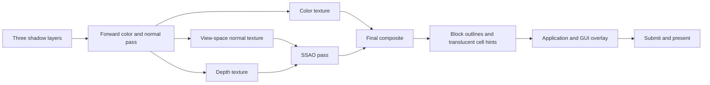

# Rendering as implemented

The engine has a fixed sequence of WebGPU passes assembled in `Engine.draw`. It renders the active scene into intermediate textures, applies screen-space ambient occlusion (SSAO), composites to the swapchain, then draws application/GUI overlays. This document describes that sequence and its current constraints.

## Frame data and pass order

Before encoding passes, the engine fits directional-light cascades, collects object candidates for every cascade and the camera, refreshes dirty/billboard instance transforms, and uploads the changed instance range. The current visibility index returns every registered object for each query.

| Stage | Current behavior |
| --- | --- |
| Shadows | One pass for each of three cascades per scene light; writes an `r32_float` layer with a separate depth attachment. |
| Forward scene | Clears and renders color (`rgba8_unorm`), encoded view-space normals (`rgb10_a2_unorm`), and depth. Some pipelines disable normal writes. |
| SSAO | Full-screen pass reconstructs view-space positions from depth and uses the normal texture to estimate occlusion; output is `r16_float`. |
| Final composite | Full-screen pass copies scene color or multiplies it by SSAO. Optional blur/debug display are applied here. |
| Block outlines | Loads swapchain color and scene depth. Draws green focus edges and colored translucent cell hints as three-pixel-wide triangle pairs, with faint occluded hints and no depth writes. |
| Overlay | If `onRender` exists, loads the swapchain color without a depth attachment, invokes the application callback (including the voxel app's held block), and renders GUI when enabled. |

The SSAO pass is still encoded when SSAO is disabled. The final shader bypasses its result in that case. GUI frame creation and the engine debug window currently occur inside the optional `onRender` branch.

## Geometry paths

Regular meshes use position, normal, UV, and index buffers. Skinned meshes additionally use four joint indices and weights per vertex. Models share GPU mesh data, while each object references its own instance index. Each object/mesh is submitted separately; the current renderer does not combine all instances of one model into one draw.

Colorized primitives and window boxes use their own pipeline/bindings. A window box receives the camera position transformed into model space. Height-map terrain constructs vertices in WGSL from a sampled integer height texture; the grid side is currently fixed to 64. It is a different terrain representation from the voxel application's generated block world.

Skyboxes use camera rotation and projection, omitting translation. The dedicated cubemap skybox is drawn separately before voxels and the queried ordinary objects. Skyboxes are excluded from shadow casting.

CPU world transforms remain in `f64`. GPU paths use chunk-local matrices plus integer chunk coordinates, with a camera/cascade chunk origin. Integer chunk subtraction and optional x wrapping happen before conversion to meters. The application selects wrapping at compile time. Scenes acquire a reference to six specialized pipelines in the engine cache: unwrapped scenes share one set, and wrapped scenes share by x width. Unwrapped shaders omit periodic arithmetic and width/mask constants. Common pipelines stay engine-owned. See [world configuration](world-configuration.md) and [coordinates](coordinates.md); using an absolute-world `f32` matrix would break the large-position guarantees.

## Voxel rendering

The voxel app starts in removing mode, which shows green focus edges and skips placement
preview validation. Tab switches to putting mode, which hides green focus edges and uses
colored placement hints. Block mode is shared across player and spectator control.

Putting mode draws a camera-space held block through [`held_block.zig`](../src/engine/held_block.zig)
in the application's overlay callback, before the GUI. It shares cube geometry and atlas
UV helpers with world voxels, so material selection includes the same side-specific textures.
The convex cube uses back-face culling without a depth attachment and stays visible over
terrain and cell hints. It has steady camera-space shading and does not participate in world
shadows or SSAO. Removing mode submits no held-block draw. Its projected position, rotation,
and scale are configured together in the voxel app's `held_block_pose`. The resting pose uses
the active camera's projection and no world position or orientation. Shared held-item motion
adds camera-space offsets to this pose. The application owns and releases its renderer before
engine teardown.

The voxel app refreshes `Scene.highlighted_block` using the editing raycast after camera updates, optimistic edits, and subscription changes. The engine's independent [`block_outline.zig`](../src/engine/block_outline.zig) pipeline draws it after post-processing and before GUI overlays. It emits 72 procedural vertices, clips edges against the near plane, and expands them in screen space to keep their width constant when distance or window size changes. It excludes edges whose adjacent faces both face away from the camera. For each stroke pixel overlapping the target cube, the fragment shader reconstructs the cube's front surface depth to prevent the target's own sloped faces from cutting into the stroke.

The shader also extends each edge's visible adjacent face planes across the narrow stroke margin to keep coplanar neighboring blocks from trimming it. This continuation is limited to 0.25 metres beyond the unit face bounds: a small screen-space margin can otherwise extrapolate metres forward at grazing angles and leak through foreground blocks. Plane intersections outside that bounded neighborhood leave the reconstructed target/edge depth unchanged. This deliberately allows the outer stroke to be clipped on nearly edge-on coplanar surfaces when preserving it would require a more distant intersection. Scene depth still hides the outline behind other geometry; an eight-epsilon f32 allowance handles depth rounding, and the pass never writes scene depth. The pipeline reads each cell's transforms, viewport, masks, and color from a shared read-only instance buffer. The outline's storage cell is rebased to the camera chunk, including the wrapped x seam, before conversion to f32. No voxel face or shadow shader contains highlighting logic.

`Scene.block_overlays` also carries a bounded, value-owned set of signed storage cells and
RGBA colors and whether the cell contains a received block. Placement previews reuse the
same outline shader and bind group layout, retaining all twelve edges. For occupied cells,
edges touching camera-facing faces use the focus outline's bounded surface-depth correction,
so the block's own tilted faces do not trim the expanded stroke. Rear edges, empty cells,
unknown cells, and cells beyond finite world bounds retain their actual edge depth.
The regular pipeline alpha-blends visible strokes with a `less_equal` depth test; a second
pipeline uses `greater` and 30% opacity for hidden strokes. Both leave depth unchanged.
All hidden overlays draw before all visible overlays, using two instanced draws and two pipeline selections for
the overlay set. This prevents a later faint stroke from tinting an earlier bright stroke
where diagnostic cells overlap on screen. Each cell's instance data is prepared once and
uploaded once; a shader pipeline constant applies the hidden pass's lower opacity.
Diagnostic colors take precedence when an overlay also covers the focused cell. The voxel
app uses opaque cyan/red for the placement candidate, matching the green removal target's
three-pixel width and opacity, and translucent orange for involved blocks or missing
support cells. See [placement diagnostics](block-placement.md#edits-and-diagnostics).

The correction adds one cached block lookup per distinct diagnostic cell and a six-bit
camera-facing face mask. It adds no world support searches or mesh rebuilds. A persistent
11,440-byte storage buffer holds up to 65 instances (64 engine overlays plus an optional
ordinary focused cell). The shader selects records with `instance_index`; fragments receive
the same index without interpolation. Only the active prefix is uploaded, using 176 bytes
per cell. Ordinary green focus uses one instance in the visible draw and no hidden draw.
Both depth passes reuse one transform/inverse-transform preparation per cell. GPU correction
runs only for rasterized strokes touching camera-facing surfaces; its cost depends on their
screen coverage, including overlap between cells. The current 34-cell preview bound submits
two outline draws rather than 68, with the same 4,896 vertices.
`zig build bench-outlines -Doptimize=ReleaseFast` measures CPU classification and instance
preparation for one focused outline and 20/34 diagnostic cells (11 samples of 10,000 frames
with a changing camera transform). It then compares individual versus instanced command
encoding using the same shader/pipelines and actual Dawn API, alternating paths after warmup
(11 samples of 1,000 frames). The latter includes encoder/pass creation, finish, and release,
and excludes preparation, buffer uploads, queue submission, and GPU execution. Commands are
never submitted. If no graphics adapter is available, only command encoding is skipped.

On the local Apple M4 Max, the ReleaseFast benchmark measured median CPU preparation
times of 0.035 µs for one focused cell, 0.778 µs for 20 diagnostic cells, and 1.360 µs for 34
diagnostic cells. The diagnostic group contains received occupied cells and the candidate.
Command-encoding medians on the Metal adapter were:

| Cells | Individual draws | Instanced draws |
| --- | ---: | ---: |
| 1 focused | 0.802 µs | 0.826 µs |
| 20 diagnostic | 3.197 µs | 0.840 µs |
| 34 diagnostic | 4.922 µs | 0.845 µs |
| 64 diagnostic | 8.407 µs | 0.828 µs |

This saves about 4 µs of CPU command encoding at the current 34-cell bound: a modest absolute
improvement, with better scaling as the batch grows. These are CPU microbenchmarks, not
full-frame timings. GPU vertex and fragment counts are unchanged; storage-buffer access
differs from the former per-cell uniforms, and GPU timing remains unmeasured. GPU image
regressions compare instanced and individual draws at 20, 34, and 65 cells, including mixed
correction masks and a visible-only focused cell. Profile GPU stroke coverage before raising
the application preview bound; instancing does not reduce screen-space overdraw.

The voxel grid stores exposed-face records, not a conventional indexed mesh or a dense GPU block array. Each record contains local block coordinates and block type in four bytes. Six lists group those records by outward face direction. The vertex shader generates six vertices per face and selects atlas UVs using block type and direction.

Chunk metadata describes eight combinations of three directions, one direction from each axis. The draw's instance index encodes the chunk metadata index and the selected direction combination. The visible pass chooses a combination from the signed camera/chunk delta. When any delta component is zero, it draws opposite combinations 0 and 7 to cover all six sides. This selection affects submitted faces, not the authoritative mesh contents.

Each shadow cascade draws combinations 0 and 7 for every GPU-resident voxel chunk, regardless of camera direction. Thus the same resident geometry supplies both visible and shadow passes. Chunks that have no uploaded faces are absent from that loop; distant unloaded terrain does not cast voxel shadows.

The CPU/WGSL layouts are part of the contract: chunk metadata is 112 bytes, face records are four bytes, ordinary instances are 80 bytes. Changes must keep the shader declarations and upload layout synchronized.

## Held-item motion

[`held_item_motion.zig`](../src/engine/held_item_motion.zig) owns the tool-independent motion
state and outputs camera-space translation in metres and rotation in degrees.
[`held_item_pose.zig`](../src/engine/held_item_pose.zig) composes these offsets around the item's
centre while preserving its resting position, scale, and rotation. Neither module depends on
block types, material selection, or placement validation. Future tool renderers can consume the
same `Offset` and choose their own resting pose. The voxel app updates one motion state each
frame, including when no held item is visible.

Hybrid combines a small walking bob with acceleration-driven lag and spring recovery.

Movement velocity comes from actual camera-position differences in f64, so pressing into a
wall does not create walking motion. A short velocity filter smooths abrupt controller starts
and stops. Acceleration is computed in world space before transforming into camera space;
turning the camera cannot invent a braking force. The spring follows
`offset'' = spring_force - damping * offset' - acceleration * lag_strength`, using substeps of
at most 1/240 second. Braking therefore reverses the inertial response even while velocity
still points in the original direction. Direction lean is a separate, smaller speed-based
component.

The gait phase advances with horizontal distance travelled, and its amplitude scales with
speed and fades when stopped or airborne. Airborne player motion retains inertia and vertical
lean; landing adds a small downward impulse. Spectator motion samples its own moving camera,
with horizontal flight driving the same bob and vertical flight driving the spring.
Yaw/pitch changes add brief look sway, with angle wrapping handled across +/-pi. Absolute
pitch also shifts the item vertically: looking down raises it to reveal more above the bottom
of the viewport, and looking up lowers it. The target is `-sin(pitch) * pitch_shift`, clamped
to +/-90 degrees, and follows with exponential smoothing. The default maximum shift is
0.10 metres with a 0.18-second response time (63% of a change; about 95% after 0.54 seconds).
It persists at a held angle and affects translation only, preserving the resting rotation.
Changing camera mode, losing focus, recovery teleports, invalid frame durations, and large position
jumps reset transient motion to prevent discontinuity kicks. Initial samples and teleports
establish the grip height for the current pitch without an inertial impulse. At rest the
transient tail settles to exactly zero while retaining the pitch offset; looking straight
ahead restores the exact approved pose. There is no idle breathing motion.

The shared `Tuning` defaults provide these adjustment controls:

| Knob | Effect |
| --- | --- |
| `strength` | Overall motion amount; zero shows the resting pose. |
| `bob_amplitude`, `stride_length` | Walking bounce size and cadence (shorter stride means faster cycles). |
| `acceleration_lag` | Weight felt on starts, turns, and braking. |
| `direction_lag` | Steady lean opposite the movement direction. |
| `spring_frequency`, `damping_ratio` | Grip stiffness/recovery speed and how much it rebounds. |
| `look_sway` | Lag during mouse look. |
| `pitch_shift` | Maximum persistent vertical shift; more reveals more of the item when looking down. |
| `pitch_follow_time` | Pitch response delay in seconds; smaller follows faster, larger feels smoother and heavier. |
| `landing_strength` | Additional touchdown dip. |
| `rotation_strength` | Angular motion independently of translation. |

Regression tests cover the approved idle pose, acceleration versus braking, vertical impulses,
settling, persistent pitch displacement and slow pitch ramps, camera turns, angle wrapping,
pause/teleport resets, large world positions, and 30/60/120/240 FPS comparisons. Application
tests cover actual camera and pitch sampling in both modes, blocked movement, and preserving
motion through material selection.

## Directional shadows and light limitations

A light records a direction, color, and intensity, and has three cascades. Each cascade is anchored at the camera chunk. Its orthographic projection is fitted to a camera-frustum extent in light space, using fixed depth parameters and a light-height range of 300. Each shadow layer is 1024 by 1024.

Regular meshes, skinned meshes, primitives, window boxes, height-map terrain, and resident voxel geometry cast shadows. Terrain's visible and shadow shaders share the height-derived vertex function; voxel shaders likewise share face-derived geometry. Shadow sampling uses the same chunk frame as casting.

The mesh (including skinned meshes), voxel, and height-map fragment shaders share [`shadow_map/sampling.wgsl`](../src/engine/shaders/shadow_map/sampling.wgsl). Each pipeline prepends it to its fragment source using Zig's compile-time `@embedFile` and string concatenation, with no runtime preprocessing or source allocation. Its `shadowFactor` function takes the texture, sampler, and three light-space positions, keeping it independent of the pipeline's bind group indices. New fragment shaders can embed the same file and call the function before alpha discard.

The shared function samples all three layers before cascade-dependent branches, keeping implicit texture derivatives in uniform control flow. It selects the tightest applicable cascade (2, then 1, with 0 as the fallback), compares sampled depth with biases of 0.002, 0.008, and 0.02 respectively, and returns 0.5 for shadowed color or 1.0 otherwise. The callers multiply RGB by this factor, preserve alpha, and discard fragments with alpha below 0.25 in the visible pass. The mesh shadow path renders geometry without sampling that alpha texture, so transparent cutouts and shadows need separate validation.

## Lighting contract and extension plan

The current renderer supports one directional light per rendered scene. Call `try scene.addDirectionalLight(params)` during setup, before the scene is drawn. The scene stores the light by value in `scene.directional_light`; a second addition returns `error.DirectionalLightAlreadyExists` and leaves the existing light and cascades unchanged. Scene creation starts with no light so setup and teardown can run without one. Drawing an active scene without a configured light is a programming error and panics with a setup instruction, before any passes are encoded.

Both shadow and forward passes use this same directional light. Its three cascades own the three shared shadow layers for the current scene's frame. Lights need no separate allocation or teardown. To change the configured light, update `scene.directional_light.?.params`; the next draw refits the cascades. Color and intensity are stored in `DirectionalLightParams`, but current shading uses only shadow attenuation and does not consume those fields. This contract does not yet provide diffuse/specular lighting.

The intended future contract is **at most one directional light, plus multiple point lights and multiple spot lights in the same scene**. Point and spot lights are planned, with no immediate implementation priority. Keep the directional slot separate from future collections of local lights; a list of directional lights does not express this contract.

Adding local lights will require:

- Point and spot parameters and scene collections, including positions, ranges, and spot cones.
- GPU light data and shading that accumulates contributions from all supported lights, including their color and intensity.
- A shadow allocation strategy for lights that cast shadows: directional cascades, point-light faces, and spot-light projections must have distinct allocations. The existing three directional layers cannot be reused by every light.
- Defined behavior for scenes without a directional light, practical local-light limits, and regression coverage for mixed light types and shadows.

The accumulation method, local-light limits, and which local lights cast shadows remain decisions for that work. This refactor enforces the current contract without adding speculative local-light APIs or reserving GPU storage for them.

## SSAO and final composition

SSAO uses a 16-sample kernel and a repeated 4-by-4 noise pattern. Depth is reconstructed into view space using the inverse projection. The sample radius is 0.5 and bias is 0.025. Normal values are encoded from [-1, 1] into [0, 1] and decoded in the SSAO shader.

The final shader optionally applies a weighted 3-by-3 blur to the SSAO texture, multiplies RGB by the resulting occlusion factor, and preserves alpha. Debug mode displays the factor as grayscale. E, R, and B control enablement, debug display, and blur respectively.

## Resize and diagnostics

After presentation reports a swapchain resize, the loop updates screen size/aspect ratio and recreates the depth, color, normal, and SSAO textures. The next scene update refreshes the camera projection.

Before each GUI frame, the engine reads the window's current content scale. DPI changes update font scaling and restore GUI dimensions from the unscaled style before resizing them, avoiding rounding drift during repeated monitor changes. The voxel crosshair and message layout use this same scale; message fonts keep their unscaled 14px and 20px sizes, which the GUI scales and rasterizes for the current display.

**Review point:** `recreateScreenDependantTextures` recreates those textures, but does not recreate the SSAO/final bind groups that were constructed with their original views. The static code path therefore does not establish correct rebinding after resize. This is an implementation concern to verify, not a documented promise that resizing is complete.

Frame statistics include candidate object count, uploaded instance-range size, visibility-index counters, and shadow/main-pass elapsed times. The timers wrap CPU pass encoding; they are not GPU timestamp measurements. The object count is the queried ordinary-object list length, excluding voxel face draws and the separate cubemap skybox.

## Sources and verification

- [`engine.zig`](../src/engine/engine.zig): `draw`, `drawGameObject`, `drawGameObjectToShadowMap`, transform adjustment, and resize handling.
- [`light.zig`](../src/engine/light.zig): cascade fitting and camera-relative origins.
- [`lighting_tests.zig`](../src/engine/lighting_tests.zig): single-light setup and rejection of a second directional light without changing existing state.
- [`pipelines.zig`](../src/engine/pipelines.zig), [`pipelines/`](../src/engine/pipelines), and [`bind_group_layouts/`](../src/engine/bind_group_layouts): pipeline and binding configuration.
- [`shaders/basic/`](../src/engine/shaders/basic), [`shaders/voxel/`](../src/engine/shaders/voxel), [`shaders/shadow_map/`](../src/engine/shaders/shadow_map), and [`shaders/quad/`](../src/engine/shaders/quad): vertex generation, shadow comparisons, and post-processing.
- [`render_coordinates_tests.zig`](../src/engine/render_coordinates_tests.zig): agreement of camera/shadow projections and translation invariance across all cascades.
- [`world_shader_tests.zig`](../src/engine/world_shader_tests.zig), [`world_coordinate_readback.zig`](../src/engine/world_coordinate_readback.zig): headless production-pipeline validation, cache lifetimes, and numerical GPU/CPU coordinate comparison through compute/readback.
- [`voxel_tests.zig`](../src/engine/voxel_tests.zig): face/upload data and allocator behavior without creating a GPU device.

`zig build test` exercises the registered CPU tests under both application wrapping configurations. `zig build test-gpu` separately validates the six specialized pipelines and their cache sharing, reference lifetimes, and allocation cleanup with headless Dawn in each compiled wrapping mode. It also validates the height-map pipeline, covering every pipeline that embeds the shared shadow sampler, and executes the production coordinate helper to compare GPU readback with CPU results at seams, half-period ties, f32 precision boundaries, and signed i32 limits, using three world widths. These checks do not replace a runtime visual check of rendering, alpha/shadow agreement, SSAO, or resize.
