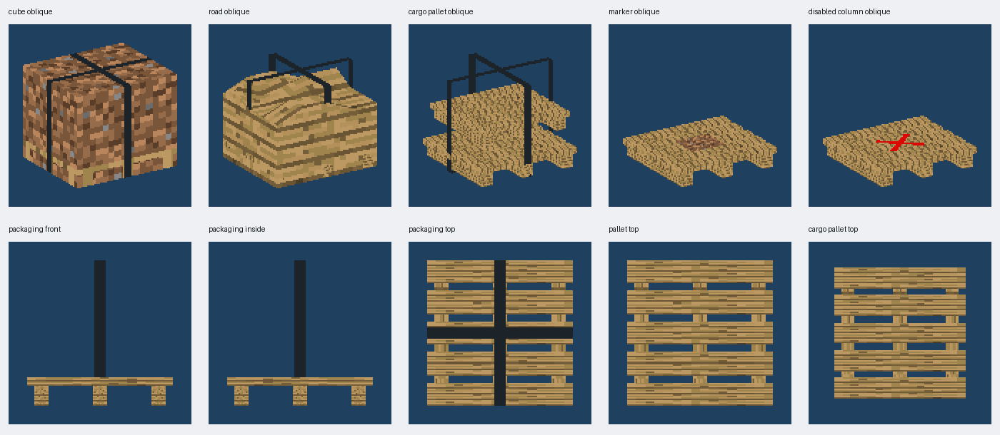
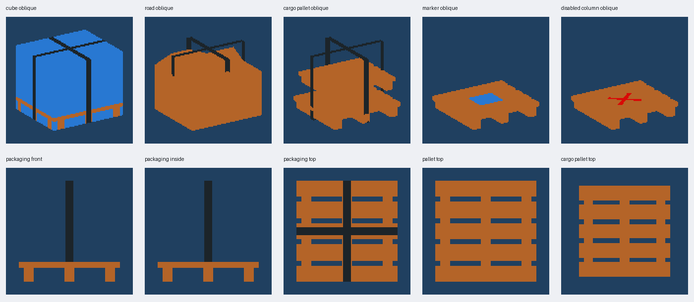

# Warehouse rendering validation

The packed renderer is a scene-owned world-geometry path. CPU sources carry flat exterior
cube faces and shared irregular-model, packaging, loose-pallet and marker instances.
Global dense GPU buffers batch each category across retained sources: one draw for all
irregular goods and one for all their packaging in each pass. Cubes use one flat face draw,
without terrain side groups or camera view tables. Terrain shaders contain no packaging code.

## Reproduce

```sh
zig build test-gpu -Doptimize=ReleaseSafe
mkdir -p /tmp/warehouse-packed-render
PACKED_RENDER_ARTIFACT_DIR=/tmp/warehouse-packed-render \
PACKED_RENDER_REAL_ATLAS=1 \
zig build test-gpu -Dtest-filter='packed cargo' -Doptimize=ReleaseSafe
python3 docs/validation/warehouse-rendering/render_fixtures.py /tmp/warehouse-packed-render
```

The final command needs Pillow. The optional environment variables export binary PPM
readbacks and repeat the fixture with `content/minecraft.png`. Ordinary tests write no images.
Tests run with both finite and wrapped x coordinates.

## GPU evidence

`src/engine/packed_readback.zig` renders through the production renderer, pipelines, vertex
expansion and fragment shaders on Dawn. Its 23 cases check:

- Resource color beneath opaque cube packaging, distinct wooden artwork and straps;
  hardware face culling, scene-depth occlusion and directional-shadow sampling.
- Real holes in loose pallets, matching real bottom pallets on irregular cargo, alpha-cutout
  unit-boundary straps, top straps and the opposite wall viewed from inside the cell.
- The original unsloped adaptive model and uniformly 90% pallet cargo. The pallet model's
  actual bounds are centered at `(0.5, 0.5, 0.5)`, giving x/y `0.05..0.95` and z `0.41..0.59`.
  Its packaging pallet remains at z `0..0.2`.
- Material icons, disabled-column red crosses with cutout backgrounds, shadow color/depth agreement
  and cutout shadow holes. Flat advisory markers do not cast shadows onto their own pallet.
- Chunk-relative coordinates near the end of a 131,072-chunk x axis and across its wrapped
  seam, plus a mixed-model fixture asserting two draws across two independent sources.

The 2026-11-18 loose-pallet shadow regression uses the same caller bindings as the engine:
scene at group 0 and material atlas at group 1, without a sampled shadow-map group. With the
original shared color/shadow layout, this reproduces `No bind group set at group index 2`
on `Draw(288, 1, 0, 0)` in both world modes. The earlier fixture bound a sampled-light group
even during shadow rendering and masked the runtime failure. Shadow pipelines now use a
separate three-group layout, with packed source data at group 2. Color pipelines keep sampled
lighting at group 2 and packed sources at group 3. The test checks the pallet's shadow depth
and board gaps; shadow rendering never needs to bind the map it is currently producing.
After the fix, the full ReleaseSafe GPU suite passed in both world modes on Apple M4 Max/Metal,
and `zig build install -Doptimize=ReleaseFast -j2 --summary all` passed all 25 build steps.

The allocation-failure sweep checks preservation of the old source, including failures
after one GPU buffer grows and a later category fails to reserve. Dense-buffer churn checks
swap-removal, moved-source reverse references, source-slot reuse and buffer growth.
The existing headless scene teardown test verifies resource ownership with the renderer attached.



The image above uses the game's material atlas. These are raw world-pass color readbacks,
without the later SSAO/final postprocessing passes. The diagnostic image below substitutes
flat material colors so coverage and holes are easy to inspect.



## Client geometry preparation

The [raw CPU results](warehouse-packed-cpu.txt) come from `bench-packed-geometry` in ReleaseFast
on the same Apple M4 Max. The fixture retains 4,096 logical warehouse records with 150 items
each but derives sources only for observed objects. Averages cover eight source sweeps and
exclude GPU uploads/draws, authority work and initial logical record allocation.

| Observed full warehouses | Cube source preparation | Irregular source preparation |
| --- | ---: | ---: |
| 0 | 0 sources/slots/bytes | 0 sources/slots/bytes |
| 64, inside chunks | 0.163 ms | 0.118–0.120 ms |
| 1,024, inside chunks | 2.581 ms | 1.911 ms |
| 64, crossing X/Y/Z chunk boundaries | 0.567 ms | 0.515–0.519 ms |

The boundary fixture includes the wrapped seam, visits each object's eight chunk references,
and emits the same total source bytes as its contained counterpart. Source derivation uses a
bounded local occupancy mask to avoid repeatedly searching column order for each neighbor.
An unchanged 1,024-source scan takes about 1.2 µs and performs no derivation or upload. Native
source-array capacity peaks at 4,580 bytes for cubes or 6,144 bytes for irregular goods in one
contained source; fixed stack masks and allocator overhead are excluded. These measurements
do not establish a whole-frame deadline or target-PC capacity.

## Cost accounting

Measured on 2026-11-15 with Apple M4 Max / Metal, Zig ReleaseSafe. The fixture contains
128 sources, each with 256 irregular items and 256 packaging instances; half the items are
adaptive roads and half pallets. These are CPU plus asynchronous queue-write measurements,
not GPU execution times or whole-frame timing.

| Work or storage | Measurement |
| --- | ---: |
| Build/upload 32,768 irregular items plus packaging | 7.31–7.90 ms |
| Replace one source's 256 items with 255 | 56–86 µs |
| Geometry/chunk upload for that replacement | 20,456 bytes / 5 writes |
| GPU buffer capacity after replacement | 1,312,836 bytes |
| Estimated renderer CPU container capacity | 3,695,200 bytes |
| Draws per pass for all irregular items plus packaging | 2 |
| Submitted vertex invocations per such pass | 20,054,016 |
| Adaptive-model padding within that total | 1,474,560 invocations |

Each public cube face is 20 bytes `(x, y, z, material, direction)`. The GPU adds a 4-byte
source index; each public irregular instance is 16 bytes and its GPU record is 20 bytes.
The shared source table adds 16 bytes per chunk slot. CPU capacity includes cached GPU
records, reverse references, source-local slot indices, dirty-index staging and approximate
source-map storage; it excludes driver and command-buffer allocations.

The shared model template submits 288 vertices per item. Adaptive geometry uses 198 and
degenerates the remaining 90; a pallet uses eight actual cuboids. This adds 7.35% to the
combined model-plus-packaging vertex count in the half-adaptive fixture. Packaging submits
288 pallet vertices plus 36 cutout strap vertices. No alpha-blended pass or sorting is used.
These counts establish the cost of the selected single mixed-model draw; they do not show
that it is faster than two model-specific draws on every GPU.

Source replacement touches the changed source and the records swapped into its old slots.
Dirty adjacent indices coalesce into writes; geometric buffer growth can reupload a whole
category. Unchanged source revisions perform no rebuild or upload. Retained buffer capacity
is reused after source removal, so memory reflects the peak retained batch until scene teardown.
