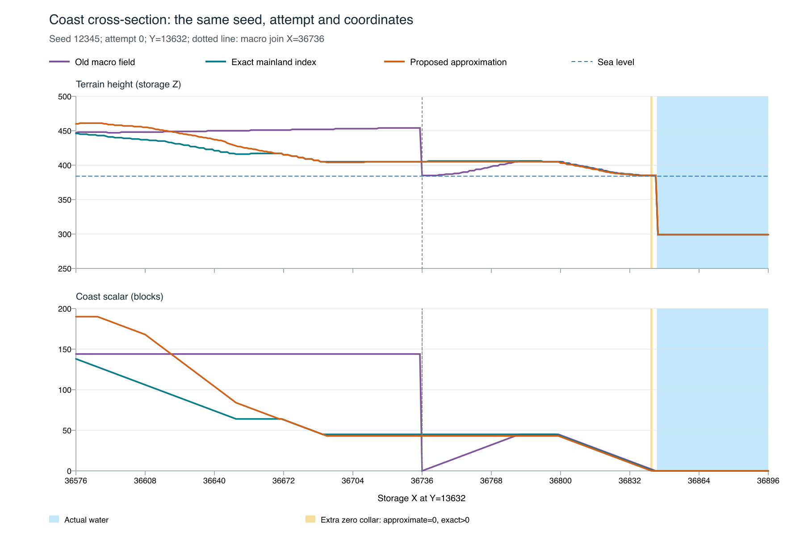

# Old, exact and approximate mainland coast: prototype comparison

The approximation removes the reported artificial macro-cell cliff while retaining query cost close to the old field in this experiment. It trades exact distance for a bounded conservative near-shore collar and a coarse inland extension. These are isolated prototypes; final production benchmarks and broader validation are separate.

## Same-coordinate environment queries

One Geography is built from seed 12345, attempt 0, at 65536×32768×1024 blocks, with the same ClimateField for every mode. Each trial calls `Geography.atWithClimate` at 250,000 identical coordinates: `h=hash.mix(i+12345)`, `x=h%65536`, `y=(h>>32)%32768`. Mode order rotates old/exact/approx, approx/old/exact, exact/approx/old. Every trial visits 152,002 mainland columns. No beaches, trees or deposits are queried. Index/feature construction is outside this timer; coordinate hashing and result accumulation are inside it. Zig 0.16.0, ReleaseFast, aarch64-macos; mutable query counters are absent.

| Mode | Three trial times, ms | Median, ms | Median cost / old |
|---|---:|---:|---:|
| old | 20.578, 20.597, 20.543 | 20.578 | 1.000x |
| exact | 144.328, 143.415, 142.521 | 143.415 | 6.969x |
| approx | 21.875, 21.658, 21.992 | 21.875 | 1.063x |

Approximate outputs differ from exact/old outputs. These figures compare the cost of the same query locations under each field, not equivalent terrain output. The approximation costs about 6.3% more than old on this sample; exact costs about 6.97× old. Three trials on one seed/platform do not establish a latency guarantee.

## Reported macro join and the actual shore

The [CSV](cross-section.csv) contains 321 consecutive X samples, 36576–36896, at Y13632, from the same seed/attempt before deposit preparation. Land/water identity is asserted equal across modes. At X36735→36736, old coast 144→0 produces height 454→385; exact coast 45→45 and approximate coast 43→43 both produce height 405→405. Among adjacent land samples in this slice, maximum height change is 69 old, 2 exact and 2 approximate.

Blue shading marks actual water, starting at X36845. Gold marks the extra zero collar: one sampled land column at X36842 has approximate coast 0 while exact coast remains positive. All three variants retain an 86-block seabed-height step at the actual land/water boundary; removing the artificial land-to-land join does not establish smooth bathymetry. The approximation also changes inland heights (for example, near the left edge of this slice). The [SVG](coast-cross-section.svg) is suitable for export.

The probe additionally checks 474,777 adjacent same-mainland pairs at six selected offsets on macro joins in the default world: maximum approximate coast delta 2 and height delta 2. This is sampled join coverage, not a full-resolution census or proof of all terrain gradients.

## Absolute regeneration measurements

Fresh full runs executed serially old→exact→approx in one reserved quiet window, seed 12345, nine samples per site/workload, both beach settings. All commands exited 0. The old baseline includes current climate-transition handling and per-column material reuse, matching the exact/approx material path. It is not the older pre-cleanup timing baseline.

Each cell below gives beaches **off / on**, milliseconds. Preparation/traversal rows are single observations; other rows are medians of nine samples. The workload includes the indicated chunk hashes; meshing and GPU/disk work are excluded from those workload rows.

| Workload | Old | Exact | Approximate |
|---|---:|---:|---:|
| Preparation (single observation) | 54.388 / 32.722 | 57.726 / 40.223 | 53.077 / 33.955 |
| Cold column + surface chunk + hash | 0.337 / 0.260 | 1.299 / 1.142 | 0.330 / 0.280 |
| Cached column, 32 vertical chunks + hashes | 5.226 / 4.939 | 4.936 / 4.890 | 5.273 / 5.003 |
| 96-column forward traversal + hashes (single) | 16.992 / 16.827 | 82.434 / 82.614 | 18.483 / 17.907 |
| 96-column reverse traversal after eviction (single) | 13.638 / 13.829 | 65.709 / 66.459 | 15.060 / 14.838 |
| Mainland coast column initialization | 0.105 / 0.188 | 0.336 / 0.573 | 0.119 / 0.195 |
| Dense forest column initialization | 0.186 / 0.201 | 1.932 / 1.944 | 0.203 / 0.211 |

All 11 selected site X/Y/Z coordinates happen to match across these three runs. Generated outputs still differ: `mainland_coast` and `steep_shore` chunk/boundary/climate/mesh digests change in both beach settings. The other 18 of 22 site digests agree for this seed. Coast scalars also differ at many unchanged-digest sites. Absolute regeneration times therefore are not a pure speedup comparison of identical worlds, and this limited measurement cannot distinguish small timing differences from noise. All site positions, medians, face counts and digests are in [site-results.csv](site-results.csv) and the [parsed logs](full-regeneration-summary.json).

| Requested-memory counter | Old | Exact | Approximate |
|---|---:|---:|---:|
| Preparation allocations | 7 | 8 | 8 |
| Preparation peak requested bytes | 2,122,224 | 2,122,304 | 2,122,280 |
| Prepared live requested bytes | 418,288 | 680,511 | 680,488 |

Approximate feature storage is 262,144 bytes (2 bytes per macro cell); the exact tree is 262,143 bytes. Additional descriptor bytes explain the small live/peak differences. All variants retain 27,200-byte columns, 27,168-byte natural columns, a 64-column limit / 1,740,800-byte retained-column upper bound, and 32,768-byte chunk scratch. These are requested bytes, excluding allocator overhead and RSS.

Every run verifies its own eviction/restart outputs and full prepared-world fingerprint equality. Old/approx print the full 64-hex `prepared_fingerprint`; exact prints an assertion boolean. The `mesh_start metadata_fingerprint` value is the diagnostic environment-sample hash and must not be described as the full prepared fingerprint. Cross-variant full fingerprints/output equality is not expected.

## Approximation contract and evidence

For production mainland, the local conservative rectangle field is zero at actual shores, may add a zero collar up to 16 blocks, and underestimates exact Chebyshev water distance-minus-one by at most 16 **after both local fields are capped at 128**. The final relief scalar adds a bilinear coarse inland extension; that final scalar is **not exact water distance** and has no global 16-block accuracy guarantee. Its cardinal step bound is 2, compared with exact's 1. Land/water ownership and erosion remain unchanged. Islands keep the existing analytic field and are outside this mainland proof. The prototype does not establish final preparation-work accounting or all visual requirements.

- [Identical-query log](identical-query-comparison.txt) and [parsed trials](identical-query-summary.json).
- Fresh full logs: [old](old-full-12345-9.txt), [exact](exact-full-12345-9.txt), [approximate](approx-full-12345-9.txt).
- [Evidence manifest](evidence-manifest.json): protocol, source inventories, binary/file hashes, site differences and fingerprint terminology. The full source inventories are retained separately in `source-manifests.json`; compact preservation can omit them.
- Exact source changes: [exact](exact-source.diff), [approximate](approx-source.diff), each relative to the old snapshot. Blank diff context-line spaces are normalized.
- `probe-source/` retains the standalone query/cross-section harness and its input modules. `plot_cross_section.py` uses ReportLab LinePlot 4.4.9; SVG was rasterized with Sharp. `parse_generation_log.py` parses the raw full logs without rerunning benchmarks.

No production source was changed by this comparison run. Final integrated production validation is recorded in the [parent validation report](../README.md).

The evidence manifest also records `write_report.py`, an omitted report-generation scratch script retained in the original temporary evidence directory. During repository preservation, `site-results.csv` was converted from CRLF to LF without changing values; its manifest entry hashes the LF copy and preserves the original CRLF hash and byte count. All other included manifest files retain their original bytes. README is not included in that manifest; its final navigation line and this preservation note document the copying changes.
