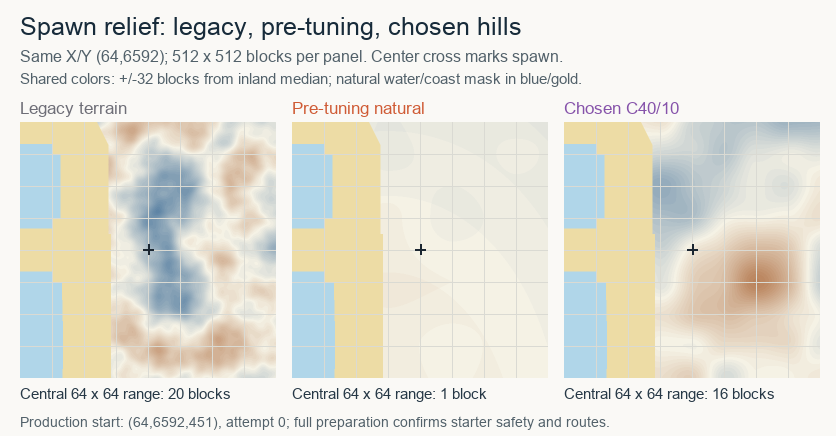
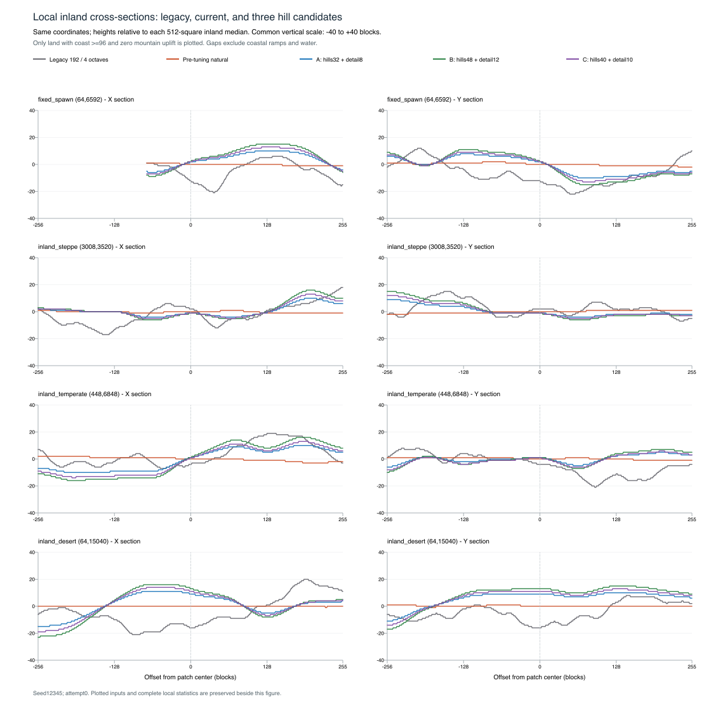

# Local terrain relief tuning

Chosen **C40/10** restores visible hills at the default spawn. The central 64×64-block height range is **16 blocks**, compared with **20 legacy** and **1 pre-tuning natural**. The final full production preparation confirms start **(64,6592,451)** on attempt 0, with starter safety and routes passing. The amount of gentling varies by site and measurement scale; it is not a global promise that every tuned patch has less relief than legacy.

## Method

All comparisons use seed 12345, attempt 0, the default 65536×32768×1024-block layout, and identical X/Y coordinates. `current` in the data means **pre-tuning natural** from commit `d528f99b38c6ca062c56ef900194aa4d70e5caaf`, after the coast/polar fixes. `legacy` mirrors the retained default 192-block, four-octave Perlin path with amplitude 48 and base 512. Its floating-point heights are only the visual reference. Natural candidates keep the same integer broad field, ownership, erosion, coast field and mountain uplift.

Candidates A32/8, B48/12 and C40/10 add nonnegative hill/detail bands with spans 32/8, 48/12 and 40/10, at 192/64-block scales. The broad, hill and detail weights are summed before one integer `/131070` floor, then scaled by the coast ramp. Production uses C; smaller world heights scale the spans down. The standalone probe covers the default layout only.

One Geography/Climate preparation produced six 512×512 patches. Four fixed comparison sites are the original spawn (64,6592), inland steppe (3008,3520), temperate (448,6848), and desert (64,15040). Inland sites are the first macro centers passing the documented coarse-distance/protected-box and nine-point climate/uplift checks. These site-selection probes do not establish the statistical subset: each sampled block is filtered explicitly below. Two additional patches cover positions selected by the old spawn filter. The bounded native diagnostic took about 0.87s wall time, including output; it is not a regeneration benchmark.

Statistics enumerate every block in the centered 256² and 512² patches. `all_land` uses the shared natural land mask for every profile, including legacy. `inland_lowland` additionally requires coast ≥96 (fully applied height ramp) and mountain strength 0. The fixed-spawn 512² patch is only 88.3% land; coast ramps strongly inflate its all-land range. Keeping this subset separate avoids attributing coast-to-inland elevation to local hills. The legacy reference itself has no natural ocean classification; blue/gold in its image shows the common comparison mask.

## Comparable inland relief

Each cell is **P95−P5 / median 64×64 tile range**, in blocks, for the 512² `inland_lowland` subset. Tile ranges use nonoverlapping 64² tiles wholly inside that subset. They differ from the centered 64² spawn range reported above.

| Site | Legacy | Pre-tuning | A32/8 | B48/12 | Chosen C40/10 |
| --- | ---: | ---: | ---: | ---: | ---: |
| Fixed spawn |30 /19 |3 /1 |22 /8 |32 /12 |27 /10 |
| Inland steppe |29 /18 |4 /1 |18 /6 |27 /10 |22 /8 |
| Inland temperate |27 /14.5 |5 /1 |24 /9 |37 /14 |30 /12 |
| Inland desert |32 /17 |2 /1 |27 /9 |40 /14 |33 /12 |

All sampled candidate cardinal steps in this inland subset are at most 1 block. Across the sampled all-land patches, coast ramps can produce steps up to 3 blocks. These are bounded observations at the reported sites, not a universal terrain-gradient guarantee. The CSV also retains min/max, standard deviation, cardinal-step distributions, centered 64² ranges, tile counts and coverage.

The cross-sections share **−40…+40 blocks** vertically and subtract each profile's 512² inland median. Gaps exclude water, coast ramps and mountain uplift. Relative centering exposes local variation despite the profiles' different absolute base elevations. The compact spatial grids preserve exact 2×2 mean heights; full-resolution one-block section inputs are retained separately.

## Spawn selection

The provisional Geography-only search reproduces the old four cardinal ±64 probes with height differences ≤4. Its local alternative keeps those distant dry/same-owner checks, and inspects cardinal distances 1…4 with both center and consecutive-step differences ≤1. Center climate/lowland/meadow/coast/soil requirements remain the same. This probe does not place deposits or validate starter routes; final production preparation does both.

| Profile | Old filter: provisional X,Y,Z | Local filter: provisional X,Y,Z |
| --- | --- | --- |
| Pre-tuning |64,6592,429 |64,6592,429 |
| A32/8 |1344,6592,428 |64,6592,447 |
| B48/12 |1728,6592,427 |64,6592,455 |
| C40/10 |1728,6592,424 |64,6592,451 |

For C, the old filter's selected position has a centered 64² range of **2** blocks; the local filter's selected position has **16**. The centered 256² inland P95−P5 is 10 at the old-filter position and 31 at the local-filter position. Full production confirms the local-filter C start (64,6592,451), attempt 0; final acceptance evidence is in the [parent report](../README.md).

A separate copied-production point probe records the current regression pairs: coast join (36735,13632)→(36736,13632) is **411→411**, coast 43→43; frozen/steppe join (11647,3212)→(11647,3213) is **439→439**, with zero mountain uplift on both sides. The historical [coast comparison](../coast-comparison/README.md) predates hill tuning, so its absolute heights remain distinct evidence.

## Preserved evidence and reproduction

- [Statistics CSV](statistics.csv) and [JSON](statistics.json): both patch sizes and subsets, all five profiles, all six sites.
- [One-block cross-sections](cross-sections.csv); [compact height grids](height-grids.csv.gz) contain the exact mean of each 2×2 block group at the four plotted sites, with common-mask sample counts. Raw 512² grids are omitted; their hashes are recorded in [source provenance](source-manifest.json).
- [Native probe](probe.zig), [analysis](analyse.py), [plot script](plot.py), [metadata](metadata.json), [production pair output](production-pairs.txt), and [file manifest](evidence-manifest.json).

The native probe imports six modules under `current/`; recover their exact bytes from the baseline commit using the paths/hashes in source provenance. Build with Zig 0.16.0 ReleaseFast, then run `./probe /absolute/results`. Run `analyse.py /absolute/results` and `plot.py /absolute/results` with NumPy 2.3.5, Pillow 12.3.0 and ReportLab 4.4.9. The SVG was rasterized with Sharp. The plot script regenerates the full temporary atlas; the compact spawn preview here crops its first/second/fifth panels. No production source was changed by these diagnostics.
