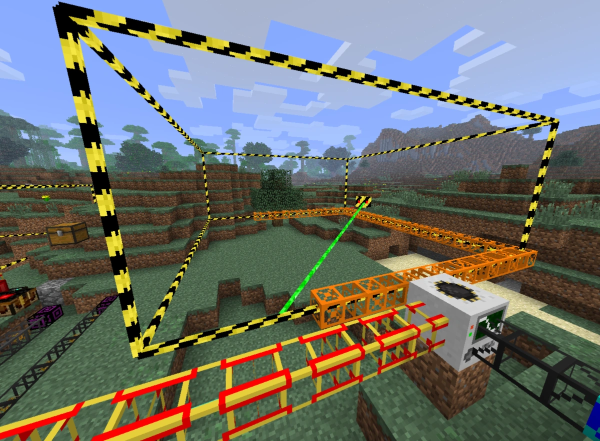

# Capture and build with blueprints

## Intent

Let a player save a valid arrangement of blocks as a reusable blueprint and apply it to a prepared site. Validate the completed design when creating the blueprint, so assembling many buildings later needs only constant-time local structural checks per placed block.

The first runtime version is implemented; the hybrid-admission follow-up below awaits external specification review before implementation. Requirements distinguish user-confirmed behavior, **DERIVED** correctness/performance consequences, and **ADOPTED DEFAULTS** chosen to complete routine UI details. Defaults may be revised without implying that the user explicitly selected them. No gameplay question remains blocking this iteration; concrete resource/latency limits must be selected and measured during implementation. Q20 defines one current ruleset and world-save version gates for incompatible changes. Use **blueprint** in code and documentation.

## Context

**Approved hybrid design, pending external review and runtime implementation (2026-11-06):** R39/R44/R50–R52 and R58–R65 specify whole-chunk protection limited to the proposed construction box, potentially stale exterior structural evidence, and current publication checks. The current runtime and existing validation reports still describe version-checked admission with a retained mutation FIFO. T31 gates implementation on external review; T27–T30 track the runtime follow-up. Earlier checked tasks and measurements do not verify it.

The voxel app has a one-block player inventory, timed manual placement/extraction, debug spectator tools, a main-thread streamed world cache, and an authoritative `WorldDataService` worker. Client and service currently run ordinary structural validation, including potentially affected constructions. Persistent saves include terrain, construction metadata, roads, block timers, player identity, inventory, blueprint definitions, and active construction progress.

The selected capture design uses the player's current client view, including already-applied optimistic edits, then validates detached contents in isolation. The previous service-owned source-snapshot design is retained under [Rejected alternative: WorldDataService-owned capture](#rejected-alternative-worlddataservice-owned-capture) as decision history. It is superseded and is not a second implementation target. Authoritative destination checks still apply when applying a blueprint.

This spec owns the detailed blueprint selection algorithms, size limits, normalization, UI transitions,
capture/helper/Save protocol, and acceptance criteria. [Game vision](../../docs/game-vision.md#blueprints-and-automated-construction)
summarizes player-facing outcomes; [architecture](../../docs/architecture.md#ownership-and-concurrency-boundaries)
records ownership boundaries; [construction rules](../../docs/block-placement.md) describe shared world
semantics, including the completed-world view and local fulfillment contract. Those summaries
link here for blueprint-specific algorithms and lifecycle details.

Relevant sources:

- [Construction rules](../../docs/block-placement.md), `src/voxel_app/block_rules.zig`, and `src/engine/voxel/voxel_chunk.zig`: foundations, material capabilities, height/span rules, mining conversions.
- `src/voxel_app/world.zig`, `world_data_service.zig`, and `chunk_metadata.zig`: predictions, authoritative admission, dependent validation, and mutation costs.
- [Input](../../docs/scenes.md), `src/voxel_app/main.zig`, `player_interaction.zig`, and `src/engine/engine.zig`: application overlays, timed interactions, Escape priority, and the voxel app's B chooser key and Ctrl+B SSAO blur debug shortcut.
- [Persistence](../../docs/persistence.md), [streaming](../../docs/voxel-world.md), and [coordinates](../../docs/coordinates.md): ownership, unknown cells, finite Y/Z bounds, and wrapping X.
- [Game vision](../../docs/game-vision.md#blueprints-and-automated-construction): eventual player/NPC construction at scale.

The attached image is a reference for the selection frame only: thin square-section rails with black/yellow stripes along the twelve box edges. Its other game content does not define requirements.

## Requirements

### Definition, ownership, and scope

- R1: A blueprint is an immutable arrangement of logical block types at integer 3D cell offsets. Its completed normalized arrangement must satisfy construction rules under the foundation contract in R15–R18.
- R2: A private blueprint belongs to the player who created/received it and is stored in that world's save, keyed by player identity; no cross-world profile is introduced. A shared blueprint is available to all players on its multiplayer server. Capture and future interactive planning produce private blueprints by default; future progression rewards produce shared blueprints by default. Private-to-shared conversion is a future operation.
- R3: This iteration implements capture from existing structures and application/assembly. Interactive blueprint design, rewards, sharing, and multiplayer remain future acquisition/distribution paths.

### Capture and input

- R4: Z enters capture only with empty player hands. Otherwise show an on-screen error, for example `Cannot enter blueprint capture while holding a block.` Capture does not consume a block or mutate terrain.
- R5: While capturing, display `Blueprint capture` in the upper-right corner. A held low-poly blueprint model is deferred. **ADOPTED DEFAULT:** keep the existing empty hands visible this iteration.
- R6: Capture proceeds through three fresh Mouse1/E presses: anchor cell, XY extent, then Z extent. These are immediate presses rather than the normal timed place/mine interaction. Movement and looking remain available during selection; ordinary block actions are suppressed.
- R7: The first target preserves ordinary putting-target selection, including the adjacent placement cell for a physical hit and the full planned cell for a pending miniature, with capture reach extended to **30 metres**, inclusive. First-anchor hover and confirmation use the same target query and the existing distance from the camera to the candidate cube's nearest vertex, using its nearest wrapped X image; this is separate from the XY/height raw-contact distance from player feet. Ordinary placement/mining reach stays four metres. The first fresh Mouse1/E press commits that currently eligible anchor. Initially the confirmed inclusive box is 1×1×1. During XY selection, normally intersect the camera's view ray with a fixed horizontal XY plane through the anchor cell and floor its X/Y coordinates. **CONFIRMED fallback:** when camera storage Z lies in the anchor block's slab `[anchor.z, anchor.z + 1)`, instead target the first actual physical solid block along the ray, skipping miniatures, and take the adjacent `Hit.placement` cell's X/Y while forcing endpoint Z to anchor Z. This fallback uses bounded traversal sufficient for the extent range, without the ordinary four-metre interaction reach. Its exact physical contact Q remains separate from the placement cell; do not floor Q to choose fallback X/Y. In either branch choose the shorter wrapped X interval under Q25 and keep one-cell height. At the second click, freeze X/Y and a vertical plane through the accepted exact fractional plane/physical contact Q, with its normal taken from that click's horizontal camera yaw. During height selection use absolute world/grid Z from the fixed plane: `endpointZ = floor(rawHeightHit.z)`, without an offset or anchor-relative baseline. XY selection stays one cell high; entering height selection may immediately jump above or below the anchor to the actual contact Q height. Do not reevaluate the XY targeting policy after this click. The normal XY-plane branch and height selection work in open air without a voxel hit; the XY fallback requires a valid physical hit and adjacent placement cell. In all extent paths the raw contact/intersection must be within **30 metres of the player's current feet position**, inclusive, under Q12's metric, before projection, quantization, or wrapping. Reevaluate range as the player moves and before confirmation. Invalid or beyond-range targeting retains the last valid box and disables confirmation. The limit applies to the current contact/intersection; previously confirmed bounds remain fixed, and moving the player allows boxes larger than 30 metres within R54's horizontal size cap. World bounds and configured resource budgets still apply. Allow extension above or below the anchor. Dimensions are `abs(endpoint - anchor) + 1` after lifting the shorter X interval into the anchor's signed unwrapped frame, with no zero-size box or off-by-one loss at either end. Plane positions, quantization, and invalid-target handling follow Q12.
- R8: While capture awaits its first anchor, immediately draw a 1×1×1 frame at the currently eligible cursor target using R7's 30-metre anchor query; hide it when no eligible target exists. This hovered frame is transient and unconfirmed: it does not set the draft anchor/bounds or advance selection. Throughout selection and after confirmation, draw the box with the frame described in Context. The three stages produce a cell, a one-cell-high rectangle, and a volume respectively. **CONFIRMED occlusion treatment:** the selected capture frame, including its unconfirmed anchor frame, remains faintly visible behind world geometry. Draw its occluded portions first with depth comparison `.greater`, faint blending, and depth writes disabled, then draw the normal opaque overlay with `.less_equal` and depth writes enabled so exposed rails retain their ordinary appearance. Reuse the same uploaded instances: the extra instanced draw covers only the selected frame's twelve rails, 144 triangles. Miniatures, full-size application previews, and other active sites' frames receive no occluded-frame draw. The frame/selection is noncolliding and does not alter voxel occupancy.
- R9: Before accepting the third press or starting capture-specific loading/copy, verify the raw dimensions under R54. For an eligible box, begin client-owned preparation/validation and show loading or validating status. Obtain all selected cells in full block form, freeze the player's local logical view under R41, and validate that detached snapshot on a bounded helper. Enter/name entry remains disabled until the matching successful helper result arrives. Only a valid candidate enables Enter and the upper-right hint `Press Enter to create a blueprint.` Highlight invalid included blocks in red and explain the rejection. Empty selection, unknown source data, cancelled jobs, and stale results cannot be accepted as valid. The successful result certifies the frozen snapshot, not a continuing live view of its source.
- R10: Enter opens the name dialog only for a valid candidate; a subsequent Enter in that dialog confirms the name and saves. Require a nonempty name of at most 100 characters. Confirming saves a private blueprint; failure must report an error rather than claim success. Character counting, duplicates, and save durability are specified by Q8/Q9.
- R11: With the chooser closed, before any anchor/first block is selected, including while an unconfirmed hovered frame is visible, Escape leaves capture and opens the ordinary game menu; Resume returns to ordinary play. Once an anchor has been selected, Escape cancels the entire draft capture, including from the name dialog before confirmation: discard box, candidate, diagnostics, and pending name, then stay in capture awaiting a new anchor without opening the menu. A subsequent fresh Escape from that anchor stage, with the chooser closed, leaves capture and opens the menu. Invalidate the selection generation immediately, release capture-specific chunk retention, and cancel/release the associated client helper job/candidate; late results cannot restore it. Z exits capture and discards that state, except while entering a name: Z must be available as text and must not toggle the mode. After final save submission, apply Q9's save-owned payload semantics rather than promising draft cancellation.
- R12: Before final save confirmation, capture state is temporary and must not enter the saved library, autosave records, or gameplay simulation. The main thread owns UI, source capture, and candidate lifecycle; a bounded helper may temporarily own the detached validation input/output under Q16. Before Save, WorldDataService participates only through ordinary chunk loading/subscriptions, with no blueprint preparation job or candidate. Cancel/release unconfirmed jobs/candidates on reset, exit, or owner disconnection; never mistake one for a saved blueprint. Name entry requires a successful matching helper result. Confirming the name transfers the checked definition to the service for publication under Q9; disk durability is a separate state. After Save submission, cancellation of tool UI must not free or silently cancel the definition now owned by the save operation.
- R13: Capture the player's current merged logical view: real included cells with already-applied local pending edits, plus expected types from unfinished blueprint miniatures. Read the existing predicted cache rather than replaying pending commands a second time. A miniature means the same planned block as a completed real cell. Capturing does not modify or complete its source instance.
- R14: The saved definition must have all empty outer layers removed on all six sides and occupied cells translated to nonnegative offsets from the compact minimum corner. Keep internal empty cells. Raw and compact dimensions must satisfy R54; compaction does not rescue an oversized raw selection. Normalization, compaction, and validation may occur during preparation before name entry; save exactly the certified immutable contents rather than trimming or changing them afterward. Empty contents have no valid compact form.

### Full validation and portability

- R15: Validate the complete normalized arrangement in isolation. Source blocks outside the selected box supply no structural support. Treat all included cells as construction, including cells copied from generated terrain; generated-terrain exemptions cannot certify a blueprint.
- R16: Let `z_min` be the globally lowest occupied layer after compaction. Assume a full stable platform beneath **each occupied cell at `z_min`**, not beneath every column's first occupied cell at a higher Z and not beneath every empty cell in the bounding rectangle. The virtual foundation is the union of these platforms; other external cells provide no support.
- R17: A platform beneath cell `(x,y,z)` consists of 27 qualifying cells at offsets `dx,dy ∈ {-1,0,1}`, `dz ∈ {-3,-2,-1}`. Use the current shared stable-platform material predicate. Platforms reset height counters; they do not remove the ordinary height/span limits above that reset. The ordinary isolated-deeprock shortcut does not replace this blueprint-specific 3×3×3 requirement.
- R18: Apply normal structural limits to the normalized isolated arrangement above the virtual foundation, including internal platforms and the existing fixed support window, after correcting ordinary independent-support routes under R38. Keep existing direct-support material rules: crushed_stone alone does not support rebar/reinforced_concrete; a qualifying platform or legal lateral route can still support them. R47 changes captured materials, not these rules. During application preparation verify full real platforms and composed compatibility in the observed destination input under R39. R62 protects box-chunk contents; exterior input may become stale. At publication R59 requires a known actual nonempty cell directly below every globally lowest occupied target: an uninterrupted protected observation proves this where covered, and external supports are read again immediately before commit. Do not repeat 3×3×3 platform checks. Later external extraction follows R37 without permanent foundation locks.
- R19: First normalize **every included** `stone → crushed_stone` and `grass/packed_dirt → dirt`, then validate the resulting isolated arrangement. R47 permits one narrowly scoped concrete-support fallback; otherwise reject invalid normalized contents and highlight the affected source cells. Preserve occupied-cell geometry apart from R14's empty-outer-layer compaction; do not remove cells, add supports, substitute other materials, or relax structural limits. A narrow seven-cell stone-only column without an intervening platform reset still becomes invalid crushed stone and rejects capture. This iteration supports dirt, sand, crushed stone, tree trunk, planks, rebar, reinforced concrete, and solid country road. Reject leaves, natural resource types, clay, deeprock, water, snow, adaptive roads, and unknown custom blocks rather than dropping them. Dirt/packed dirt/grass are one logical fulfillment material, so normal aging does not undo a completed target.
- R20: **DERIVED correctness safeguard:** a blueprint must be assemblable with the cheap rule in R28–R30. Certify creation-time isolated reachability from the assumed bottom foundations; the initial design must not need another site's targets. Reject unreachable cells if found. Use the same directed support predicate as runtime R28, including the reinforced pair and natural-rock XY support for crushed stone. The compiler may fuse this check with structural certification if equivalence is proved for the allowed materials; do not add runtime searches. After application, ordinary world changes may introduce cross-instance dependencies under R52; creation-time certification is not a permanent independent-completion guarantee.

### Selection, preview, and application

- R21: B opens blueprint selection in ordinary play or while capture awaits its first anchor, including while an unconfirmed frame is hovered or after a draft reset. Opening the chooser over unanchored capture keeps capture mode, its anchor-stage selection, and selection generation unchanged. Cancel/Escape/B closes only the chooser and restores that capture state; choosing a definition exits capture into normal placement preview. A chooser opened from ordinary play returns there on dismissal. B after an anchor has been selected remains ignored outside name entry. Ctrl+B toggles SSAO blur separately, subject to modal input blocking. F has no blueprint-tool binding. With no accessible blueprints, show `You do not have any blueprints yet.` and leave the current mode unchanged. Capture and placement preview must not run simultaneously.
- R22: Preview the complete building at the cursor with normal full-size block appearance. Preview blocks have no collision, support, mining, inventory, or world-mutation effects. R rotates 90° clockwise viewed from +Z; bare R must not consume Ctrl+R. Anchor/rotation details and cancellation are Q7.
- R23: A fresh Mouse1/E press submits application at the preview's current origin/rotation only if the destination is admissible. Freeze that transform while admission is pending and suppress duplicate tool submissions. **ADOPTED DEFAULT:** a submitted command owns its request independently of tool UI; Escape/B/Q may dismiss the tool but cannot cancel that command or an applied building. Show pending status and deliver its eventual success/failure even after dismissal. A failed apply keeps preview available for adjustment only if that preview remains open. Clear held/queued tool actions on entering/exiting tool states so a chooser click or old placement hold cannot apply it. Check the rotated footprint against R54 before large preparation. Atomic publication must satisfy R59 using uninterrupted protected target evidence and current external-bottom, bounds/ownership, overlap, resource, and index-integrity checks. R44/R58 permit stale exterior structural input. Failure leaves no partial instance or changed terrain. Releasing protection always invalidates preparation; a retained storage wait preserves the submitted request under R64, while non-storage preparation expiry terminates it under R65.
- R24: An unfinished blueprint's box must not overlap another unfinished blueprint's box. Every nonempty blueprint target cell must be physically empty when applying, including cells occupied by the correct material: existing blocks never count as prefulfilled targets. Blueprint-empty cells may contain existing real blocks; leave them untouched. Such contents must be compatible with the composed completed world under R39; do not require all cavities empty. Preview must explain application failures.
- R25: After application, show the compact rotated box with the same frame. Initially every target displays a matching block miniature, approximately one-quarter linear block size, centered within its full cell and apparently floating. Miniatures have no collision, voxel occlusion, or physical terrain occupancy and never count as real support for cheap fulfillment. Ordinary extraction validation treats them as completed logical blocks under R37.
- R26: A miniature must still be an interaction target: use the full planned cell for blueprint placement targeting, not only the miniature's visible geometry. Ordinary player reach and player-body collision checks remain applicable to the real block placement.

### Assembly and completion

- R27: A pending target accepts only its blueprint's required logical material. Successful placement consumes the normal carried block and replaces the miniature with a real block atomically; rejected placement preserves both inventory and miniature. Dirt aging, prediction, service rejection, and reload must not duplicate or lose fulfillment.
- R28: Structural approval for a blueprint-directed placement examines at most five immediate **physical** world neighbors: one below and four face neighbors in the same XY plane. If the below cell has any actual real block (`material != none`, never a miniature), accept without ordinary material-support, height/span/platform searches. If below is physically empty, require at least one eligible already-real XY neighbor. The directed predicate is matching logical material, either member of the rebar/reinforced_concrete pair for a reinforced target, or `neighbor.isNaturalRock()` for a crushed_stone target. The existing natural-rock family is stone, metal_ore, limestone, coal, and deeprock. This covers ordinary crushed-bridge support without changing ordinary rules, permitting natural-rock targets, or substituting any support material for the required target item. Count eligible real neighbors outside the instance too, including fulfilled targets of another site. Miniatures of any site never provide physical support. Unknown data is not proof of occupancy or emptiness.
- R29: The five-neighbor bound is a hard requirement for the structural approval path, on both client and authority, including dependent checks invoked indirectly. Do not run ordinary recursive support searches, dependent collection/scans, or per-instance/per-building scans for each blueprint placement. Pay for completed-design validation during blueprint creation; platform/destination admission is paid once per application. **CONFIRMED implementation clarification:** blueprint fills enqueue coalesced adaptive-road updates using bounded chunk metadata/index work; they do not run the ordinary road planner. Process proposed road shape changes separately, rejecting unsafe changes before commit. Shape-only plans check each changed road and any real/planned road directly above it against the complete final plan in the completed logical world; ordinary material edits retain broad affected-construction validation. Process a bounded batch per service turn, initially 16 work units counting seed processing and entry completion or requeue, and yield on dependency, source-hold, or error waits. Preserve in-progress pass cursors across metadata revisions; completed dirty passes move to the queue tail for another pass. A small delay in road shape updates is accepted. Every durable capture persists the full set of unfinished typed road/chunk obligations with current terrain, progress, inventory, and global state. Do not wait for the road queue to empty or hold later mutations solely for its drain. Preserve selected command fences, source holds, bounded retries, and normal dependency/read/compaction conditions. Reserve marks before accepted effects, persist completed results and clears together, restore saved keys as fresh current-world passes before readiness, and preserve valid saved road ownership. See [persisted unfinished world work](deferred-world-work.md) for the shared representation and acceptance criteria.
- R30: Temporary violations of ordinary construction rules during assembly are intentional, including internal support and compatibility with surrounding structures. The exception covers partially built structures and already completed structures affected by unfinished construction, including buildings outside the active box. A six-cell beam may be assembled from one supported end while its other endpoint is still a miniature. Do not require legal ordinary physical intermediate states or re-run full validation at completion. R50–R51 also explicitly permit lasting ordinary-rule violations introduced by stale destination admission; a short observation window does not imply automatic repair or eventual ordinary validity.
- R31: Forbid extraction of **any real block inside the entire active box**, including preexisting nontarget cells. Enforce the restriction for player actions, debug tools, and simulation/service mutation paths. Outside the box, use ordinary extraction against the completed logical world under R37, without special foundation locks. New ordinary placements in blueprint-empty cells follow R40.
- R32: When every target is fulfilled, remove all miniatures, the frame, and instance-specific restrictions. Maintain a remaining-target counter so identifying completion is O(1). The completed real blocks then participate in ordinary construction/removal rules, with other active instances still represented in the completed reader under R37/R40. Finishing this instance alone does not promise its ordinary physical validity while nearby construction remains unfinished; R50–R51 apply. Do not add a final structural or neighboring-instance scan.
- R33: **DERIVED persistence requirement:** persist saved blueprint definitions in the owning world's per-player library, and persist unfinished applied instances including their fulfillment state, consistently with real blocks and inventory. Unfinished buildings must survive restart; drafts must not. Persisted instances must retain their immutable definition even if library-management features are added later.
- R34: Future cancellation of an applied instance removes only its frame, miniatures, and instance restrictions; already placed real blocks remain. Cancellation UI/commands are not implemented here. A temporarily invalid remaining building after that future cancellation is an explicitly accepted gameplay compromise, including deliberate player exploitation. Future cancellation and its effects on remaining or surrounding structures are excluded from the current invariant in R50 and its consequence in R51; that behavior requires separate design.
- R35: All world-changing actors and mutation paths use the same authoritative blueprint placement contract and the ordinary completed-world checks in R50, with R44/R58–R59's explicit stale-Apply exception. This iteration supplies the contract for future NPC construction; it does not implement NPC scheduling, transport, or material delivery.
- R36: **DERIVED progress invariant:** while an instance is active, forbid destructive/type/shape-changing overwrites of fulfilled targets, not just extraction. Permit certified equivalent transitions such as approved dirt aging. No timer, simulation, debug, or indirect write may leave a fulfilled bit representing a missing/different block. This protects progress bookkeeping; it is not a permanent foundation/support certificate.
- R37: For ordinary extraction outside active boxes, treat pending miniatures as already built blocks of their expected logical types. Validate the hypothetical removal exactly as if every active construction were complete, using ordinary structural rules, the same fixed support windows, and all affected real **and planned** constructions. Retain physical mining/occupancy/item checks so miniatures themselves cannot be mined. Reject a removal that invalidates the logical completed world; allow one that preserves it even if it dismantles part of an original 3×3×3 platform. Do not add a separate prohibition on foundation extraction or repeatedly require the original platform cube. This full check belongs to ordinary extraction, never cheap blueprint fulfillment.
- R38: Change ordinary construction rules before certifying blueprints: distinguish a block below being present from its eligibility to supply support. In particular, planks over dirt/packed dirt/grass may use a legal lateral plank support route even when the earth below is not a stable platform. The nonqualifying below block contributes no support and cannot veto an independently valid lateral route. A failed direct-support attempt must not suppress a valid existing lateral-support mechanism; materials still retain their own span, height, footprint, and crushed-column/bridge restrictions. Trunks gain no new lateral-support mechanism, and an unsupported or unknown below block does not itself become a foundation. Apply the same corrected validator to ordinary placement, existing-structure/removal checks, isolated blueprint certification, and composed admission.
- R39: Once per preparation attempt, fully check compatibility of the complete new blueprint with the observed real destination and other active sites' completed logical blocks. Validate new targets and potentially affected existing real/planned constructions under corrected ordinary rules. Reject invalid observed input atomically with diagnostics; preserve harmless cavity contents. This remains necessary because joining a six-cell crushed-stone blueprint column to an existing one-cell crushed-stone bridge above can create a forbidden seven-cell run. Under R44/R58 box-chunk evidence is protected while exterior input need not describe the publication-time world. Exterior changes alone do not trigger full structural revalidation; R59 remains required. A retry after protection release takes new copies and validates a new attempt under R64. Full structural work never moves into each fulfillment.
- R40: For ordinary placements in blueprint-empty cells or near active sites, require the proposed new block to pass target validation in **both** physical terrain and the completed logical view, then protect affected real/planned dependents in the completed view. Both target checks include the same hypothetical new block; the completed reader also overlays pending targets of every active site. Reject the ordinary edit atomically if any check fails. Checking completed dependents alone is insufficient: dependent enumeration excludes the edit cell and cannot establish the new block's completed-world validity. Physical approval remains necessary so ordinary construction cannot obtain real support from miniatures. Enforce the same contract for client previews and authoritative admission. Blueprint-directed fulfillment is a separate operation and remains a structural no-op in the completed view with the five-neighbor bound.
- R41: The main thread freezes the player's current selected logical contents into an owned immutable snapshot once every selected cell is available. Capture need not match one authoritative world revision and does not wait for pending-edit acknowledgment. Subsequent source updates, prediction rebases, or rejection of a captured optimistic edit do not change/invalidate the snapshot; its isolated contents must still validate. The client retains the checked candidate until Save or cancellation. Save publishes **that same checked snapshot**, without recapturing the live box or retaining source chunks during naming. Validation and save payloads use local blueprint coordinates and require no source world location. The certificate applies to isolated contents under the running game's single current ruleset, not source revisions or a separately selected historical rules version.
- R42: Blueprint selection and name dialogs block gameplay movement/look input and terrain tools but **do not pause the world**. Player gravity/collision, simulation, NPC/service edits, block timers, streaming, preparation/helper replies, and persistence continue. Resuming input must clear queued/held tool actions so closing a dialog cannot accidentally place or mine.
- R43: Support approximately **100×100×32 selected cells** as the large first-iteration scenario, with most blueprints expected to be smaller. This is a required workload target where the world dimensions permit it, rather than an exact maximum dimension. R54 separately fixes the hard horizontal size cap, including for sparse designs; smaller worlds obey that cap. Additional technical limits derive from explicit memory/work/queue budgets and must accommodate the reference workload in sufficiently large worlds, including worst source-chunk alignment and wrapping-X cases. No benchmark result or fixed latency claim is implied.
- R44: **CONFIRMED hybrid destination admission:** prepare applications asynchronously from bounded owned immutable copies. Before the first box terrain/index copy, protect exactly R62's full-box chunk set; do not protect the surrounding structural dependency halo. Conflicting terrain/index writes wait, while eligible unprotected installations/extractions, fills, and background changes progress. The helper fully validates observed platforms/composition; R58 permits stale exterior evidence. At atomic publication use R59's current conditions and R60's prepared whole-index swaps. Exterior terrain/planned-overlay revisions alone do not invalidate preparation. Preserve producer/save ordering under R61 and protection lifetime and expiry/fair reacquisition under R64/R65. Atomic apply describes visibility/commit, without requiring a current exterior snapshot or a full-building validation on the sole service thread.
- R45: **DERIVED memory requirement:** bound helper/compiler caches and diagnostic storage independently from the raw snapshot. Do not retain a full inline detailed failure record per successful validated cell across an entire large blueprint. Use compact cached states/evidence with separate failure details or a bounded cache lifecycle, while preserving shared structural semantics and useful diagnostics. Measure actual type sizes, allocator capacity/peaks, and cancellation cleanup.
- R46: **DERIVED throughput requirement:** account for mutation, metadata, response cloning, meshing, and persistence costs separately from the five-neighbor structural bound. Support coalesced/batched authority replies or revision-safe deltas for high-rate fulfillment rather than require a full 32 KiB chunk copy per target unconditionally. NPC scheduling remains out of scope; the fulfillment/protocol design must not prevent batching. Keep ordinary player acknowledgments and reconciliation responsive and correct.
- R47: **CONFIRMED concrete-support fallback, replacing the withdrawn general support change:** keep the ordinary direct-support rules unchanged. If initial normalization is valid, retain it without extra substitutions. Otherwise, only when the **original logical snapshot** already contains rebar or reinforced_concrete, allow `crushed_stone → reinforced_concrete` at a support directly below an invalid reinforced cell whose crushed-stone support is incompatible and which has no other legal support route. An existing qualifying platform or valid lateral route needs no replacement. The supporting crushed stone may be original or stone-derived. Continue down the same necessary support chain when a replacement concrete cell itself has this conflict, stopping at a legal support route; each replacement must be traceable to an original reinforced cell's conflict. Original reinforced material elsewhere is insufficient to repair an unrelated crushed column. The guard is computed before conversion, including miniature logical types; newly introduced concrete cannot establish eligibility. Fully validate the final arrangement and R20 assemblability under unchanged limits before certifying it. Change only the captured definition, never source terrain. Q21 specifies the cascade examples and implementation constraints.
- R48: **CONFIRMED compatibility policy:** the game uses one current construction/gameplay logic, shared by ordinary validation and the blueprint compiler; no world or blueprint selects a historical ruleset. For a sufficiently incompatible gameplay change, advance the world save's `current_write_version` and raise `minimum_readable_version` to exclude incompatible old worlds. Their entire saves, including blueprint libraries and unfinished instances, are rejected through the existing base/WAL version gates before gameplay starts. Do not add a per-blueprint rules version, old-rule execution, automatic recertification, or migration policy. Compatible older file encodings may remain readable when they map to the same current logic.
- R49: **CONFIRMED fallback failure diagnostics:** if the resulting support path exceeds the existing mineral-height limit of 20 levels, reject capture with an explicit error stating the mineral height and limit, for example `Blueprint mineral height 21 exceeds the limit of 20.`, and red source-cell highlights; do not offer Enter/name entry. A continuous vertical reinforced_concrete/rebar chain reaching level 21 without a reset or other valid route is invalid. Prioritize the lower included cells of the offending support chain, especially substituted supports, rather than highlighting only the upper cell where the limit was detected. Preserve these lower-cell diagnostics when limiting highlight storage and map them to the original selection. This is a height-path limit, not a global count of reinforced blocks in the blueprint; legal platforms and alternative support routes retain their usual semantics.
- R50: **CONFIRMED ordinary mutation contract with an explicit stale-Apply exception:** ordinary player/NPC edits, timers, simulation/debug/service commands, batches, and indirect effects retain completed-world target/dependent checks under R37/R40. They reject detected invalid resulting affected constructions, with ordinary generated-terrain exemptions. Blueprint fulfillment remains a logical no-op and retains the five-neighbor path. R44/R58–R59 intentionally allow application based on stale structural evidence; its composed completed world can therefore be ordinary-rule-invalid, including after all miniatures are filled. The earlier unconditional invariant for every admitted mutation is withdrawn for this race. No automatic repair or completion-time validation is introduced; ordinary checks do not retroactively certify/repair an accepted stale composition. Future cancellation remains separate under R34.
- R51: **Conditional locality consequence:** if a constructed cell's completed logical arrangement is ordinary-rule-valid and no pending target lies within its inclusive support cube (currently ±28 per axis with shortest wrapped X displacement), physical/completed reads coincide and physical ordinary validity follows. Apply the condition to every constructed cell of a building. This is not an unconditional eventual-validity guarantee after stale admission under R50: absence of miniatures cannot make an already invalid completed arrangement valid. Add no per-fill radius query, neighbor-site enumeration, completion scan, background repair, or persisted stability flag.
- R52: **CONFIRMED initial assemblability and deferred independence:** at publication, R20's isolated reachability certificate and R59's real direct-below block at every globally lowest occupied target provide a cheap-rule completion sequence for the new instance, assuming required materials/data and other nonstructural preconditions remain available and no further external mutations intervene. This is placement feasibility, not ordinary structural validity. Later sites may depend on neighbors; independent completion under subsequent edits remains deferred. For ordinary-valid completed arrangements the existing global completion-order argument still applies. After introducing stale admission, the old unconditional after-every-mutation global guarantee must not be inferred from R50; any stronger preservation claim needs its own proof. Do not add runtime reachability scans, support graphs, per-site views, or completion scans.
- R53: **ADOPTED foreground-input default:** the map/menu remains exclusive with blueprint tools. The chooser may overlay unanchored capture under R21, keeping capture mode active while the chooser owns foreground input. M is consumed without opening the map during a blueprint tool; Z/B cannot start a tool behind the map/menu. Name entry handles these letters as text. Route Escape to the current foreground state exactly once under Q24, without falling through to another handler; closing a chooser over capture follows R21 rather than also resetting capture or opening the menu. Submitted save/apply operations keep their ownership independently of foreground UI; late results must not restore dismissed tools, reset a newer draft, or close an unrelated overlay. Preserve the existing pending-debug-teleport map lock.
- R54: **CONFIRMED horizontal size limit:** derive `L = min(world_block_size_x / 2 - 1, world_block_size_y)` from the current world's fixed layout. Both horizontal dimensions must satisfy `1 <= size_x <= L` and `1 <= size_y <= L`, measured as inclusive cell counts. During XY selection choose the unique shorter wrapped X interval between the anchor and endpoint cells, represent it in signed unwrapped coordinates, and then apply this limit. An exact half-period tie is invalid; selecting a long arc or accumulating width by walking laps is not supported. The raw box is this chosen interval before empty-layer compaction. Apply the cap before capture-specific chunk acquisition/copy and to the compact definition; neither compaction nor refolding an already formed oversized box may rescue it. Check proposed extents during selection, retaining the last valid box and disabling confirmation with an explicit size-limit error when exceeded. Recheck compact dimensions at Save and the rotated footprint at authoritative application before publication. Quarter-turns swap size_x/size_y and preserve the bound. Ordinary X-seam crossings remain allowed, with no self-overlap or alternate long-arc shortcut between targets under Q25. Height retains its separate world/resource/structural limits. Keep origin-specific finite Y/Z bounds, observed-input platform/composition validation, and current R59 overlap/publication checks. This scalar precondition adds no target-deduplication search or fulfillment-time work.

- R55: Cache full-size application-preview geometry on the GPU for the selected immutable definition/tool generation. Camera movement, placement-origin changes, and quarter-turn rotations must not rebuild or reupload its source cells. Rotate cell offsets only, preserving ordinary world-aligned cube faces/UVs and exact chunk-relative/wrapped placement. Keep the cache while the origin is temporarily unavailable, suppress its draw, and release it on replacement or leaving preview. Preserve the combined visible-instance budget and existing miniature/diagnostic/frame rendering, including R8's capture-only occluded pass. Exposed-face culling is a separate deferred optimization.

- R56: Bound persistence preparation memory separately from encoded journal size. Use compact preallocated ordered operations and sparse-aware duplicate tracking, preserving transaction order and allocation-free commit. Include preparation, encoded changes, retained journal capacity/growth, and in-flight overlap in save budgeting. Before accepting new blueprint mutations, use constant-time checked summary accounting and drain-and-retry backpressure when the current journal cannot fit; reject a single operation that cannot fit an empty journal before changing terrain, inventory, or progress. Retire only the committed journal prefix and keep the running job's encoded/prepared reservation until it finishes. If a journal drain fails before a Job starts, retain the submitted application request and make it reachable from the save retry path without relying on a completion event; preserve queued save identity, exact command-fence membership, and bounded transient retries. Under R64 release admission protection and discard its candidate on storage failure or prolonged wait. Recovery takes fresh protected copies and revalidates; while protection remains valid, exterior revision changes alone do not invalidate earlier validation. Coalesced ordinary save requests must also wake a journal-waiting application or idle retained FIFO/save work without replacing the queued intent or extending its fence; while a writer is active, this wake check must be constant-time and allocation-free, without retrying unrelated queues. If a prefix writer fails or is canceled before commit, do not immediately retry journal-blocked Apply/FIFO work or its drain; journal-blocked work and saves with nonzero command fences retain the existing bounded delayed/explicit recovery policy. A distinct queued save with command fence zero may instead take its first capture attempt after the older writer terminates: publish its own queued status without attributing the older failure to its intent, perform the guarded existing query recheck, and start capture only when the lifecycle's existing pending-read, waiting-query, and compactor readiness checks pass. This handoff must not retry Apply/FIFO work or bypass a nonzero command fence. Wake retained work immediately after observed commit progress, even if later finalization fails; waking does not grant protection ahead of R65's scheduling opportunity for queued conflicting work. Determine this wake from the existing lifecycle in constant time, with no per-block work or additional polling. Persistence wakes cannot revive an Apply already terminated for preparation expiry. Preserve whole terrain/progress capture and blueprint operation encoding; the unfinished-work extension advances the enclosing world format without adding a replay-time working-memory policy.

- R57: **CONFIRMED frame-wrapping scope:** draw one continuous twelve-rail frame, choosing its periodic X image from the box's middle cell rather than its minimum corner. Use the existing chunk-relative coordinate policy once per frame, then subtract the middle-cell offset; keep Y/Z and nonwrapping placement unchanged. Do not split rails or add images, uploads, draw calls, or per-cell work. Simultaneous visibility of opposite periodic images of the same site's blocks on both sides of the camera is outside the supported rendering scope; this clarification adds no new world-size or blueprint-admission rule.

- R58: **CONFIRMED short-window exterior observation model:** outside R62's protected chunk set, preparation may use mixed-time immutable copies and count an observed support even if it changes before publication. Roughly 1–2 seconds of observation age is tolerated; measure from the earliest exterior data copy through publication, including helper, queue, and journal waits. This is not a real-time completion promise or a recovery deadline for ordinary structural validity. Implementation must expose finite configurable freshness and protection-hold limits. Hold age starts when P is acquired; observation age starts at the earliest exterior copy. Copy/helper progress, polling, and helper completion do not reset these clocks. Expiry invalidates the candidate and releases protection under R64, with its terminal-versus-storage outcome defined by R65; release retires that attempt's clocks. Protected copies retain their validity only while the same protection remains uninterrupted. The helper never traverses concurrently mutated live containers.
- R59: **CONFIRMED publication conditions:** every nonempty target must be physically empty, including matching materials. Establish this during preparation after protection starts; uninterrupted protection through commit proves it remains current, so do not require another full N-target occupancy scan. Immediately before publication check active-box nonoverlap, bounds/identity/ownership, current resource/capacity and inventory/progress accounting, and valid protection/publication ownership. Require a known actual real block (`material != none`) directly below every target in the compact blueprint's globally lowest occupied layer. Any real material qualifies under R28; miniatures and unknown data do not. Previously checked supports inside protected chunks remain proved; read every unprotected support again in the same service turn immediately before atomic commit. This includes a lower Z chunk when the bottom layer lies on a chunk boundary. Do not retest 3×3×3 platforms, material support, height/span, or higher-starting column roots. Reject unmet conditions without partial site/terrain/inventory/progress mutation. For B_ext unprotected bottom supports and K box chunks, final support and index-swap work is O(B_ext+K), separately from overlap, allocation/resource/recipient preflight, journal work, and any disposal. Full target/platform/composition work remains in earlier preparation.
- R60: **DERIVED publication integrity:** retain helper-built whole `ChunkIndex` replacements for the protected box chunks, including unrelated entries in each record. Their source records must remain unchanged from copying through commit. Swap only those records and install the new instance atomically; never overwrite current global instance/progress state from a copied snapshot. Unprotected fills, completion, cleanup, and library changes must retain their live accounting. Exterior changes alone must not force a merge/rebuild of protected indexes or fail a global overlay-epoch check. Prepare/reserve fallible publication resources and current recipient payload ownership before commit; current recipients, owner/IDs and capacity must still match the publication, with safe retry/rejection on incompatible change. Preserve authority response order and durable terrain/inventory/progress consistency. Releasing protection discards these prepared replacements under R64.
- R61: **DERIVED scheduling requirement:** preparation must not impose a global mutation FIFO barrier. Eligible requests whose conservative write sets do not intersect protected chunks progress past retained Apply/conflicting requests, preserving each material/inventory producer's required order, contiguous request/checkpoint resolution, and exact selected save-fence membership. A later bypassed request cannot satisfy an older unresolved fence. The fence selects the exact required-command set, not exclusive snapshot contents. Once every required command is terminal and existing capture-readiness conditions hold, Save captures coherent authoritative current state at its capture boundary. Independent later submissions committed before capture may be included; changes committed after capture are excluded. Preserve required producer order and player-checkpoint eligibility. Do not add a global post-fence mutation hold solely to exclude independent later commands. Reads can cross protected chunks; protection conflicts concern writes under R63. Existing independent persistence source holds, read/backpressure gates, atomic transfers, bounded queues and failure/retry behavior remain. Admission protection has task-owned lifetime and must neither reuse nor clear persistence `source_holds`. Keep one active preparation; parallel live-world writers or multiple admission helpers are not required.

- R62: **CONFIRMED protection scope and initiator:** Apply is initiated by a player; simulation/NPCs only assemble already published instances. Keep at most one active preparation in WorldDataService. Its protected set P is exactly every whole world chunk intersecting the proposed rotated compact bounding box, using normal X wrapping and finite Y/Z bounds. Include cavity-only and empty box chunks, because publication replaces whole records. A disjoint neighboring site sharing a chunk can therefore wait. Acquire all P under R65's scheduling rule before copying any of its terrain or blueprint indexes and keep P unchanged until publication or R64 release. The full existing structural dependency halo (currently 56 blocks) is still loaded/copied/validated but is not protected outside P. This is logical single-worker admission control, not a new mutex around live helper reads.
- R63: **DERIVED complete-write protection:** defer any operation whose actual or conservative terrain, relevant chunk-metadata, or blueprint-index writes intersect P. Include indirect road-plan/run changes, below-cell earth/timer changes, timers, batch/debug/service/simulation writes, and deferred site-index cleanup; checking only the submitted target cell is insufficient. Defer conflicting mutations atomically before changing terrain, progress, or inventory. A site may finish via a fill outside P; its cleanup must not change protected membership/index records or free the instance before all its cleanup completes. Retain bounded cleanup and resume it after release. Unprotected chunks and read-only activity may progress under R61; no extra full structural scans or site-wide searches enter the fulfillment support predicate. When no Apply is active, protection checking has a constant-time inactive fast path.
- R64: **CONFIRMED release and recovery:** prolonged journal/disk waits, storage failure, expired observations/protection, terminal rejection, shutdown, and failed preparation must not leave admission chunks protected indefinitely. Define and measure a finite configurable hold/expiry policy; no new numerical timeout is selected here. R65 distinguishes terminal preparation expiry from retained storage recovery and governs every acquisition/reacquisition. On a retained storage wait/failure, release P, invalidate and discard the candidate snapshot/prepared publication, and preserve the submitted request identity plus existing save intent/fence and bounded retry semantics. A late helper result cannot publish after release. Keep its owned immutable buffers alive until that helper has finished or relinquished ownership; invalidating a candidate never permits freeing in-use data. An eligible storage recovery attempt reacquires P under R65, copies current data, and prepares fresh indexes; reacquiring protection never makes an old candidate valid. Safely retired allocation capacity may be reused, but old snapshot contents and index records cannot be treated as current. Preserve resources owned independently by an in-flight persistence job until its existing release point. Release each admission ownership exactly once and never release unrelated persistence holds. UI dismissal retains R23's operation ownership; release/reprepare is not applied-site cancellation.

- R65: **CONFIRMED expiry outcome and fair reacquisition:** exceeding a preparation freshness/hold limit during copying, helper validation, preparation or a non-storage scheduling wait terminates that Apply with a clear `preparation timed out; try again` failure. Release P, discard its candidate and resolve the original command and selected save-fence membership exactly once. Do not automatically retry/reacquire for preparation expiry; manual Apply retry is a new command. Save/Retry, autosave/coalescing, commit-progress wakes and late helper results cannot revive the terminated request. If this Apply is already explicitly retained for an actual journal/disk wait when expiry occurs, use R64's retained storage release instead: keep the request/fence and existing bounded storage recovery, retire the candidate clocks and never replenish retry allowance. An unrelated persistence job alone does not qualify for that exception. A later recovery starts fresh preparation clocks and is subject to the same terminal non-storage expiry rule. Before any new or recovered Apply acquires P, give already queued, otherwise admissible conflicting work from independent producers a fair bounded scheduling opportunity; Apply must not repeatedly overtake the same continuously eligible conflicting waiter. Preserve producer order and independent dependency/resource/persistence gates; unrelated queue completion, ineligible work and same-producer commands ordered after retained Apply are not acquisition prerequisites. Release protection without synchronously waiting for an expired helper; retain its buffers until it finishes/relinquishes ownership, reject late publication and preserve bounded single-helper capacity.

## Clarifications

Answers distinguish user-confirmed behavior, source-verified current rules, and adopted defaults. Resource tuning and internal representation choices are implementation work, not further gameplay approvals.

- Q1: Is a private library scoped to one saved world or shared across worlds?
  A1: **CONFIRMED:** store it in the world's save, separately for each player, keyed by `(world, player_id)`.
- Q2: Can application reuse existing blocks?
  A2: **CONFIRMED:** require every nonempty target cell to be free, including when its existing block has the correct type. Do not reuse blocks or create prefulfilled targets. Only blueprint-empty cells may retain existing contents.
- Q3: What is permitted in blueprint-empty cells of the bounding box?
  A3: **CONFIRMED:** these cells need not be cleared; keep their blocks untouched. They are still covered by the active box's extraction ban. Apply the corrected independent-support rule and composed admission/ordinary-edit checks in R38–R40/Q15 rather than a blanket empty-cavity requirement.
- Q4: May the external foundation change during assembly?
  A4: **CONFIRMED:** no additional foundation extraction locks. General extraction includes miniatures alongside ordinary blocks and evaluates outside-box removals through the completed logical view. Full platforms are required in observed application input, while publication repeats only current direct-below occupancy under R59. The original platform is not permanently required. Every active instance participates in ordinary completed-world checks; R50 records the accepted stale-admission exception.
- Q5: Does cheap XY support mean identical type or compatible structural family?
  A5: **CONFIRMED:** allow the rebar/reinforced-concrete pair for XY support. **DERIVED from ordinary-support coverage:** a crushed_stone target also accepts real `isNaturalRock()` XY neighbors, matching the ordinary crushed-bridge side predicate; this includes stone, metal_ore, limestone, coal, and deeprock, not clay. Other XY neighbors match the logical material. This is directed support eligibility, not interchangeable materials: the target still requires its specified item. It uses the same four XY reads and adds no recursive support checks.
- Q6: Which captured material/state conversions are supported?
  A6: **CONFIRMED:** allow dirt, sand, crushed stone, tree trunk, planks, rebar, reinforced concrete, and solid country road; first normalize every included stone to crushed stone and grass/packed dirt to dirt, then validate. Only the reinforced-support fallback in R47/Q19/Q21 may change crushed stone to reinforced concrete. Treat dirt/packed dirt/grass as one fulfillment material after placement. Reject leaves, natural resource types, clay, deeprock, water, snow, adaptive roads, and unknown custom blocks with diagnostics. Adaptive-road slope/ownership capture is deferred.
- Q7: What anchors preview, rotates it, and cancels it?
  A7: **ADOPTED DEFAULT:** cursor targets the compact minimum corner, which stays fixed when rotating. Rotate local integer coordinates as `(x,y,z) → (y,width−1−x,z)` and exchange width/depth; rebase to nonnegative offsets. Four turns restore the original contents exactly. Escape/B cancels an unsubmitted preview; successful apply returns to ordinary play if that preview is still open. After submission, Escape/B/Q may dismiss its UI but the frozen application command remains pending, blocks another application submission until resolved, and reports its outcome without reopening dismissed UI. Tool dismissal never implies applied-building cancellation. B opens the chooser while capture awaits an anchor; after anchor selection, ignore B outside name entry rather than discard its draft. Blueprints are player tools; Q switches control mode only after discarding temporary tool state, preserving any submitted command's ownership.
- Q8: What counts as 100 name characters, and are duplicate names allowed?
  A8: **ADOPTED DEFAULT:** trim outer whitespace, reject whitespace-only input, count at most 100 Unicode scalar values with at most 400 UTF-8 bytes, reject line breaks/control characters, allow duplicate display names, and use an independent stable ID. Letters inside the dialog, including M/Z/F/Q/B/R/E, are text rather than shortcuts; Escape cancels capture under R11. Successful save clears its submitting selection and stays in capture only if that capture session/selection still owns the foreground tool. A late result must not reset a newer draft or change unrelated foreground UI under R53/Q24.
- Q9: When does finalization transfer a definition to WorldDataService, and when is Save successful?
  A9: **CONFIRMED finalization boundary:** confirming the name authorizes transfer of the checked immutable definition to WorldDataService for publication. Earlier detached-buffer handoff to a pure validation helper is allowed; unconfirmed preparation remains client-owned, temporary, and never autosaved. After submission the save operation owns its payload and normal save/exit draining applies. **ADOPTED durability/UI default:** save asynchronously through the existing world transaction mechanism; show `Saving…` until durable commit, or clearly distinguish authoritative in-memory acceptance from durable success. On storage failure retain the finalized definition for Retry. Escape follows Q24's foreground action and may also dismiss nonmodal status after submission, but cannot promise to undo the save; any cancellation would need authoritative acknowledgment before commit. A late commit remains visible in the library. Explicitly label session-only storage in ephemeral worlds. Do not keep movement blocked while waiting for disk durability after the name dialog closes.
- Q10: How does capture obtain all source cells and handle changes during selection/name entry?
  A10: **CONFIRMED client-view capture:** first reject raw dimensions exceeding R54; then request/promote and retain all selected chunks in full block mode through ordinary WorldDataService subscriptions; capture is not limited to the normal resident neighborhood. Mesh-only data or missing cells are insufficient. Once data is available, copy the current predicted real+planned view at one main-thread point without processing world replies/edits midway. The initial implementation uses one copy pass; measure its frame cost before adding slicing or copy-on-write. If loading is required, the snapshot point is after loading, not a reconstruction of the historical third-click instant. Release capture-specific residency immediately after copying. No authoritative owner-operation fence, source-version barrier, or retry on later source churn is required. Q13 still bounds memory/work.
- Q11: Which real neighbors qualify, and how do external structures interact with the shortcut?
  A11: **CONFIRMED rule / DERIVED implementation consequence:** use the actual real block below or real matching/compatible XY world neighbors, including outside the instance. Since Q4 permits safe foundation changes, neither admission-time bottom-root flags nor instance-only planned-neighbor masks are sufficient runtime support proof. Probe at most five physical cells or equivalent coherently updated actual-presence/type data; never count a miniature. The logical completed overlay makes each successful fulfillment a structural no-op, so no ordinary dependent search is needed for that operation. Ordinary extraction uses the completed overlay instead of the earlier proposed active-cell exemption. Ordinary placements validate the new target in both physical and completed views and protect completed dependents under R40.
- Q12: How are XY/height selection, invalid rays, and overlay priorities handled?
  A12: **CONFIRMED:** normally select the second endpoint by intersecting the camera ray with a horizontal XY plane through the first cell. When the camera is at the anchor block's height, use the physical-block fallback below instead. Freeze the second click's exact fractional plane/physical contact Q and unit horizontal normal n from camera yaw, independent of pitch or camera-to-center displacement, for height selection; its plane is `n·(p - Q) = 0`. Keep this plane throughout height selection, regardless of later camera height or terrain hits. **ADOPTED concrete interpretation of same height:** camera storage Z is in `[anchor.z, anchor.z + 1)`, including the lower boundary and excluding the upper boundary; use camera height rather than player feet height. Outside that slab, the fixed horizontal plane remains at `z = anchor.z + 0.5`; floor its X/Y, including negative coordinates, and keep anchor Z. Within the slab, query the first actual physical solid block along the view ray, ignoring miniatures, using longer bounded traversal sufficient for the 30-metre extent range. Take X/Y from its adjacent `Hit.placement` cell, ignore that cell's Z, and force anchor Z. The ordinary four-metre reach does not apply. Keep the physical contact Q's full fractional coordinates separately: its floored X/Y can differ from the adjacent placement cell at a face boundary. No hit, no placement cell, unloaded traversal data, or an out-of-range contact invalidates targeting, retains the last valid box, and disables confirmation; do not substitute a near-camera or horizontal-plane hit. For either branch, retain raw Q before flooring or projection, then translate its X by the same whole-period offset used to lift the chosen endpoint into the shorter wrapped interval under Q25. Use the matching periodic image at height-stage entry so the unchanged nondegenerate ray still intersects at Q. **CONFIRMED absolute height, replacing the earlier relative-height decision:** derive `endpointZ = floor(rawHeightHit.z)` in world/grid coordinates, with no offset or anchor-relative baseline. XY selection remains one cell high, but the unchanged ray at height-stage entry selects the actual Q Z and may immediately extend the box above or below the anchor; this jump is accepted. For the horizontal-plane path, `Q.z = anchor.z + 0.5` naturally starts at one-cell height. Raw height-plane hits outside world Z bounds are invalid, and the floored endpoint Z must also be in bounds. Keep Q and n as temporary draft state; player movement/look updates the ray and range origin, not this frozen geometry or the confirmed XY interval. First-anchor preview and confirmation use R7's camera-to-nearest-cube-vertex metric. During XY/height selection, measure full 3D Euclidean distance from current `PlayerController.position` (feet) to the raw physical contact, horizontal-plane hit, or height-plane hit, before projection, quantization, or X normalization. Compare squared distance with `900 m²`, accepting equality, in the same coherent unwrapped frame as the player and camera ray; a far contact/intersection must not become eligible by wrapping back near the player. Check range only for the active extent endpoint; confirmed bounds stay fixed, and walking away after the third confirmation does not invalidate preparation or name entry. Require finite forward raw contacts/intersections, in-bounds endpoints, and proposed inclusive dimensions within R54's cap. For a plane path, parallel/near-parallel or coplanar rays are invalid. Retain the last valid box and disable confirmation until the active path becomes valid again, without clamping or switching a failed plane path to voxel targeting. Only after the raw-hit range check, choose the shorter cell interval under Q25. Keep its lifted bounds/local geometry unwrapped and normalize world-cell lookups under R54/AC32. Use a consistent nearby periodic image of the fixed selection for plane targeting, with player/camera/ray coordinates in the same frame; changing that image does not move confirmed logical bounds or rotate the stage plane. Chooser/name dialogs block controls without pausing the world. Route input by the exclusive foreground state in Q24; name entry consumes text before tool/map/debug shortcuts. The voxel app consumes bare B: it opens the chooser from ordinary play or unanchored capture, dismisses chooser/preview under R21, and is ignored after anchor selection outside name entry. Ctrl+B toggles SSAO blur during ordinary play, capture outside name entry, and placement preview; modal/map input blocking still applies. Enter opens name entry only for a matching valid candidate. With the chooser closed, capture Escape resets a draft after anchor selection without opening the menu; while awaiting an anchor, it leaves capture and opens the ordinary game menu under R11/Q24. Escape in a chooser over capture closes only that chooser. Losing focus clears held inputs but retains selection. Keep normal pause policy for the separate game menu.
- Q13: What are the supported capture/instance size and work limits?
  A13: **CONFIRMED workload:** approximately 100×100×32 cells is a large first-iteration blueprint; most are smaller. That workload is not the hard cap: R54/Q25 fixes both horizontal cell counts at no more than `L = min(world_block_size_x / 2 - 1, world_block_size_y)`, checked before capture-specific loading/copy and for compact definitions/application. It applies independently of sparsity, volume, and resource budgets; the reference workload is required where world dimensions permit it. **CONFIRMED initial volume budget:** a configurable maximum of 1,048,576 selected cells, including air in the raw box, checked before capture-specific acquisition/copy. **Implementation tuning:** choose explicit capture/helper/admission memory, retained-source, queue/candidate, work-slice, and cancellation budgets; demonstrate that the reference workload fits them. Use one current preparation/candidate per player as an adopted default, with bounded total helper concurrency/queueing. Reject budget exhaustion cleanly before publication; release abandoned candidates. The arithmetic and measurement plan below inform these choices; no unmeasured numerical SLO or unlimited-size promise is part of this spec.
- Q14: Does a stable platform eliminate all height restrictions?
  A14: **VERIFIED current rule; ADOPTED interpretation:** a stable platform resets height counters at that level. Wood/mineral/crushed-column limits and the support window still apply above it. Portability means source terrain elevation does not consume those counters. This feature does not introduce an unlimited-height construction exception.
- Q15: How are allowed existing cavity blocks and later ordinary placements reconciled with completed validity?
  A15: **CONFIRMED with the user's prerequisite:** first fix ordinary support eligibility under R38, especially planks over earth: unsuitable support below is not an obstruction to valid lateral support. The user authorized compatibility checks at application and ordinary edits if conflicts remain after this fix. Source audit confirms they do. Concrete fixture: an existing single crushed-stone bridge at `(0,0,16)` has natural-stone sides at `(±1,0,16)` supported by stone at `(±1,0,15)`, with air below the bridge center. A separately valid six-cell crushed-stone blueprint occupies `(0,0,10..15)` above a real platform at `z=7..9`. Applying it joins seven consecutive crushed cells (`z=10..16`), invalidating the existing bridge even after lateral-support fallback is corrected. Therefore use one-time composed validation, ordinary physical/completed target checks, and completed dependent protection as R39/R40 specify. The cheap fulfillment path does not change. A second direct-dependency example is placing a sand blueprint below existing constructed water/snow, which remains forbidden independently of the lateral-support fix; include these material classes in affected-dependent discovery.
  **CONFIRMED ordinary-placement follow-up:** the reverse order must also reject the conflict. Apply six crushed-stone targets at `(10,10,4..9)` above a real platform at `z=1..3`, with natural-stone sides at `(9,10,10)` and `(11,10,10)` supported by stone at `z=9`. Before filling the miniatures, attempt an ordinary crushed-stone bridge at `(10,10,10)`. Physical target validation accepts the one-cell bridge over air. Completed-view target validation rejects its seven-cell crushed run; the six lower targets remain individually valid, so dependent checks cannot replace this target check. Require physical target approval, completed target approval, and completed dependent protection under R40. This prevents an invalid final structure without adding validation to fulfillment or completion.
- Q16: Who prepares and validates a blueprint: the main thread or WorldDataService?
  A16: **CONFIRMED, superseding the earlier service-owned design:** the client captures the player's view on the main thread and retains the checked candidate. A bounded helper runs the shared pure normalization/compaction/structural/assemblability compiler over owned immutable contents, never live world pointers. It needs local dimensions/types, selection generation, and immutable horizontal limit L under R54, not source world coordinates or a rules-version selector. Results carry the matching generation and either a checked immutable candidate/summary or local-cell diagnostics; the client maps diagnostics to the original selection. Only a matching success enables Enter/name entry. Save transfers the checked definition, owner, name, and idempotency key to WorldDataService. Use a bounded reusable helper queue rather than a thread per capture. Acquisition and validation execution are independent choices. The [rejected alternative](#rejected-alternative-worlddataservice-owned-capture) preserves the previous service workflow and reasons for replacing it; implementing both workflows is not planned.
- Q17: Does Save preserve the validated snapshot or recapture the latest source contents?
  A17: **CONFIRMED:** save exactly the immutable client snapshot certified before name entry, even if the source changes or a captured pending edit is later rejected. This records the player's view at the local snapshot point. Save checks the trusted compiler output's ownership, name, request identity, and compact dimensions under R54, then publishes it without a second source scan/full validation or source locks. WorldDataService need not know where it was captured. An unchecked `is_valid` boolean is not a replacement for owned compiler-certified contents. A new capture deliberately obtains a new snapshot.
- Q18: Can crushed stone support rebar and reinforced concrete directly?
  A18: **CONFIRMED reversal:** the earlier proposed direct-support pairing is withdrawn. Keep the ordinary material rule: crushed stone alone cannot support rebar/concrete; an actual qualifying platform or legal lateral route remains available under R38. Ordinary placement, extraction, blueprint certification, and composed admission share that rule. Capture instead has the narrow material conversion in R47/Q19/Q21. The reverse crushed-on-reinforced relation, XY support families, mineral-height limit, and separate crushed-column limit remain unchanged.
- Q19: Should capture repair a design that becomes invalid after stone normalization?
  A19: **CONFIRMED exception replacing the blanket no-repair decision:** first try every stone as crushed stone. Only a reinforced-on-crushed support conflict permits replacing that crushed support with reinforced concrete, including the necessary downward cascade in Q21. The original logical snapshot must already contain rebar or reinforced concrete, including expected miniature types, so the compiler never introduces these materials into a design which originally contained neither. That guard is necessary but not sufficient: unrelated invalid crushed columns remain invalid even when reinforced material exists elsewhere. No other material/geometry repairs, new cells, removed cells, or relaxed limits are allowed. A narrow seven-cell stone-only column without a reset still rejects capture; this is a consecutive-run limit, not a limit of six crushed cells in the whole blueprint. Virtual bottom foundations and ordinary platform resets do not add saved blueprint blocks.

### Single ruleset and world-save compatibility

- Q20: What happens to saved blueprints and unfinished instances after a future construction-rule change?
  A20: **CONFIRMED, replacing the earlier deferred policy:** keep one current gameplay logic. A sufficiently incompatible change advances the world-save write version and minimum readable version so incompatible older worlds are rejected as a whole, including their libraries and unfinished instances. No parallel rulesets, per-blueprint rule versions, grandfathering, recertification, or migration are required. Increasing only the write version would still accept older saves within the readable range and is insufficient for breaking compatibility. Reading compatible old serialization, such as the current inventory-less format 1, does not imply executing old gameplay rules. This closes the previously open compatibility question.

### Conditional concrete-support conversion

- Q21: How far may the fallback replace supports, and what happens at the height limit?
  A21: **CONFIRMED:** cascade down the necessary supporting crushed-stone chain until the replacement concrete has a legal support route. With no lateral support or internal platform, seven stone below an original rebar cell can become seven concrete cells plus rebar and pass; the same seven stone without original rebar/concrete reject capture. A valid baseline is unchanged, and unrelated reinforced material cannot justify repairing another column. The fallback applies to conflicting supports whether originally crushed or converted from stone. **DERIVED implementation:** use a deterministic bounded worklist with conversion provenance and coherent validator-cache invalidation; each eligible cell changes at most once. Do not search alternative material assignments or a global minimum-replacement solution, or run full-design validation after each replacement. Before each queued replacement, recheck the conflict against the current candidate and skip it if another conversion has supplied a legal route. Recheck affected support routes as work proceeds, then perform final complete structural and cheap-rule assemblability validation. Any remaining or newly introduced error rejects the candidate. **CONFIRMED failure behavior:** a chain exceeding mineral height 20 produces an explicit error and red highlights prioritizing its lower included cells under R49; changing material does not reset height or suppress the error. Only existing platform/reset semantics can reset the path. Normalization and diagnostics stay on the capture helper, with no extra assembly-time checks.

### World-mutation invariant and eventual physical validity

- Q22: Must each completed building remain ordinary-rule-valid during every intermediate state of neighboring construction?
  A22: **CONFIRMED, qualified by the later stale-admission decision:** unfinished construction may temporarily violate ordinary physical rules internally and externally. In an ordinary-valid completed logical arrangement, finishing nearby targets restores physical validity once physical/completed support reads coincide. R44/R58–R59 additionally permit stale destination application, which may leave a permanently invalid composed arrangement; absence of nearby miniatures alone is then no validity proof. Ordinary edit protection remains, but no automatic repair, final validation, or convergence deadline is added. The ±28-per-axis sufficient condition in R51 is conditional on completed validity. Future cancellation remains separate. The deferred per-instance-reader alternative is still a possible future direction, not current work.

- Q23: Must neighboring sites be independently completable, or may completion depend on other sites?
  A23: **CONFIRMED:** independent completion under later external edits is not required. Adjacent plank targets A/B may lose A's direct support through a legal edit, requiring real B before A. Completion order can interleave targets across sites. Under the new admission model, initial completion feasibility for each newly published site follows from its compiler certificate plus one current real below block at every bottom target. The older ordinary-valid global-order proof remains conditional; do not infer a universal after-every-mutation guarantee from stale composition. Keep R28 support coverage, without runtime graphs, groups, per-instance checks, or scheduling. Reader/graph independence alternatives remain deferred.

### Map and blueprint tool transitions

- Q24: Which state owns M/Z/B/Enter/Escape when a map or blueprint tool is open?
  A24: **ADOPTED DEFAULT:** use the following exclusive foreground states. A name dialog belongs to capture but owns its input. A chooser may overlay unanchored capture while keeping its mode/selection/generation unchanged; chooser input takes priority over that underlying capture. `Ignore` means consume the press with no state change, shortcut fallthrough, or deferred action after closing the UI. These entries describe bare key presses; preserve modified shortcuts such as Ctrl+B/Ctrl+R/Ctrl+E where gameplay/debug input is otherwise enabled. Ctrl+B toggles SSAO blur in ordinary play, capture outside name entry, and placement preview; chooser/name dialogs and map/menu retain their existing input blocking. Map/menu/chooser retain their input blocking, and name entry consumes text before shortcuts. Q7 separately permits Q to dismiss capture/chooser/preview before switching control mode; in name entry Q remains text.

| Foreground state | M | Z | B | Enter | Escape |
| --- | --- | --- | --- | --- | --- |
| Ordinary play | Open map | Enter capture under R4 | Open chooser under R21 | No blueprint action | Open game menu |
| Map | Close map* | Ignore | Ignore | Existing map controls | Close map* |
| Game menu | Ignore | Ignore | Ignore | Existing menu controls | Resume ordinary play |
| Capture: awaiting first anchor, including hovered frame or draft reset | Ignore | Exit capture | Open chooser over capture under R21 | Ignore | Leave capture, then open ordinary game menu; Resume returns to ordinary play |
| Capture: XY/height selection/loading/validation/ready after anchor | Ignore | Exit capture and discard draft | Ignore | Open name dialog only for a matching valid candidate; otherwise ignore | Reset entire draft; stay in capture awaiting an anchor |
| Capture name dialog, before Save | Text | Text | Text | Submit name under R10/Q8/Q9 | Discard entire draft; stay in initial capture |
| Blueprint chooser opened from ordinary play | Ignore | Ignore | Close chooser to ordinary play | Existing chooser controls | Close chooser to ordinary play |
| Blueprint chooser over unanchored capture | Ignore | Ignore | Close only chooser; restore capture | Existing chooser controls; choosing exits capture into preview | Close only chooser; restore capture |
| Placement preview, including pending apply | Ignore | Ignore | Dismiss preview to ordinary play | No blueprint action | Dismiss preview to ordinary play |

\* Preserve the existing [map teleport policy](../../docs/world-map.md): M/Escape/Close are consumed without closing while a debug player teleport is pending; normal map controls resume after failure/timeout, and success closes the map. These presses cannot activate tools or open the menu.

Opening the map never suspends or discards a blueprint draft because M cannot open it from a tool. After leaving capture with Z, dismissing a chooser opened from ordinary play, or dismissing placement preview with B/Escape, a fresh M can open the map. Cancel/Escape/B in a chooser over capture instead closes only the chooser, preserving capture mode, selection, and generation; M remains ignored until capture is exited. A later fresh Escape in that restored anchor stage opens the menu. An empty library leaves the current mode unchanged, and choosing a definition exits capture into normal placement preview. Escape then belongs to the map; once it closes, another fresh Escape uses ordinary menu behavior. Resetting an anchored draft with Escape keeps capture active awaiting an anchor, so M remains ignored. With the chooser closed, a fresh Escape while awaiting an anchor leaves the tool before opening the ordinary game menu; Resume returns to ordinary play without restoring capture, and a fresh M can then open the map. This applies both before the first selection and after a draft reset. Nonmodal `Saving…` status does not replace the capture state: Escape follows the same anchored-versus-unanchored rule without cancelling the save, and dismissing status alone does not enable M.

Submitted save/apply commands continue after their tool/status is dismissed. The player may open the map from ordinary play while they resolve; eventual results update operation status/library/world without reopening a tool, resetting a newer draft, or closing that map/menu. Only a still-owning tool may react with its specified success/failure transition. Existing Q control-mode behavior follows Q7 outside name entry. Clear queued/held terrain/tool/jump actions and stale look deltas on foreground transitions so the event that closes UI cannot also place, mine, or jump.

### Horizontal size and wrapped target uniqueness

- Q25: How do we choose an unambiguous X interval and prevent wrapped target shortcuts?
  A25: **CONFIRMED, replacing the earlier full-circumference cap:** require both inclusive horizontal dimensions of the raw selection and compact definition to be at most `L = min(world_block_size_x / 2 - 1, world_block_size_y)`, regardless of occupancy or volume. World X sizes are even under the existing layout contract. After the raw plane/physical contact passes the current-player 30-metre check, derive the endpoint X/Y through the active Q12 path, compute the shortest wrapped X displacement `dx` from the anchor cell, and lift the endpoint to `anchor.x + dx` in the recipe's signed unwrapped frame. The X size is `abs(dx) + 1`; Y uses its ordinary inclusive extent. Reject an exact half-period tie and any size above L. Thus the raw selection is the untrimmed short-arc box, not accumulated travel around the world. Once XY is confirmed, preserve that interval and the vertical stage's plane; later movement does not reselect the arc. An already formed oversized raw box or definition rejects before capture-specific loading/copy/publication; do not refold it or trim empty layers to bypass the guard. Check the scalar invariant in the compiler, Save, and application using current world dimensions; the helper may receive immutable L without source coordinates or live-world access.

  **DERIVED geometry/locality:** with X period W and accepted X cell count S, any two targets have local X separation at most `S - 1 <= W/2 - 2`. Their unique shortest wrapped displacement therefore equals their local displacement, and distinct well-formed targets cannot alias. The complementary arc between opposite end cells is at least `W - (S - 1) >= W/2 + 2`; with the current minimum `W = 64`, it is at least 34 cells, beyond the ordinary root-centered support radius 28. One support search cannot use that outside arc to reach the opposite end. All quarter-turns preserve these target properties by swapping the two bounded dimensions. Foundation halos retain signed local coordinates; their enlarged extent is not an input to shortest-arc box selection. The formula permits a Y-limited size equal to the full Y extent, subject to actual bounds/platform checks; the default 65536×32768 horizontal world still gives `L = 32767`. This guarantees a short target interval, not independence from external blocks, shared supports, or other sites; several sites may still form a larger ring. Preserve normal wrapped world reads, composed/affected validation, finite destination bounds, platforms, overlap checks, and the isolated compiler's nonperiodic local geometry. Enforce the size/interval conditions with O(1) checked arithmetic, without a per-target world-alias set or per-fill checks; ordinary definition well-formedness remains required.

Resource budgets, client-copy latency, helper-cache memory, fulfillment response costs, and existing-road/indirect-write integration are implementation measurements/audits under T3/T12/T13/T16. They require evidence during implementation rather than another gameplay decision now. R54/Q25's geometric cap is fixed independently of those budgets. Q7/Q8/Q12/Q24's adopted UI defaults remain concrete behavior for implementation and can be refined through playtesting under T9/T-val.

### Hybrid destination validation and protected publication

- Q26: Must destination structural evidence remain current until Apply publishes?
  A26: **CONFIRMED hybrid:** protect the whole chunks intersecting the entire rotated construction box before copying their terrain/indexes. Exterior observations may be roughly 1–2 seconds old and need not match the world at publication. Retain full observed-input platform/composition validation, then use uninterrupted protected occupancy evidence, current external direct-bottom support, overlap, ownership/resources and global accounting under R59. This permits the existing whole-index swaps without a final N-target scan or current-index merge. R62/R63 include cavity-only chunks and indirect/cleanup writes; exterior changes alone do not reject the candidate. Initial cheap-rule assemblability remains separate from ordinary structural validity, and lasting stale-composition violations remain accepted. The considered full-halo and fully unlocked alternatives are retained in the Plan. T31 external review precedes T27–T30 runtime work.
- Q27: What happens if the unpublished application is retained through a long storage wait or failure?
  A27: **CONFIRMED:** free the admission-protected chunks, preserve the request and existing persistence intent/fence/retry semantics, and discard the candidate. Retry must reacquire protection and copy/prepare again. No late result from the released attempt may publish. Expiry while this request is already recorded as storage-waiting follows that retained-storage policy; releasing the candidate retires its clocks without resetting storage retry allowance. Fresh recovery preparation remains subject to R65's terminal expiry and fair acquisition rules. A finite configurable freshness/hold policy must be defined and measured; a numerical timeout remains implementation tuning. This does not cancel an already published site.

- Q28: Does a selected save fence exclude later independent commands from saved contents?
  A28: **CONFIRMED:** it excludes them from the required-command set, not from capture-time contents. Save waits for its original required commands to reach terminal outcomes, then captures coherent current authoritative state when existing readiness conditions permit. An independent later command already committed before capture may be included; a change committed after the capture boundary is excluded. Producer order, contiguous resolution, player-checkpoint eligibility and persistence source holds remain unchanged. No new global admission barrier is added merely to exclude later independent commands. AC134 exercises the two-producer interleaving and reopened contents.

- Q29: Does preparation expiry retain Apply for automatic retry, and how do waiting writers progress?
  A29: **CONFIRMED:** a non-storage preparation timeout ends that command with a retryable failure; only a new manual Apply retries it. Its original command/fence resolves once. Expiry during an explicitly recorded journal/disk wait instead releases the candidate while retaining the storage-waiting request and existing bounded recovery policy. Retired clocks and persistence wakes cannot restart a terminally expired request or replenish retry allowances. New/recovered acquisitions must give already waiting, otherwise admissible conflicting independent work a fair bounded scheduling opportunity under R65, preserving producer order and existing gates without draining unrelated work. AC135–AC137 cover progress, storage recovery and new-request ownership; numerical limits remain implementation tuning.

## Acceptance Criteria

Criteria cover the confirmed contract and explicitly adopted defaults. Performance/memory figures in Constraints are arithmetic for planning, not reported measurements; implementation validation must supply actual results.

- AC1: GIVEN empty player hands WHEN Z is pressed THEN capture starts with its upper-right mode indicator and no terrain edit.
- AC2: GIVEN a held block WHEN Z is pressed THEN capture does not start and an on-screen error explains why.
- AC3: GIVEN capture selection with the XY-stage camera outside the anchor-height slab, no terrain at the desired extent endpoints, and each plane intersection within 30 metres of current player feet WHEN three fresh Mouse1/E presses select an ordinary placement-cell anchor, an XY endpoint from the ray/horizontal-plane intersection, and a lower Z endpoint from the ray/vertical-plane intersection THEN inclusive bounds preserve anchor Z and one-cell height throughout XY selection, then extend down during height selection; these plane paths remain selectable in open air regardless of unrelated voxel hits.
- AC4: GIVEN any capture stage WHEN the box changes THEN twelve black/yellow square-section rails represent its bounds without collision or voxel edits.
- AC5: GIVEN an empty, unknown, structurally invalid, or unassemblable candidate WHEN validation completes THEN Enter/name entry is disabled and the rejection is explained, with invalid included blocks highlighted red.
- AC6: GIVEN a matching successful client-helper validation result WHEN Enter is pressed THEN the name dialog opens; GIVEN validation is pending, invalid, cancelled, or for an older selection WHEN Enter is pressed THEN name entry does not open. B is ignored after anchor selection outside the name dialog without opening the chooser or toggling SSAO blur; a subsequent Enter in the name dialog submits the name under R10/Q8/Q9.
- AC7: GIVEN name input WHEN an empty/whitespace-only or over-limit name is submitted THEN no blueprint is saved; accepted Unicode/duplicate behavior follows Q8.
- AC8: GIVEN a capture draft after an anchor has been selected, including unconfirmed name entry WHEN Escape is pressed THEN all temporary capture data is discarded and capture stays active awaiting a new anchor without opening the game menu; a subsequent fresh Escape follows AC81's unanchored menu behavior.
- AC9: GIVEN capture outside name entry WHEN Z is pressed THEN the draft and box disappear and ordinary play resumes; GIVEN name entry WHEN Z is typed THEN it does not exit capture.
- AC10: GIVEN an unconfirmed client capture job/candidate WHEN autosave or game exit occurs THEN no candidate enters persistent records, exit cancels/releases its temporary state, and reopening has no draft; generic service chunk requests and detached helper validation are permitted before Save, without a service-owned blueprint candidate.
- AC11: GIVEN a completed source relying on supports outside the selected box WHEN captured in isolation THEN it is rejected unless the normalized included arrangement and virtual bottom platforms alone prove support.
- AC12: GIVEN a two-cell source with stone below rebar or reinforced concrete, no lateral support, and a virtual platform under the lower cell WHEN capture first normalizes stone to crushed stone and detects the reinforced-support conflict THEN only that crushed support becomes reinforced concrete, and the final stack passes ordinary validation at mineral height two without changing the source world or general rules.
- AC13: GIVEN a blueprint with empty outer layers and internal cavities WHEN saved THEN outer layers are removed on six sides, internal offsets are rebased, and cavities remain.
- AC14: GIVEN a source unfinished instance WHEN its real cells and miniatures are captured THEN the new private blueprint contains all included expected logical blocks without changing source progress.
- AC15: GIVEN an isolated structurally valid arrangement WHEN the agreed cheap-rule reachability traversal cannot reach some cells from bottom roots THEN capture rejects those cells as unassemblable.
- AC16: GIVEN no accessible saved blueprints WHEN B is pressed during ordinary play or capture awaiting its first anchor THEN the empty-library error is displayed, the current mode stays unchanged, and neither placement preview nor SSAO blur is activated; F does not open the chooser.
- AC17: GIVEN a selected blueprint WHEN previewed and rotated four times THEN full-size noncolliding blocks follow the cursor and exactly restore the original integer cell arrangement.
- AC18: GIVEN a missing, nonqualifying, or unknown required 3×3×3 platform cell in observed destination input WHEN preparation validates it THEN reject without a published site. GIVEN a previously qualified platform cell outside P changes before publication WHEN every bottom target still has proved or freshly checked real nonempty support and other R59 conditions pass THEN no final 3×3×3 recheck or exterior structural-revision rejection is required. Conflicting writes inside P wait under R63.
- AC19: GIVEN a box overlapping an unfinished instance WHEN apply is attempted THEN it is rejected atomically even if occupied target cells themselves do not overlap.
- AC20: GIVEN an admissible destination WHEN apply succeeds THEN every target starts as a centered quarter-size miniature inside the frame, without physical collision, real support, terrain occlusion, or inventory consumption; extraction validation still sees its completed logical type.
- AC21: GIVEN a suspended pending cell WHEN aiming within ordinary reach at its full-cell bounds THEN the real block can target that planned cell even without terrain behind it.
- AC22: GIVEN a pending cell WHEN a wrong material is placed THEN target, inventory, and completion counter remain unchanged with a material-mismatch error.
- AC23: GIVEN the correct carried material and any known actual real block below WHEN placement commits THEN its miniature disappears with no ordinary material-support, height/span/platform, or dependent search.
- AC24: GIVEN air below and one eligible real XY neighbor under R28, including rebar/concrete cross-support, natural-rock support for crushed stone, or a neighbor outside the instance, WHEN the correct target material commits THEN it is accepted; GIVEN only miniature neighbors of any site WHEN attempted THEN placement is rejected.
- AC25: GIVEN a valid six-cell supported beam blueprint WHEN assembling outward from only one finished endpoint THEN cheap placements may temporarily exceed ordinary cantilever limits and are not rejected by indirect ordinary validation.
- AC26: GIVEN an unfinished instance WHEN any actor attempts extraction anywhere inside its box THEN the mutation is rejected, including a preexisting nontarget block.
- AC27: GIVEN one unfulfilled target WHEN its placement commits THEN remaining reaches zero, frame/reservations disappear, and subsequent operations use ordinary rules without a completion-time full-building validation.
- AC28: GIVEN a saved unfinished instance WHEN the world restarts or its chunks unload/reload THEN its definition, owner, transform, pending miniatures, locks, and exact progress agree with persisted terrain and inventory.
- AC29: GIVEN a finalized save that encounters a storage failure WHEN the UI receives the failure THEN it reports the failure and preserves the finalization/retry semantics agreed in Q9 without claiming success.
- AC30: GIVEN a validated immutable client snapshot WHEN the original source changes during name entry and Save is confirmed THEN exactly the checked snapshot is published without source coordinates, recapturing source data, or repeating full validation.
- AC31: GIVEN fulfilled dirt whose world state becomes packed dirt or grass WHEN rendering, saving, reloading, or checking completion THEN no miniature reappears and it retains the approved dirt fulfillment identity.
- AC32: GIVEN capture endpoints selecting the shorter wrapped X interval or a placement crossing the X seam WHEN bounds, rotation, platform lookups, and overlap are evaluated THEN the structure remains contiguous; crossing finite Y/Z bounds rejects application.
- AC33: GIVEN instrumented client and service fulfillment paths WHEN supported/unsupported placements are exercised across small and large instances THEN structural approval probes at most five neighbors, invokes no ordinary/dependent validators, and does not grow with blueprint volume or site count.
- AC34: GIVEN existing matching or different material in any required target cell WHEN apply is attempted THEN it is rejected atomically; GIVEN harmless real contents only in blueprint-empty cells WHEN apply succeeds THEN those contents remain untouched and every target still starts pending.
- AC35: GIVEN failed authority admission or replay of an already completed request WHEN reconciliation occurs THEN no duplicate inventory transfer, double decrement, or lost miniature occurs.
- AC36: GIVEN an active fulfilled target WHEN a timer or indirect write would remove it or change its required material/shape THEN R36's progress invariant prevents a false fulfillment bit; certified equivalent dirt aging remains permitted.
- AC37: GIVEN certification using synthetic natural-stone platforms and destination input with heterogeneous qualifying platforms WHEN no intervening structural changes occur and preparation validates that input THEN completed validity and height/crushed-column counters agree, including internal platforms overlapping the virtual foundation. R58 permits later environmental changes; this fixture is not a current-state publication certificate.
- AC38: GIVEN an outside-box real support whose removal invalidates a still-miniature planned block WHEN ordinary extraction is attempted THEN ordinary validation rejects it exactly as for the completed building, with a diagnostic identifying the planned dependent.
- AC39: GIVEN an original platform cell outside the box whose removal preserves completed structural validity through another support route WHEN ordinary extraction is attempted THEN no special foundation lock prevents it.
- AC40: GIVEN an outside edit affecting several active sites WHEN ordinary dependent validation runs THEN pending targets of all affected sites participate as constructed cells within the normal support windows, even if none has a real construction marker yet.
- AC41: GIVEN a previously admitted lower support removed legally with a real compatible XY neighbor remaining outside the instance WHEN fulfilling the target THEN live neighbor checks permit it and no stale root/mask certificate grants unsupported placement.
- AC42: GIVEN one successful target fulfillment WHEN comparing the completed logical world before and after THEN it has the same logical material/occupancy and no dependent revalidation runs.
- AC43: GIVEN an invalid composition in observed application input or a later ordinary placement that invalidates a new target or planned/existing construction WHEN its structural check runs THEN reject the detected composition atomically; ordinary placements also require physical target validation. Application publication follows the stale-input exception in R58 and strict current checks in R59. No full search moves into fulfillment.
- AC44: GIVEN planks with a legal lateral support route and dirt/packed dirt/grass directly below without a stable platform WHEN ordinary placement or existing-structure validation runs THEN the planks remain valid through lateral support and the earth contributes no unsupported foundation claim.
- AC45: GIVEN the same earth-below setup without a legal lateral route WHEN validating planks THEN placement is rejected; GIVEN only a tree trunk in that setup WHEN validating THEN it gains no plank-style lateral exception.
- AC46: GIVEN the six-cell column and existing single bridge fixture in Q15 in observed destination input WHEN validating application THEN reject the composed seven-cell crushed run without publishing miniatures or a box. A conflict introduced only after that observation is covered by R58's accepted stale-composition exception, not repeated structural validation.
- AC47: GIVEN constructed water/snow directly above a free sand target in observed destination input or current ordinary-placement input WHEN the structural check runs THEN find the direct dependent and reject that forbidden composition. Ordinary checks remain current; late application-environment changes follow R58–R59.
- AC48: GIVEN harmless dirt below a laterally supported plank target WHEN applying the blueprint or making an ordinary edit below it THEN corrected support semantics preserve the valid composition rather than reject it solely for occupied incompatible support.
- AC49: GIVEN selected chunks absent or available only as meshes WHEN client preparation begins THEN capture-specific pins/full-block subscriptions obtain all selected data within the configured budget, Enter/name entry remains disabled while data is missing, and pins are released after copying or cancellation.
- AC50: GIVEN a cancelled/replaced selection WHEN an old validation result arrives THEN it cannot enable Enter/name entry, reopen name entry, publish a blueprint, or retain an abandoned candidate indefinitely.
- AC51: GIVEN a large client capture/validation job WHEN ordinary edits, streaming, persistence events, and cancellation are processed THEN source copying has a measured bounded frame cost, heavy validation reads only detached immutable data on a bounded helper, and world progress continues without persistence mutation-freezing source holds.
- AC52: GIVEN a compiler-certified immutable definition WHEN Save is retried with the same idempotency key THEN that definition is published at most once; invalid ownership or a conflicting payload under the same request identity is rejected without publishing another candidate's contents.

  **Implemented protocol default:** retry keys are scoped to one client endpoint's lifetime. Explicit caller keys and automatically generated command identities occupy distinct namespaces. A successful same-key replay returns the existing definition ID only when owner, canonical name, dimensions, target count, and logical cells agree; conflicting payloads are rejected. The successful-key ledger is bounded by the library cap. Persistence retries retain accepted definitions and journal identity; no multiplayer reconnect or cross-session request-key protocol is introduced.

- AC53: GIVEN a plane path during XY or height selection WHEN its camera ray is parallel/near-parallel or coplanar with the fixed stage plane, or has no finite forward intersection with an in-bounds endpoint THEN the last valid box remains visible and confirmation is disabled without switching the failed plane path to voxel targeting; WHEN a valid intersection within range returns, including after player movement or across wrapped X, THEN selection resumes on the same logical plane with Q12's endpoint quantization, including negative coordinates, and the chosen shorter X interval/inclusive bounds under R7/Q12/R54/AC32. The explicitly selected same-height XY fallback follows AC96–AC101 instead.
- AC54: GIVEN an optimistic placement/removal already applied to the client cache but not acknowledged by authority WHEN the fully loaded selection is frozen THEN capture includes its current local effect without waiting for acknowledgment or replaying it twice; later authority rejection does not alter the captured design if its contents validate in isolation.
- AC55: GIVEN a frozen client real+planned snapshot WHEN subsequent chunk replies, prediction rebases, or planned-overlay changes update the live source THEN helper input and checked candidate remain unchanged; no live-world pointers or authoritative source-version barrier participate in validation.
- AC56: GIVEN Save has been submitted with a checked candidate WHEN the player resets the tool or exits before disk completion THEN draft cleanup does not free/cancel the save-owned payload, and normal commit/failure/exit-drain handling preserves its outcome.
- AC57: GIVEN the blueprint chooser or name dialog remains open WHEN gameplay input and background world work arrive THEN controls/terrain actions are suppressed while player gravity/collision, ticks, NPC/service edits, timers, streaming, preparation replies, and persistence progress continue without a global pause.
- AC58: GIVEN valid representative sparse and high-occupancy designs within the 100×100×32 scenario, plus invalid dense input, WHEN capture/validation/application/rendering are exercised at worst source alignment and across wrapped X THEN the supported workload completes or reports the correct structural error within configured resource budgets, with measured latency/memory and no silent truncation.
- AC59: GIVEN a large player Apply and concurrent edits WHEN preparation runs THEN protected-chunk writes wait while eligible unprotected ordinary edits, fills and background work continue past retained commands. Exterior structural revisions alone do not restart/reject validation. Publication swaps protected prepared records, applies R59 current conditions, and preserves R61 producer/save ordering. AC116–AC137 verify this approved pending replacement for the earlier global FIFO/version barrier.
- AC60: GIVEN the large reference workload and varied active-site counts WHEN profiling fulfillment THEN the report separates ≤5-neighbor approval from construction metadata, reply cloning, meshing, persistence, and render costs and demonstrates no per-fill full-instance scan or unconditional whole-chunk-copy requirement.
- AC61: GIVEN an application command awaiting authoritative admission WHEN Escape/B/Q dismisses its tool UI THEN the frozen command remains owned and pending, another application cannot be submitted until it resolves, and its success/failure is reported without reopening dismissed UI or cancelling a published instance.
- AC62: GIVEN a reinforced block directly above crushed stone with no qualifying platform or legal lateral route WHEN ordinary construction validation checks that unchanged arrangement THEN it rejects the unsupported reinforced block; the blueprint fallback grants no new direct-support pairing and does not change lateral or reverse material compatibility.
- AC63: GIVEN an original logical snapshot containing neither rebar nor reinforced concrete, including miniature types WHEN normalization or subsequent validation finds errors THEN no cell becomes reinforced concrete, and newly proposed substitutions cannot satisfy the original-material guard.
- AC64: GIVEN a narrow stone-only column on the assumed bottom platform with no intermediate platform reset WHEN capture normalizes and validates it THEN six cells pass the column rule, while seven become seven crushed-stone cells and reject creation with Enter/name entry disabled and involved source cells highlighted, without alternative materials, cell removal, added supports, or a relaxed limit.
- AC65: GIVEN an update with incompatible gameplay semantics WHEN its world-save write/minimum-readable versions exclude an older save THEN loading rejects that world through the base/WAL version gates before its blueprint library or unfinished instances enter gameplay, without selecting old rules or migrating blueprints; accepted compatible file encodings all use the current rules.
- AC66: GIVEN initial normalized contents which already validate, including reinforced cells over crushed stone supported through qualifying platforms or legal lateral routes WHEN capture compiles the blueprint THEN it preserves those crushed cells and performs no concrete fallback.
- AC67: GIVEN seven stone cells below an original rebar cell on the assumed bottom platform, with no other support route or intermediate platform WHEN the reinforced-on-crushed fallback runs THEN it converts the necessary seven-cell support chain to reinforced concrete, validates the resulting eight-level path and assemblability, and leaves the source world unchanged.
- AC68: GIVEN an invalid seven-cell stone column with no reset and an unrelated supported rebar cell elsewhere in the selection WHEN capture normalizes and validates it THEN the rebar does not authorize converting that column to concrete, and capture rejects the unresolved crushed-column error.
- AC69: GIVEN a necessary support-chain conversion whose result reaches mineral height 21 or more with no reset or alternative valid route WHEN final validation runs THEN capture fails with an explicit mineral-height-limit error, keeps Enter/name entry disabled, and highlights lower source cells of the offending chain, prioritizing substituted supports even when diagnostics are capped.
- AC70: GIVEN a necessary support-chain conversion whose resulting reinforced_concrete/rebar path reaches mineral height exactly 20 with no intermediate reset WHEN final validation runs THEN the height check accepts it, preserves the inherited counter across both reinforced materials, and still requires all other structural and assemblability checks to pass.
- AC71: GIVEN six pending crushed-stone targets at `(10,10,4..9)` above a real platform at `z=1..3` and supported natural-stone sides at `(9,10,10)` and `(11,10,10)` WHEN an ordinary crushed-stone bridge is attempted at `(10,10,10)` THEN physical target validation accepts its one-cell bridge route but completed target validation rejects its seven-cell crushed run before mutation; valid lower targets or an edit-skipping dependent pass cannot admit the new block, and terrain, inventory, and blueprint progress stay unchanged.
- AC72: GIVEN a free ordinary target whose support exists only as miniatures and which would validate in the completed view WHEN ordinary placement is attempted THEN physical target validation rejects it; completed approval never grants physical support, and miniature fulfillment continues to use only R28/R29's five-neighbor shortcut.
- AC73: GIVEN legally admitted nonoverlapping sites where crushed-stone bridge A is valid both before B is built and above B's completed stable platform WHEN B first fills a six-cell crushed central column directly below A and A is already real or finishes through the cheap rule THEN A's temporary ordinary-physical seven-cell-run violation is permitted, whether A is still active or completed, while the all-sites-completed arrangement remains valid and each fill retains the five-neighbor bound.
- AC74: GIVEN AC73's temporarily invalid bridge and B's remaining surrounding platform targets WHEN B finishes those targets without cancellation THEN the bridge satisfies ordinary physical rules again through the completed platform, with O(1) completion detection and no final structural scan, repair pass, or neighboring-site scan.
- AC75: GIVEN a completed structure whose completed logical arrangement is ordinary-rule-valid and whose cells have no pending targets within their inclusive ±28-per-axis support windows WHEN physical validity is evaluated THEN it agrees with that logical validity, including wrapped X. Evaluate the condition around every constructed cell, without adding queries to fulfillment. A composition already invalidated by stale application does not gain validity merely because all miniatures disappeared.
- AC76: GIVEN an ordinary-valid all-sites-completed arrangement WHEN an ordinary player/NPC edit, timer, simulation/debug/service command, batch, or indirect effect would invalidate affected real/planned constructions THEN its existing completed-world checks reject before commit, with generated-terrain exemptions. Blueprint application has R58's explicit stale-evidence exception and must pass R59; fulfillment stays a five-neighbor logical no-op. No ordinary check is claimed to retroactively repair stale composition; future cancellation remains separate.
- AC77: GIVEN adjacent plank targets A and B of different sites, initially on real foundations with no other real plank neighbors WHEN a legal external removal leaves air below A while B retains real support below THEN A's cheap placement waits for a real XY neighbor, B can fill first, and A can fill through real B afterward; the removal is not rejected solely because it creates that cross-site dependency.
- AC78: GIVEN a finite set of active sites with an ordinary-valid completed arrangement, required materials/data, and no further external mutations or cancellation WHEN targets are filled in a suitable global order under R28 THEN all can finish, possibly interleaving targets, without runtime graphs, per-instance views, reachability scans, or final validation. Separately, each newly published site has R52/AC122's initial direct-bottom/certificate completion proof even if stale composition is not ordinary-valid; the conditional global proof does not establish an after-every-mutation guarantee in such states.
- AC79: GIVEN a pending crushed-stone target on a real platform with a mineable center cell and supported real natural-rock sides WHEN that center cell is legally removed and air remains below THEN the target remains fillable from a real XY side for each of stone, metal_ore, limestone, coal, and deeprock; inventory must still supply crushed_stone, and unrelated earth/wood/reinforced XY neighbors alone do not qualify.
- AC80: GIVEN a pending same-family horizontal component spanning multiple sites whose last actual support lies outside their boxes WHEN an ordinary edit would remove that support and leave only mutually supporting miniatures with no legal ordinary foundation route THEN completed-world validation rejects the edit before commit; no separate runtime reachability graph or per-site independence check is required.
- AC81: GIVEN capture awaiting its first anchor with the chooser closed, including with an unconfirmed hovered frame or after a draft reset WHEN M then Escape are pressed THEN M leaves capture unchanged, Escape leaves the tool and opens the ordinary game menu, and Resume returns to ordinary play without restoring capture. GIVEN capture after an anchor is selected, including XY/height selection, loading, validation, or ready state WHEN M then Escape are pressed THEN M leaves the tool/draft unchanged, Escape discards the entire draft and stays in capture awaiting an anchor without opening map/menu, and M remains ignored there; a subsequent fresh Escape opens the game menu, and a fresh M after Resume can open the map.
- AC82: GIVEN a chooser opened from ordinary play or a placement preview WHEN M/Z are pressed THEN neither opens the map nor starts capture; WHEN B/Escape dismisses that UI and a fresh M then Escape are pressed THEN the map opens and closes, with no hidden blueprint tool receiving Escape and no menu opening until another fresh Escape.
- AC83: GIVEN an open map or game menu WHEN Z/B are pressed and that overlay later closes THEN no blueprint tool starts behind it or from queued input; GIVEN a pending debug player teleport WHEN M/Escape/Close is used THEN the existing map lock consumes those actions until completion/failure/timeout permits transition.
- AC84: GIVEN unconfirmed capture name entry WHEN M/Z/F/Q/B/R/E are typed THEN they enter text without triggering map, tool, control-mode, or debug actions; WHEN Escape is pressed THEN the whole draft is reset to initial capture and the menu stays closed.
- AC85: GIVEN a submitted save/apply whose tool has been exited/dismissed WHEN a new map/menu or capture draft is active and the old operation resolves THEN its outcome is reported and normal durability/retry/library/world handling continues without closing that overlay, reopening the old tool, or clearing the newer draft; closing only save status leaves the current capture state active.
- AC86: GIVEN XY or height selection with an otherwise valid raw physical contact or ray-plane intersection WHEN its unsnapped 3D distance from current player feet is at most 30 metres, including exactly 30, THEN range approval succeeds; WHEN it exceeds 30 metres, including a far hit that would wrap near the player after X normalization, THEN the last valid box remains and confirmation is disabled without clamping or substituting a different targeting path. Distance is checked before projection, snapping, or wrapping and again at confirmation, with nearby seam-crossing hits measured in the common unwrapped frame.
- AC87: GIVEN a confirmed anchor and, during height selection, a confirmed XY extent WHEN the player moves so a new contact/intersection falls within the current 30-metre range THEN selection/confirmation can continue without moving any fixed stage plane or previously confirmed bounds, even when the resulting box exceeds 30 metres or the original anchor is more than 30 metres away; R54's horizontal size cap, world bounds, and resource budgets still apply.
- AC88: GIVEN square or rectangular world dimensions and `L = min(world_block_size_x / 2 - 1, world_block_size_y)` WHEN an otherwise eligible proposed selection has either horizontal cell count exactly L and the other at most L THEN the size gate permits it; WHEN either count becomes L+1 THEN the last valid box remains visible, a size-limit error is shown, and confirmation/capture-specific acquisition is blocked before source copying or candidate publication.
- AC89: GIVEN a sparse `65537×1×1` raw selection in the default world, with fewer selected cells than the 320,000-cell reference workload, or another oversized selection whose occupied contents would compact below L WHEN capture preparation is requested THEN the raw dimension guard rejects before capture-specific chunk acquisition, source copying, helper work, or candidate publication; neither occupancy sparsity nor compaction bypasses the cap.
- AC90: GIVEN a definition whose horizontal dimension exceeds L WHEN compilation, Save, or application checks it, including after any quarter-turn THEN it rejects before checked-candidate, library, or site publication without partial progress/reservations; dimension arithmetic and ordinary definition well-formedness remain checked, and no per-target wrapped-alias search is required.
- AC91: GIVEN an otherwise admissible well-formed blueprint within L on both horizontal axes WHEN it is applied across the X seam in each of the four quarter-turns THEN each local target maps to one distinct world cell, remaining-target counts agree with actual unique targets, and each fulfillment decrements once; normal finite Y/Z bounds, observed-input platform/composition validation, and current R59 bottom/occupancy/overlap checks still apply.
- AC92: GIVEN a 64-cell X period and an otherwise eligible XY-stage anchor at normalized X=62 WHEN the endpoint has normalized X=1 THEN the selected X cells are 62,63,0,1, represented contiguously as 62..65 with size 4; WHEN endpoint separation is exactly half a period or gives a shortest-interval cell count above L THEN confirmation is disabled and the last valid box remains. The 30-metre check applies to the original plane/physical contact before shortest-arc selection, a whole lap does not accumulate width, and confirmed XY bounds stay fixed during height selection.
- AC93: GIVEN the minimum legal X period 64, L=31, and a well-formed target interval at that limit WHEN wrapped target displacements and ordinary support windows are evaluated THEN local target displacements remain the unique shortest ones and the complementary end-to-end arc is 34 cells, outside radius 28. Across rotated instances the same property holds; external blocks/sites still participate in ordinary composed/affected validation, and signed local foundation halos do not receive a target-interval recanonicalization or extra fulfillment checks.
- AC94: GIVEN the camera directly above the XY rectangle center, outside the anchor-height slab, and a valid second-click ray with a nondegenerate horizontal heading toward an off-center fractional plane hit Q WHEN XY is confirmed THEN the height plane uses exact Q and the click's yaw-derived unit horizontal normal without a camera-to-center normalization, and the unchanged ray intersects it at Q. Initial height remains one cell and the same hit retains its 30-metre range approval; no extra movement is required solely because the camera is above the rectangle center.
- AC95: GIVEN a height plane created from fractional plane/physical contact Q and second-click yaw, including a capture crossing the X seam WHEN the player moves/looks or targeting changes periodic images THEN the logical plane point/normal and confirmed XY stay fixed, Q retains its fractional coordinates, and whole-period X translations remain coherent with the camera/ray frame. Invalid, parallel/near-parallel, coplanar, or out-of-range rays preserve the last valid box and disable confirmation under Q12/AC53; the plane is never reconstructed from a cell center or rectangle center, and camera movement into or out of the anchor slab never reselects an XY targeting policy during height selection.

- AC96: GIVEN XY selection and anchor Z WHEN camera storage Z is in `[anchor.z, anchor.z + 1)`, including the lower boundary but excluding the upper boundary, THEN the physical-block fallback is active; WHEN camera Z is outside that slab THEN the fixed horizontal-plane path is active. Player feet height alone does not select the fallback, and unrelated voxel hits do not redirect the plane path.
- AC97: GIVEN the same-height XY fallback with miniatures before a physical solid block, including a side-face contact at an integer boundary WHEN targeting succeeds THEN the first actual physical block supplies the hit, endpoint X/Y comes from its adjacent `Hit.placement` cell rather than the backing block or floored contact, endpoint Z stays at anchor Z, and the box remains one cell high; retain the distinct exact fractional contact Q for the height plane.
- AC98: GIVEN the same-height XY fallback and a physical contact more than four metres but at most 30 metres from current player feet WHEN the bounded ray query finds that contact and an otherwise valid placement cell THEN ordinary interaction reach does not reject it; WHEN raw contact distance exceeds 30 metres THEN confirmation is disabled even if forcing anchor Z or choosing a nearby wrapped image would make the projected endpoint appear in range.
- AC99: GIVEN a second click from the physical fallback with contact Q above or below the anchor cell and a nondegenerate unchanged view ray WHEN height selection begins THEN XY has remained one cell high until that transition, and `endpointZ = floor(rawHeightHit.z)` may immediately jump the box upward or downward to the actual Q Z. Subsequent selection uses absolute world/grid Z without an offset or anchor-relative baseline, range uses the raw height-plane hit, and raw hits or floored endpoint Z outside world bounds reject confirmation. With a horizontal-plane contact at `Q.z = anchor.z + 0.5`, the unchanged ray naturally starts at one-cell height.
- AC100: GIVEN the same-height XY fallback across the X seam, with a face contact Q whose adjacent placement cell lies on the other side of the contact boundary WHEN XY is confirmed and height selection continues THEN shortest-interval lifting uses the placement cell, Q receives that cell's whole-period X translation while retaining its fractional contact coordinates, and the unchanged ray intersects the frozen yaw-derived plane in the matching periodic frame; half-period ties, horizontal caps, and other budgets still reject normally.
- AC101: GIVEN a last valid XY box and the same-height fallback WHEN there is no physical hit, no adjacent placement cell, unloaded traversal data, or a raw contact outside the 30-metre range THEN the box is retained and confirmation is disabled without a near-camera or horizontal-plane substitute; WHEN a valid physical contact and placement return THEN selection resumes. Height selection, once entered, retains its frozen plane and absolute world/grid Z rule regardless of subsequent camera slab changes.

- AC102: GIVEN ordinary play, capture outside name entry, or placement preview WHEN Ctrl+B is pressed THEN SSAO blur toggles without opening/dismissing the chooser, discarding capture, or opening name entry; bare B continues to follow R21/Q24 and Enter follows R10. GIVEN a chooser/name dialog, map, or game menu WHEN Ctrl+B is pressed THEN existing modal/map input blocking prevents the debug toggle.

- AC103: GIVEN capture awaiting its first anchor and an eligible ordinary putting-target cell whose nearest vertex is at most 30 metres from the camera, including exactly 30 and targets beyond four metres WHEN the cursor targets that cell THEN its 1×1×1 striped frame appears immediately without setting the draft anchor/bounds or leaving the anchor stage, and a fresh Mouse1/E press confirms the same currently eligible cell. Physical hits retain face-adjacent placement and pending miniatures retain full planned-cell targeting. GIVEN no eligible target, unloaded traversal data, or a target beyond that camera-to-vertex reach WHEN hovering or confirming THEN no unconfirmed frame is shown and no anchor is committed. Escape while hovering with the chooser closed still opens the menu under AC81; ordinary placement/mining stays at four metres, and XY/height continue using their raw-contact-from-feet metric.

- AC104: GIVEN a selected capture frame, including an unconfirmed anchor frame, with rails partly hidden behind world geometry WHEN the overlay renders THEN a faint `.greater` pass with no depth writes draws only that frame's twelve rails before the normal opaque `.less_equal` depth-writing pass, leaving hidden portions faintly visible and exposed portions opaque. The extra draw reuses the uploaded instances and adds 144 triangles in one instanced draw; miniatures, full-size application previews, and other active sites' frames receive no occluded-frame draw, and no extra draw is submitted when there is no selected capture frame.

- AC105: GIVEN capture awaiting its first anchor, including an unconfirmed hovered frame or a draft reset, and an accessible saved blueprint WHEN B is pressed THEN the chooser opens over capture without changing its mode, anchor-stage selection, or generation. WHEN Cancel, Escape, or B dismisses that chooser THEN only the chooser closes and capture resumes with that state unchanged, without opening the menu or advancing selection; M/Z and Ctrl+B remain blocked while the chooser is open. WHEN a definition is chosen THEN capture exits into normal placement preview. GIVEN an empty library WHEN B is pressed THEN the existing error appears with capture unchanged; B after anchor selection remains ignored outside name entry, and Ctrl+B keeps its existing debug behavior and modal blocking.

- AC106: GIVEN a selected immutable blueprint and an uploaded full-size preview WHEN the player moves, its origin moves across chunks or the X seam, or R rotates it through all four quarter-turns THEN the cached rendering matches the existing full-cell rendering in color and depth without further source-geometry uploads or CPU geometry allocation. GIVEN a temporarily unavailable origin WHEN rendering resumes THEN the cache is reused; WHEN selection changes or preview ends THEN old resources are released and no stale geometry is displayed. Miniatures, diagnostics, frame occlusion, texture orientation, and the combined visible-instance budget retain their behavior.

- AC107: GIVEN dense maximum-size fulfillment journals or sparse changes in large definitions WHEN persistence prepares a transaction THEN measured peak allocations fit the shared preparation estimate, sparse updates avoid whole-library copies, and ordered creation/completion/replacement and duplicate rejection remain atomic under allocation failures. GIVEN prospective journal growth or an in-flight save WHEN a blueprint mutation would exceed its working budget THEN it waits for an accepted-prefix drain or rejects before mutation if it cannot fit alone, and accepted terrain/progress remains recoverable. Committing a prefix preserves a newer suffix's summary; finishing releases the old job's reservation before retries. Save preflight checks the same preparation costs before launching workers, while valid WAL replay keeps its existing format and semantics.

- AC108: GIVEN a wrapping width of 256 blocks, a box with minimum X=31 and size X=127, and camera chunk X=5 (storage X=160) WHEN drawing the frame THEN its continuous X interval relative to the camera chunk is [-129,-2], aligning its nearby far face with the last cell at X=157 rather than drawing the frame at [127,254]. Shifting the minimum by a world period preserves the frame image. The frame retains twelve rails and its original dimensions, Y/Z placement, and visible/occluded passes; warm construction needs no allocation. Single-cell and nonwrapping frames keep their existing placement. This fixture checks the nearby end under R57, not simultaneous opposite images.

- AC109: GIVEN a prepared application waiting for journal space WHEN capture fails synchronously before creating a save Job THEN retain its request, report the failure, release admission protection and discard its candidate under R64 without a busy retry loop. WHEN explicit Save/Retry (including a coalesced ordinary request) or the existing bounded final-save retry resumes work THEN reacquire protection and take fresh copies/preparation before normal current publication checks. Coalesced requests preserve the original intent and exact required-command set without adding later commands; captured contents follow R61's capture-time boundary; active-writer coalescing remains allocation-free without unrelated queue traversal. With no writer/application, explicit coalesced retry also resumes ready saves or retained commands. A queued final save keeps its identity and full command fence; an internal prefix drain cannot masquerade as its completion. Repeated transient failures do not replenish automatic retry, and restored capacity permits request resolution and recoverable saves.

- AC110: GIVEN retained journal-blocked Apply/commands or a queued save with a nonzero fence WHEN a prefix writer terminates without processed commit THEN preserve the request and original intent/fence without immediately starting another drain. Release admission protection and invalidate its candidate under R64; preserve independently owned persistence buffers/holds. Keep the existing single delayed final-save transient retry and explicit-retry behavior for ordinary saves/cancellation. A distinct zero-fence save follows AC111 without retrying blocked Apply work. WHEN committed progress wakes retained work, including after later finalization failure, THEN reuse a candidate only if its protection and freshness are still valid; otherwise reacquire/copy/prepare fresh subject to R65's queued-writer scheduling opportunity. The wake cannot revive a terminally expired Apply. Commit-progress gating adds no polling or fulfillment work.

- AC111: GIVEN an older ordinary autosave and a distinct queued ordinary or final save with command fence zero WHEN the older writer terminates before commit because of a real capture-watchdog cancellation or I/O failure THEN publish the queued save's own status without assigning the older error to that intent. After the guarded existing query recheck, begin that save's first capture only if the lifecycle's existing pending-read, waiting-query, and compactor readiness checks pass; otherwise keep it queued under existing readiness handling. Preserve its intent/fence and automatic retry allowance, do not retry Apply/FIFO work from this uncommitted completion branch, and keep journal-blocked work/nonzero command fences under AC110's bounded delayed/explicit policy. The handoff uses existing state and the shared queued-drain readiness helper, adds only constant-time gating, and introduces no polling or fulfillment work; committed-progress wakes remain unchanged.

- AC112: GIVEN completed instances awaiting retirement on client/service WHEN ordinary updates run THEN cleanup visits at most four footprint chunks per call and eventually frees completed records, bitmaps and unused indexes while retaining definitions and replay ID high-water marks. On the service, R63 defers any cleanup write into P and retains the instance until its cleanup finishes, even if completion happened outside P; cleanup resumes after release without adding scans to fulfillment/completion. Client cleanup runs after reconciliation on every update, including empty queues, before gameplay/render/GPU early returns. Idle cleanup remains allocation-free O(1); active cleanup retains per-chunk ID-search cost. Once instances are gone ordinary validation regains its no-site fast path.

- AC113: GIVEN an ordered client change package that completes an existing site or a site created earlier in that package, then publishes a replacement over its footprint WHEN reconciliation runs THEN instance publication and fulfillment preserve that order atomically, including replacement chains across sparse wrapped footprints, while unrelated shared-chunk targets remain intact. Unknown-instance fulfillments are ignored at their position in the package; duplicate, invalid, and sparse-air fulfillments have no effect. Replaying a valid authoritative package before or after completed-site cleanup cannot remove replacement targets. A replacement preceding the required completion rejects without mutation, and every allocation failure leaves the package retryable with unchanged observable state. Fulfillment-only packages remain allocation-free, without bitmap copies or added structural approval/completion work.

- AC114: GIVEN accepted blueprint fills with coalesced adaptive-road work pending WHEN any ordinary/autosave, overdue, final, or internal journal-prefix capture becomes otherwise ready THEN capture persists the full outstanding road/chunk key set with fulfillment and current road state, without waiting for the global queue to drain or holding later mutations solely for that drain. Reopening restores fresh current-world passes directly from saved keys, preserving saved ownership and avoiding whole-world scans/preloads. Marks accompany accepted world effects and clears accompany completed results; cursor/repeat state remains volatile. Preserve public save identity, selected command fences, source holds, dependency rechecks, existing retry limits, fair 16-unit batches, and the five-neighbor fulfillment bound. This revision supersedes the earlier empty-queue capture barrier; [unfinished-work AC1–AC12](deferred-world-work.md#acceptance-criteria) specify its recovery and performance checks.

- AC115: GIVEN a deferred adaptive-road plan that changes only shapes WHEN it is validated THEN the complete proposed final plan is read through `CompletedReader`, checking each changed road's own support and any real or planned road directly above it before atomic publication, without recursive support searches or broad affected-construction scans; unsafe plans leave terrain and metadata unchanged. Ordinary material edits retain broad completed-world validation. GIVEN queued road work whose chunk metadata changes after a pass has progressed WHEN processing continues THEN the current cursor is preserved, a completed dirty pass is requeued at the tail for a fresh pass, quiet entries progress, and metadata reordering converges once edits stop. Each normal service turn performs at most the initial 16 seed/completion/requeue work units and yields on dependency, source-hold, or error waits, without adding work to the five-neighbor fulfillment path.

- AC116: GIVEN protected box chunks P and otherwise admissible edits, fills, road updates or timers WHEN work arrives THEN preparation alone defers conservative writes intersecting P and allows eligible writes wholly outside P to progress, including inside the structural halo. Read-only access may cross P. Immutable helper input stays memory-safe, and exterior structural revisions alone do not restart validation.
- AC117: GIVEN successful observed full-platform validation WHEN publication establishes support for each globally lowest occupied target THEN any known actual real nonempty below cell qualifies; unknown, empty and miniature-only supports fail. Use uninterrupted protected evidence for covered cells and a live check immediately before commit for unprotected cells. Higher-starting columns are not additional roots. Failure publishes no partial terrain/inventory/progress/index state.
- AC118: GIVEN a target checked empty after protection starts WHEN a later matching or different-material write would occupy it before publication THEN defer that write without partial inventory/terrain changes, preserve checked emptiness, and publish without a second N-target scan. If protection is released, the candidate loses that proof; a fresh attempt observes any intervening occupancy and rejects rather than overwriting/counting it prefulfilled. Cavity contents remain unchanged.
- AC119: GIVEN an initially nonoverlapping proposal WHEN another active box conflicts at publication, including a conflict confined to blueprint-empty cells THEN reject the new site atomically using current box state.
- AC120: GIVEN helper copies of complete protected chunk indexes containing unrelated sites WHEN unprotected fills/cleanup progress while writes into those copied records wait THEN whole-record publication preserves the unrelated entries and current global progress without resurrecting miniatures or losing membership. Resume deferred writes/cleanup after release; client packages retain actual authority commit order. Fallible preflight publishes no partial state, and discarded/released candidates cannot swap records.
- AC121: GIVEN retained Apply work, independent producer commands, and a selected save fence WHEN eligible commands bypass blocked preparation THEN producer inventory order and block/material/progress atomicity remain correct, and only actual fence members satisfy that save's required-command wait. Snapshot contents follow R61/Q28 rather than exclusive fence membership; AC134 verifies them after reopen. Resource or journal-capacity failure cannot publish a partial site or acknowledge an unresolved earlier command as completed.
- AC122: GIVEN an R20-certified definition, continuously protected empty target cells, and proved or freshly checked real below support for every global bottom target WHEN required materials/data are supplied with no further external changes THEN following the certified cheap-support order fills all targets without ordinary structural searches. Final external support probes and chunk swaps cost O(B_ext+K), separately from other preflight work; there is no additional N-target occupancy scan, index merge, or full platform/composition validation. Fulfillment retains at most five physical support probes.
- AC123: GIVEN structurally valid observed input and a subsequent change outside P that violates ordinary composed rules without failing R59 WHEN the site publishes and completes THEN that stale-composition violation may persist. No automatic repair/final validation is implied; later ordinary edits retain their existing completed-world checks.
- AC124: GIVEN acquisition, copying, helper work, queue/journal waits and publication WHEN reporting the roughly 1–2-second exterior observation allowance THEN measure earliest exterior copy through commit separately from protection duration, helper CPU, and final commit cost. Document finite freshness/hold limits and R64/R65 release and expiry outcomes. Report accepted fill throughput, waiting writes, retries, final support probes and chunk swaps; old coherent-admission timings do not verify this follow-up.

- AC125: GIVEN rotated/X-wrapped boxes containing empty chunks and unrelated neighboring sites WHEN constructing P THEN P equals all whole bounding-box chunks, including cavity-only chunks, while the remaining 56-block dependency halo is unprotected. An otherwise eligible fill outside the box but in the same protected chunk waits; a fill in an unprotected chunk progresses.
- AC126: GIVEN staged destination copying WHEN acquiring protection and starting the helper THEN all protected terrain/index copies are made after acquiring the complete P and remain valid through commit without another target scan. No prepared publication may be committed after releasing/replacing its attempt's protection, even if the same chunk set is later reacquired.
- AC127: GIVEN a foreign site whose final fill lies outside P but whose box/index membership reaches P WHEN that fill completes and cleanup runs THEN completion may progress outside P while protected cleanup writes wait and the instance remains retained until cleanup finishes. Publishing the new site and then resuming cleanup neither resurrects miniatures/membership nor drops unrelated entries, and fulfillment/completion gains no whole-site scan.
- AC128: GIVEN an initiating edit or deferred road/timer operation outside P whose conservative writes include a protected chunk WHEN scheduling its effects THEN defer the conflicting mutation before any partial terrain/inventory/progress change. A wholly unprotected plan proceeds under ordinary preconditions. Protecting only the initiating cell cannot pass this fixture.
- AC129: GIVEN a bottom target at local chunk Z=0 and a support in the unprotected lower chunk WHEN that support becomes air/unknown/miniature-only before commit THEN reject at the final live support check. A real nonempty support of any type passes that check. GIVEN the support was checked in a continuously protected chunk WHEN publication occurs THEN its protected evidence suffices without another platform or target scan.
- AC130: GIVEN a storage failure, prolonged wait, freshness expiry, failed/cancelled attempt or shutdown WHEN retiring the attempt THEN release its admission protection exactly once and prevent late helper publication, preserving independent persistence holds and owned in-flight job buffers. A request retained for an explicit storage reason keeps its identity/fences/retry allowance; non-storage preparation expiry instead terminates it once under R65/AC135. Edits may change formerly protected chunks; any permitted new/recovered attempt follows fair acquisition and copies/prepares fresh rather than reusing old replacements.
- AC131: GIVEN unprotected progress or recipient/resource changes during preparation WHEN final preflight runs THEN preserve live IDs, ownership, inventory, capacity and recipient identities. Equal recipient counts alone cannot justify sending payloads to different recipients; safely refresh delivery ownership or reject/retry without partial publication. Exterior progress alone must not fail a global blueprint-revision check.
- AC132: GIVEN player Apply submissions and simulation work WHEN scheduling preparation THEN at most one Apply helper/protection owner is active, player requests retain their ordering, and simulation does not initiate Apply; NPC fills of published instances remain eligible according to P and independent resource/persistence gates.
- AC133: GIVEN idle protection and small/large active proposals WHEN measuring scheduling/publication THEN the idle check is constant-time, active conflict work follows bounded conservative write-chunk sets, and final publication retains protected whole-record swaps. Report footprint/protected versus snapshot chunks, final support probes, queue/backlog and throughput separately from helper validation; none of these checks adds a per-fill building scan or changes the five-neighbor structural bound.

- AC134: GIVEN retained Apply A and Save S whose selected required-command set contains A WHEN another producer submits an otherwise eligible fill B outside P after S and B commits while A is unresolved THEN B neither resolves A's fence membership nor makes S capture-ready. WHEN A publishes and existing capture-readiness conditions permit S to capture, then a distinct independent edit C commits after that capture boundary while S's writer is still pending and existing source holds permit C THEN complete S and reopen its durable snapshot without a subsequent save: A's instance and B's terrain, inventory and fulfillment effects are present consistently, while C's effects are absent. Preserve producer ordering and selected player-checkpoint eligibility; no global post-fence admission hold may prevent B solely because it was submitted after S.

- AC135: GIVEN an Apply helper held at a deterministic test gate and an otherwise admissible independent write queued into P WHEN the test clock exceeds the preparation hold/freshness limit outside any recorded storage wait THEN release P and return one terminal preparation-timeout failure, resolving that command and its save-fence membership once without automatic reacquisition. The queued write progresses while the old helper remains gated; the service does not synchronously wait for it. Releasing the helper later neither publishes the expired site nor returns another result/resolves the fence again; its owned buffers remain valid until relinquished.
- AC136: GIVEN Apply already retained for an actual journal/disk wait and an otherwise admissible independent write queued into P WHEN its candidate expires or a prolonged storage wait releases protection THEN discard the candidate and retire its clocks while preserving the original request, save-fence membership and storage retry allowance. On a permitted storage recovery wake, the queued conflicting write gets a fair bounded scheduling opportunity before reacquisition; repeatedly releasing/reacquiring cannot indefinitely overtake that continuously eligible writer. Recover from fresh data under existing bounded/explicit storage retry rules, without replenishing allowance or draining unrelated/ineligible work. A later same-producer command still subject to producer order is not required to bypass retained Apply.
- AC137: GIVEN an Apply terminated for non-storage preparation expiry WHEN Save/Retry, autosave/coalescing, commit progress or a late helper result arrives THEN none revives that request or changes its terminal outcome. WHEN the player manually retries after helper capacity permits THEN submit a new command identity with fresh protected copies/preparation and normal acquisition fairness; it is outside the original Save's required-command set, while Q28 still governs capture-time contents. An unrelated persistence writer cannot turn a copying/helper timeout into retained storage recovery. A still-open preview remains available; a dismissed preview is not reopened.

## Constraints

- GPU operations, tool UI, and source copying remain on the main thread; authoritative real-world mutations and saved blueprint publication remain service-owned. Before Save, use only generic source-chunk subscriptions through WorldDataService. Never autosave a client capture job, candidate, diagnostics, or unfinished name.
- The main-thread copy reads the already-predicted cache plus locally known planned targets at one local snapshot point. Capture does not wait for authoritative pending-edit resolution or enforce cross-chunk authority revisions. Keep all selected chunks in full block mode during preparation; available display geometry or retained stale mesh-mode block data does not prove readiness.
- Run heavy pure compilation/validation on a bounded helper over detached immutable selected-cell data, without live world pointers or source coordinates. Keep the helper independent of WorldDataService's mutable source state. Preserve generation-safe results, bounded queue/memory, and cancellation/shutdown cleanup. Maintain one shared compiler for current and any future acquisition adapters; implementing two capture workflows is not required.
- Begin with a single main-thread copy pass, using preallocated storage and chunk/row copies where practical rather than repeated per-cell hash lookups. Measure frame cost for the reference workload before adding slicing/copy-on-write. Do not silently spread reads of a mutable client view across frames while claiming one snapshot point. Missing data is loaded first; no historical third-click reconstruction is required.
- Separate ordinary source residency retention from snapshot immutability and persistence `source_holds`. Do not reuse the latter: current holds stop simulation mutations and block timers. Copy selected logical contents once, release capture-specific pins/subscriptions, and retain only detached data/candidate during validation and naming. Preserve subscriptions still needed for rendering, player collision, or pending edits.
- Reuse structural semantics through a dedicated isolated blueprint reader/entry point rather than copy a second height/span rule implementation. All normalized blueprint cells are constructed cells. Represent virtual foundations as qualifying fixture cells below `z_min`; never use real outside source support. The isolated reader uses nonperiodic local geometry/support distances; source-world X wrapping is only a capture/world-lookup concern, not a shortcut through the recipe.
- Implement the support-eligibility correction before generating a blueprint certificate. Separate failure to provide direct support from failure of the whole block: try available legal lateral routes without treating an occupied unsuitable below cell as an automatic veto. Preserve unknown-data/window diagnostics and material-specific intrinsic restrictions; do not globally replace real terrain reads with air.
- Implement R47 only as capture-time material normalization, preserving the existing reinforced/crushed direct-support compatibility rules. Compute the original-material guard before any replacements, keep conversion provenance, and use a deterministic bounded worklist with coherent cache invalidation. Each crushed cell may convert at most once; avoid per-replacement whole-design scans or combinatorial repair searches. Full final validation includes new side effects, unchanged height/span limits, and assemblability; R49 diagnostics prioritize lower source support cells on height failure. This adds no checks to fulfillment or application-time material rewriting.
- Keep physical and completed structural readers explicit. Physical queries supply collision, mining/item transfers, and the five real neighbors used by blueprint fulfillment. For ordinary extraction, the completed reader overlays pending target materials from every active site on physical terrain. Its dependent set is the deduplicated union of real construction markers and spatially indexed planned targets; changing only `Reader.get` without extending dependent enumeration is insufficient.
- For ordinary placement, validate the physical target, then the completed target and completed dependents. Reuse one completed-view validator/cache for its target and dependent checks under the same hypothetical edit; keep physical-view evaluations separate. Cached completed results must account for planned-target/index revisions as well as terrain. The extra target check is bounded ordinary support work, never a whole-blueprint scan. An indexed proof that no pending cells occur anywhere in the target validator's conservative read region permits reusing physical target approval; checking only whether the edited cell is inside an active box is insufficient. This optimization adds no searches to blueprint fulfillment and makes no unmeasured latency claim.
- Audit affected-dependent filtering across every existing world material, not only blueprint-allowed materials. The current `mayDependOnEdit` filter omits water/snow despite their explicit sand-below restriction; composed/ordinary edit checks must include this direct dependence. Generated-terrain exemptions remain ordinary policy, while new blueprint targets are always constructed cells.
- Full platforms are verified in observed input during preparation. Protect exactly R62's box chunks and their replacement-index sources, not the exterior support halo. Publication uses protected target/bottom evidence and rechecks unprotected direct-bottom support under R59; unknown data and miniatures never qualify. These temporary admission restrictions end on release. Later foundation extraction retains ordinary completed-world validation, without permanent root flags or extra foundation locks.
- Ordinary mutations and indirect effects keep R50's completed-world checks; relaxed Apply is an explicit exception. R51's eventual physical-validity argument is conditional on ordinary-valid completed contents and does not repair stale composition. Preserve current target occupancy, direct-bottom support, overlap, resource/progress ownership, and index publication under R59–R60. No completion scan, repair service, or per-fill nearby-site query is introduced. Future cancellation remains separate.
- Preserve R52's initial certificate/direct-bottom assemblability argument. The ordinary-valid global-order proof remains conditional after stale admission; stronger preservation must be justified separately. Certification/fulfillment retain the same directed support predicate and natural-rock XY exception, with no runtime reachability work. NPC scheduling and permanent per-site independence remain out of scope.
- Apply the cheap rule before ordinary edit dependency discovery, persistent-neighborhood loading, dependent collection, or road planning can accidentally invoke full construction validation. The ordinary path currently does more work than just `Validator.checkPlacement`.
- The hard bound covers structural support approval. Constant target/ownership/material/inventory/bounds checks are additional. Mesh rebuild, replication, storage encoding, timers, and rendering have separate costs; measure them separately rather than claiming the entire world update consists of five memory reads.
- Use an instance index/local-cell lookup and O(1) fulfillment updates; do not enumerate all buildings, scan an instance on each placement, or use a linear constructed-cell membership search to conceal size-dependent work in the supposedly cheap approval path.
- Last-cell completion deactivates the instance in O(1), immediately ending its frame/box-extraction restriction. Retire per-instance metadata and cell indexes through bounded deferred cleanup on both client and service; inactive tokens must not keep enforcing box restrictions while cleanup is pending. The client advances retirement on every world update after receiving/reconciling chunk and blueprint packages, even with an empty incoming queue, before gameplay/render work or GPU-capacity early returns. The service keeps its bounded retirement step each normal worker turn, deferring protected-chunk writes and retaining affected instance ownership under R63 until cleanup can finish. Each call processes at most four footprint chunks. Idle cleanup is allocation-free O(1); active cost includes the existing instance-ID search within each visited chunk. Remove completed instance records and free their owned fulfillment bitmaps/footprints and unused chunk indexes, preserving saved library definitions and the instance-ID high-water mark used by replay. Once the instance map is empty, ordinary validation regains its no-site fast path. Transfer each fulfilled target into real construction bookkeeping incrementally so completion does not need a full construction-marker scan or extra fulfillment work.
- Record progress incrementally or by dirty range; do not rewrite an entire definition/fulfillment bitmap on each block placement and accidentally create O(N²) assembly work. Checkpoint/compaction can encode complete records separately under the existing persistence policy.
- Client package reconciliation stages immutable instance/index publications against preceding valid fulfillment identities, then reserves all fallible resources before replaying the original instance/fulfillment order. Filter only owned footprint-index clones; never mutate live indexes or earlier staged snapshots during preparation. Use expected O(1) staged-instance and fulfillment lookup, with scratch proportional to package instances and preceding valid fills rather than the whole world/library or a bitmap copy per fill. Fills after the last instance require no ordering overlay, and fulfillment-only packages retain their allocation-free path.
- Missing world/source data is unknown, never air. After the raw-hit range check, use checked shortest wrapped X displacement to select the unique short interval, then compute inclusive dimensions with checked wide arithmetic in its signed unwrapped frame. Reject half-period ties/oversized bounds under R54 before capture-specific acquisition or snapshot/helper allocation; never refold already formed snapshot/definition bounds. Definition offsets must be unique and in bounds in their chosen representation; the size proof does not excuse malformed repeated local offsets. Use bounded allocations and the world's finite Y/Z bounds. Local offsets are independent of packed chunk IDs and source world elevation.
- No arbitrary total world scan per frame. Source extraction must be budgeted and cancellation-aware; helper compute, buffers, and outstanding jobs must be bounded independently. Render miniatures/frames through chunk/spatial visibility rather than one global per-frame scan of every site's cells.
- Use the world-save format's current-write/minimum-readable gates for incompatible gameplay changes under R48/Q20. Blueprint definitions have no independent rules-version field or historical validator dispatch. Compatible decoding may map several file encodings into the same current model; it does not preserve multiple game logics. Gate the whole world, including unfinished sites, before gameplay rather than running per-definition migrations or per-block compatibility work.
- Tests must enforce the five-neighbor and forbidden-call contracts deterministically, in addition to measuring CPU behavior. Wall-clock speed alone cannot prove the complexity bound.

### Reference workload and resource accounting

Use `V` for selected-box volume and `N` for occupied blueprint targets. At 100×100×32, `V = 320,000`; typical sparse buildings have `N < V`. The following are representation calculations, not measured peaks or promised storage layouts:

| Quantity | Reference arithmetic |
| --- | --- |
| Dense type snapshot at one byte/cell | 320,000 bytes = 312.5 KiB |
| Fulfillment bitset at `N = V` | 40,000 bytes ≈ 39.06 KiB |
| Separate reachability visited bitset | 40,000 bytes at `N = V` |
| `u32` reachability queue at `N = V` | 1,280,000 bytes ≈ 1.22 MiB |
| 32³ source chunks, aligned / worst alignment | 16 / 50 (worst case 5×5×2) |
| Fifty full raw chunk block arrays | 1,638,400 bytes = 1.5625 MiB; excludes metadata/headers/allocator overhead |
| Full 100×100 bottom layer's platform union | 102×102×3 = 31,212 unique cells, rather than 270,000 repeated per-root probes |

Use a dense byte-array baseline for detached selected contents, deriving coordinates from linear indices. Measure the one-pass main-thread copy separately from helper compilation and generic source loading. A sparse offset/type layout may help sparse definitions; `(u32 offset, u8 type)` costs `5N` packed bytes or commonly `8N` in memory before indexes, so sparsity alone does not justify it at high occupancy. Share immutable definitions between instances; progress/index/render state is per instance. Deduplicate foundation queries through the one-cell XY dilation of occupied bottom cells, not 27 coordinate records per root.

The pre-feature `block_rules.Validator` cache stored `Evaluation` by value, including `Failure.involved[32]` even for successful entries. Retaining that representation for 320,000 entries would use at least 245.76 MB for those coordinates before vector padding, evidence, and hash capacity. The implementation separates bounded failure records from compact successful cache entries; measured sizes and peaks are in the validation report. The small snapshot is not a bound on helper memory. Measure `@sizeOf` and actual allocation peaks; use compact cached state/failure references or a bounded cache lifecycle before claiming the reference workload is supported.

Likewise, 320,000 individual fills each copying one 32 KiB block payload would copy about 9.77 GiB before metadata/mesh work. This is an arithmetic warning about the existing chunk-reply path, not a benchmark or unavoidable blueprint cost. Measure and coalesce/batch replies or use revision-safe deltas. Keep player inventory/progress reconciliation atomic.

Validation reports must cover sparse/high-occupancy valid buildings and dense rejected input, the large reference and smaller ordinary buildings, one and multiple concurrent sites, worst chunk alignment/X seam, source changes/rebases after freezing, cancellation, and allocation failure. Report client block-loading/copy/frame cost, helper compile latency, apply latency, service edit latency, memory/retention peaks, reply-copy volume, and render cost separately. Select numerical budgets from measurements; deterministic tests still enforce the five-neighbor/forbidden-call bound. Miniatures use chunk-visible instancing, not one heavyweight scene object per target.

## Out of Scope

Interactive blueprint planning; research/reward delivery; multiplayer; sharing or private-to-shared conversion UI; low-poly held blueprint artwork; NPC scheduling/logistics; independent completion guarantees for each site and the deferred per-instance-reader/support-component mechanisms; automatic material creation/delivery; material/geometry repair beyond R47's narrowly gated concrete-support conversion; historical gameplay rulesets and per-blueprint migration/recertification; applied-instance cancellation UI; blueprint editing/deletion/renaming/export/import; cross-world private libraries; general physics/collapse; automatic repair of stale-admission composition or intentionally invalid future-cancellation remnants; capture of adaptive roads/custom states, leaves, natural resources, clay, deeprock, water, and snow.

## Plan

Runtime implementation follows this plan. Gameplay decisions are specified; the validation report records the implemented representations, budgets, measurements, and remaining verification work.

### Approach

1. Capture pipeline: main-thread box/UI state → fixed XY-plane or same-height physical-hit targeting, frozen exact-contact/yaw plane with absolute world/grid Z selection under R7/Q12 → raw contact/intersection range check, shorter wrapped X interval selection, and checked raw horizontal-dimension guard under R54/Q25 → client pins/promotes all selected chunks through ordinary full-block subscriptions → one main-thread pass copies the current predicted real+planned view into owned local-coordinate data → release capture-specific source retention → bounded helper records the original reinforced-material guard, performs initial normalization/compaction and isolated validation, runs R47's necessary support-chain fallback if eligible, then fully validates the final arrangement, compact dimensions under R54, and cheap-rule assemblability → client retains the checked immutable candidate → matching successful result enables name entry. Preserve original-cell provenance for diagnostics, including lower-support highlights on a height failure. Loading may span frames; the snapshot point is the later copy pass. Do not wait for authoritative pending-edit acknowledgment or recapture after source updates. Measure the copy's frame cost before introducing a more elaborate snapshot mechanism. Save transfers and publishes exactly that checked definition.
2. For creation-time cheap-rule certification, start from bottom roots whose platform is assumed in the isolated design. Propagate readiness upward to planned cells with an eligible below cell and sideways using R28's shared directed material predicate. A queue/visited representation makes this O(N) with at most five candidate edges per occupied cell; same-level loops without a rooted route cannot certify themselves. This does not produce a permanent runtime foundation or independent-completion certificate.
3. At runtime, short-circuit over the actual real block below, then up to four real XY neighbors with the approved material/family predicate. Use direct physical cell reads as the initial implementation; any cached equivalent must remain coherent with outside edits. Do not use the completed overlay, an admission-time root flag, or instance-only neighbor masks to grant physical support.
4. Apply the [hybrid destination protocol](#hybrid-destination-protocol) under R44/R58–R65: player-only, one active attempt, protected whole box chunks, stale exterior validation, prepared whole-index swaps, current external bottom/global checks, and release/reprepare on prolonged storage waits or failure. Preserve producer order and exact save fences under R61. Measure protection duration and exterior observation age separately from helper CPU and final O(B_ext+K) support/swap work. Creation-time source isolation and atomic failed/successful publication remain unchanged.
5. Use a dedicated blueprint fulfillment operation, shared pure admission helper, and atomic authority commit for world block + inventory + target state. Gate on required local data and persistence source pins without loading the ordinary 5×5×5 chunk edit neighborhood solely for structural searches. Predictions/reconciliation carry fulfillment metadata with the terrain transition.
6. Add a completed-world reader and a per-chunk planned-construction index to ordinary edit validation. Merge/deduplicate virtual targets and real construction markers only in the existing affected windows, across all active instances. Validate their completed logical state rather than exempting active cells or inspecting their intentionally incomplete physical form. Safe outside foundation removals need no special reservation. Ordinary new placements validate the target first in physical terrain and then in the completed view, followed by completed-overlay dependent protection; the new target cannot be covered by a dependent pass that excludes the edit cell. Share the completed target/dependent cache under one edit, keeping physical evaluations separate, and use the indexed region-proof optimization in Constraints where applicable. Each blueprint fill transfers one cell from virtual to real indexing, leaving the completed overlay unchanged. Temporary physical invalidity may affect completed neighboring buildings; once no pending targets occur in a constructed cell's support window, its physical/completed reads coincide. Ordinary validity then follows only if the completed arrangement is valid; stale admission may have violated that premise. The last fill only deactivates the frame/box restriction; reclaim per-cell resources in bounded deferred work.
7. Save accepts the client-owned compiler-certified immutable definition, owner, name, and idempotency key; it does not need a pre-save service token or capture location. Transfer candidate ownership to the submitted save so later draft/UI cleanup cannot destroy it, preserving a retryable payload on enqueue/storage failure. Check ownership, name, idempotency, and compact dimensions under R54 without recapturing source cells or repeating full structural validation of trusted in-process compiler output. Persist definitions and instances through the existing transaction/checkpoint system; transient client preparation is excluded. Store owner, stable ID, logical types, compact dimensions, and, for applied instances, origin, quarter-turn transform, fulfillment state, and outstanding count. Save compatibility belongs to the enclosing world's format gates, with one current compiler/validator. Derived indexes/render buffers may rebuild on load; restored state must agree with terrain. Pin saved definitions while instances reference them.
8. Add exclusive foreground-state input routing under Q24 before engine debug actions, preserving the existing pending map-teleport lock and submitted-operation ownership across UI transitions. Add noncolliding instanced preview/miniature rendering, twelve-rail frame rendering, and a separate full-cell blueprint targeting path. Under R55, cache packed local full-size preview cells separately from dynamic miniatures/diagnostics/rails, updating placement and rotation through independent uniforms. Preserve final-cell chunk canonicalization and strict half-period ties, including camera signed-coordinate limits. Do not represent miniatures as physical voxel materials.

### Hybrid destination protocol

This is the selected follow-up; external review under T31 precedes its runtime implementation. Let P be the proposed instance's full rotated bounding-box chunk set, K its size, and B_ext the bottom targets whose direct support lies outside P. Use the existing 56-block dependency halo for structural input; P is not that halo. Preload required data and arrange journal/resources before protection where practical, without claiming resource observations remain authoritative until commit.

Acquire the complete P on the service worker before copying any protected terrain or index record. Helper input consists of owned copies: contents in P are protected, exterior copies may represent different nearby moments. Full observed platforms, target/composed validity and affected dependents are checked once per attempt. Guard conservative writes into P from every ordinary/fulfillment/background/cleanup path, including effects initiated outside P. Reads and eligible unprotected work continue; this adds logical admission control without another live-world writer or helper-side mutex.

Keep the helper's complete replacement indexes for P. Before the short atomic commit confirm that this attempt still owns uninterrupted protection, all current overlap/owner/ID/resource/recipient conditions hold, and every global bottom target has actual direct-below support. Protected checked support stays proved; query external support in the same worker turn immediately before commit, with no intervening mutation. Current target emptiness is already proved by the protected check. Install the new instance and swap prepared P records, retaining unrelated global progress. Exterior terrain/index revisions alone cannot reject or restart this candidate. Scope final structural probes to B_ext and record swaps to K; measure other preflight/publication costs separately.

Save scheduling tracks exact required-command identities or an equivalent gap-safe representation; bypass completion cannot merely decrement a count for an unrelated selected fence. Once those members are terminal and normal capture gates permit, freeze coherent current authoritative state. The snapshot is a prefix of actual committed operations, not an exclusive cut by request submission time: independent later requests may commit before capture and be saved. Post-capture mutations remain outside that snapshot under existing source ownership. Keep required producer order and eligible player checkpoints, without introducing a global post-fence hold. AC134 must verify the reopened contents as well as fence readiness.

Release admission protection on success. Rejection, expiry and abandoned attempts invalidate/discard their unpublished state and release P. Non-storage preparation expiry terminates Apply once with `preparation timed out; try again`; do not automatically reacquire or revive it through persistence wakes. A manual retry is a new command. Actual journal/disk waits or failures, including expiry while this request is explicitly storage-waiting, instead retain its identity and persistence retry/fence semantics after release. Stop the retired attempt's clocks; a permitted storage recovery prepares fresh data without replenishing retry allowance. Before new or recovered acquisition give already queued eligible conflicting independent work R65's fair bounded scheduling opportunity, preserving required order and source/resource/dependency gates without a global queue drain. Cancel or generation-invalidate helper work so late completion cannot publish; release logical protection without synchronously waiting, retain in-use buffers and preserve bounded single-helper capacity. Define finite configurable hold/freshness limits from measured workloads, including queued/journal waits. Persistence job buffers and source holds retain independent ownership. No protection set or unfinished candidate is persisted or restored after restart.

### Considered destination-admission alternatives

- **Full dependency-region protection:** protect the box plus the 56-block dependency halo until publication. This permits current exterior evidence but stalls more neighboring work. The hybrid keeps only P protected; full-halo protection is retained as a considered alternative, not an implementation target.
- **Fully unlocked preparation:** the earlier PR #48 design accepted stale destination copies everywhere and repeated current target/bottom checks before merging additions into live indexes. The hybrid supersedes that publication strategy, retaining stale exterior evidence while protecting replacement-index sources and target occupancy. This avoids another N-target scan and index merging. Implementing both strategies for comparison is not required.

### Global completion-order argument

**New initial-publication proof (R52/R59):** R20 certifies a rooted traversal of the isolated definition. At publication, each occupied cell in its globally lowest layer has a known actual nonempty block directly below and therefore passes R28. Following the certified upward/eligible-XY edges then fills all targets, assuming required materials/data and no further external mutations. Extra cavity contents cannot veto this positive cheap predicate. Full 3×3×3 foundations and current ordinary composed validity are unnecessary for this initial placement-feasibility proof. It makes no after-every-mutation independence or eventual ordinary-validity promise.

**Conditional global proof retained from the original design:** an ordinary-valid all-sites-completed arrangement and R28's coverage of ordinary support routes imply a structural completion sequence across all active sites. For a finite set of remaining targets, consider the lowest pending Z. Any target there with an occupied logical below cell already has a real block below, because no lower pending target remains, and can pass the cheap check.

If a target has air below, ordinary-valid planks/reinforced cells need a same-family horizontal route to a directly supported source. The route reaches either an actual real family neighbor or a pending source with a real block below; diagonal routes require both intermediate face cells, so they also provide face-connected cheap steps. An ordinary-valid crushed bridge has real natural-rock sides or crushed sides with direct vertical support; a pending crushed side at this lowest Z is itself cheap-ready. Other allowed target materials require occupied support below. Same-level cycles alone cannot create ordinary support. Thus, if targets remain, at least one is structurally fillable.

Filling such a target adds physical support and leaves the completed logical arrangement unchanged. Repeat until no targets remain; steps may cross instance boundaries. This is an existence argument, not a runtime search or NPC scheduling algorithm. Further edits preserve this argument only while its ordinary-valid completed-state premise holds. R58's stale application can violate that premise, so this proof is not an unconditional runtime guarantee. Availability of materials/data, player access, and other nonstructural conditions are separate. Independent completion of a chosen site is deliberately not implied.

### Affected Components

- New pure blueprint definition/compiler/validator, client-owned capture/helper lifecycle, and authoritative instance/index modules under `src/voxel_app/`.
- `src/voxel_app/main.zig`, `player_interaction.zig`, `block_targeting.zig`: capture/preview/modal state, capture-specific full-block pins, snapshot copying, input ownership, status/errors, and target selection.
- `src/engine/engine.zig`: Ctrl+B SSAO blur shortcut and consumed-key routing for the voxel app's bare B chooser key, with reusable presentation helpers only where needed.
- `src/voxel_app/world.zig`, `world_data_service.zig` (including its command protocol), `chunk_metadata.zig`: authoritative application/fulfillment, reservations, optimistic replay, construction status, and bounded lookup/mutation paths.
- `src/voxel_app/persistence/`: versioned definition/instance records and atomic save/recovery.
- Engine/application rendering and `build.zig`: nonphysical block instances/frames and acceptance-test/benchmark registration.

### Data Model Changes

Separate `BlueprintDefinition` (immutable saved recipe), `BlueprintCaptureDraft` (main-thread box/UI/name and diagnostic-to-source mapping), `BlueprintCaptureJob/Candidate` (transient client-owned lifecycle with detached helper input and certified output under Q16), and `BlueprintInstance` (authoritative applied progress). The capture draft retains the exact second-click plane/physical contact Q and yaw-derived normal only until that draft is reset/exited/finalized; these are not definition, helper-input, or persistence fields. A job's generation identifies local UI ownership; there is no service candidate token before Save. The checked output owns immutable contents certified by the running compiler, rather than carrying a freely editable validity flag or a ruleset selector. Persistent definitions/instances inherit the enclosing world-save compatibility gate, with no separate rule-version field. The helper sees only local coordinates; source mapping stays in the client and is discarded with the draft. Miniatures derive from unfulfilled cells. Do not persist raw padded vectors/pointers or world-cache/chunk-layout IDs as local blueprint coordinates. Keep instance origin/rotation outside the immutable definition. Derive horizontal limit L from the world layout; it needs no persisted per-definition rule version. Both raw and compact dimensions obey R54, and local offsets remain unique/in bounds.

### API Changes

Client preparation uses generic full-block chunk subscriptions and a local helper API such as `compileBlueprint(snapshot, selection_generation, horizontal_limit)`, with cancellation and a polled generation-safe result. The result transfers a checked immutable definition or local-cell diagnostics and compact summary to the client. WorldDataService's save API is `saveBlueprint(validated_definition, owner, name, idempotency_key)`; it receives the owned compiled payload after name confirmation, with no capture bounds, operation watermark, pre-save candidate token, or ruleset version. Authority commands also atomically apply a saved definition at origin/rotation and fulfill instance targets using inventory transfers. A submitted apply has operation-owned lifetime and an outcome channel independent of preview UI, with at most one unresolved player application submission. Cancelling temporary client preparation differs from dismissing a submitted apply or cancelling an applied building; applied-building cancellation remains out of scope. Save and application enforce R54's scalar dimensions against the current world layout without source recapture or full structural recertification at Save. Rejected commands carry actionable errors without partial publication. Exact names/encoding follow architecture review.

### Rejected alternative: WorldDataService-owned capture

**REJECTED / SUPERSEDED by client-side capture.** This section preserves the earlier design at the user's request. It is decision history, not an active requirement, implementation task, or second workflow to build and benchmark. R9/R12/R41 and Q10/Q16/Q17 specify the selected design.

The earlier design placed source acquisition, candidate ownership, and finalization in WorldDataService:

1. The main thread sent selected bounds, owner, selection generation, and an earlier-owner-operation watermark through `prepareBlueprint(bounds, selection_generation, after_operation_id)`.
2. The service waited for those relevant owner edits to resolve, loaded/retained intersecting source chunks, and copied authoritative real blocks plus planned miniature types. Source copying was budgeted across service turns.
3. A final all-source real-content/planned-overlay version barrier, or equivalent mutation-driven invalidation, established one coherent authority snapshot. Checking each chunk only at its individual copy time would have permitted mixed source versions. Changed sources triggered bounded retries/rejection. Ordinary read queries bypass the deferred mutation FIFO, so an explicit owner-operation fence was part of this design.
4. The service released source residency after freezing and dispatched a bounded helper over owned immutable data. It retained the successfully checked candidate and returned an owner-scoped transient token/summary or source-coordinate diagnostics. No candidate entered autosave; stale generations, cancellation, disconnection, and shutdown released jobs/tokens.
5. Only a matching successful service response enabled name entry. `saveBlueprint(candidate_token, name, idempotency_key)` promoted that exact checked buffer, even if its source subsequently changed. Submitted saves owned their payload independently of tool cleanup. The design avoided sending all source block chunks to the UI solely for capture.

Source residency in that alternative did not imply immutability, and persistence `source_holds` were unsuitable because they freeze simulation/timers. Keeping heavy validation off the sole service worker, bounding source churn retries/cache memory, and managing both service candidate and helper lifetimes were necessary parts of the previous plan.

It was rejected because the user confirmed that a blueprint records the player's current view, including effective pending edits, and its validity depends only on detached contents under virtual foundations. Matching one authoritative source state adds no required gameplay guarantee. Client capture reuses the existing predicted cache and removes capture-specific owner fences, service source-version barriers/retries, and pre-save service token lifetime. Both acquisition approaches could feed the same pure compiler; implementing both now would add maintenance cost without settling a needed product question. Measure the selected client's source loading/copy/frame cost and helper cost first.

This rejected alternative concerns **source capture only**. Original destination admission separately required coherent dependencies and final version checks. The later approved hybrid R44/R58–R65 and AC59/AC116–AC137 supersede that destination policy with protected box chunks, stale exterior evidence and current publication conditions; atomic publication remains required. A future server-side acquisition adapter, if a concrete use case arises, can supply the same immutable compiler input without duplicating construction rules.

### Deferred alternative: independent assembly through support components

**Deferred; do not implement in this iteration.** During review, a stronger progress guarantee was considered: each active instance could fill all its remaining targets using its own targets and actual world blocks, without first fulfilling another instance's miniatures. This is independent cheap-rule assemblability, not a certificate that every finished building remains ordinary-rule-valid during all intermediate states of neighboring construction. The user deferred the component/counter design because its preprocessing and maintained metadata add too much complexity for the current iteration. It adds no current requirement, acceptance criterion, persistent field, or implementation task.

A direct implementation would search an instance's remaining support graph after a potentially destructive external edit, costing O(N + E) for N targets and at most five incoming support contacts per target. An optimized alternative would precompute a directed graph over **all definition targets, including targets later fulfilled**: a lower target can enable the target above, and an eligible XY target can enable its neighbor under the cheap placement predicate. Collapse strongly connected components. Every component with no incoming edge from another component must retain either a fulfilled own target or an eligible actual-world support contact outside the definition's target set. With all other cheap-placement preconditions satisfied, this roots reachability without a fresh per-instance search. Real nontarget blocks inside the box can supply such contacts too; foreign pending miniatures cannot.

The immutable component labels could be shared by instances of one definition. An instance would maintain root-contact counts and fulfilled-anchor flags for source components. A changed exterior cell touches at most five target-support contacts, so a support index could check net counter changes locally; fulfillment would add protected anchors/real contacts without a building scan. Batch edits, wrapped coordinates, logical material equivalence, prediction/rollback, and persistence/index reconstruction would all need coherent handling. A slow graph search could serve as a verification oracle. These are proposed design properties, not measured performance results or permission to add work to the five-neighbor fulfillment path.

The [per-instance logical-reader alternative](#deferred-preferred-alternative-per-instance-logical-readers) is the preferred direction if independent site completion is pursued later, because it appears simpler to implement and maintain. Retain this graph/component approach as another considered alternative. Both implementations and the stronger guarantee are deferred. The current contract permits cross-site dependencies. R52/Q23 now separate initial certificate/root assemblability from the conditional ordinary-valid global-order argument; stale application is an explicit exception to the earlier R50 invariant.

### Deferred preferred alternative: per-instance logical readers

**Potential future improvement; preferred alternative to the support-component graph; implementation deferred.** R52/Q23 permit a site to wait for neighbors after later edits, distinguish initial assemblability from the conditional global-order proof, and do not require permanent per-site independence. If stronger independent completion is pursued later, evaluate a selected instance A against a logical view with these contents:

- Every actual real block is visible, including fulfilled targets of other instances.
- Pending targets belonging to A are visible as their expected logical block types.
- Pending targets belonging to other instances contribute air. Unavailable physical data remains unknown rather than becoming air.

The proposed implementation uses a parameterized reader over the current world and planned-target index, with the game's one current construction logic. It needs no world copy or historical ruleset. Keep the selected instance fixed for an entire target evaluation, including recursive support paths, both bridge sides, platform cells, and diagonal probes. Selecting an owner independently from the first miniature on each path can combine evidence from different instances and is not equivalent to this view. Apply the same hypothetical edit throughout a check. Cache reuse must respect the selected view and relevant terrain/planned-index revisions.

The intended purpose is to prevent a site's validation from relying on another site's pending targets, while still allowing support from any actual real blocks. This approach is considered more viable than maintaining a support graph because it reuses ordinary validation and existing spatial indexes without graph preprocessing, component labels, or root counters. That is a design preference, not a measured performance claim. Repeated checks in different views and reduced cache sharing may add ordinary-edit work; future design should retain the existing bounded support windows and affected-region filtering.

Before implementation, define the subjects checked in each view, the application/exterior-mutation admission points, and the argument that the approved cheap predicate preserves independent completion. Checking every real block in every view would falsely reject intentionally incomplete real portions of foreign sites. A foreign fulfillment changes another instance's view and may temporarily make it ordinary-rule-invalid. Continuous validity of every per-instance view is not a promised invariant; R30/R50's accepted temporary physical invalidity remains in force.

These views supplement the all-sites-completed reader: individually acceptable views do not prove union compatibility. Ordinary R37/R40 checks remain; R39/R50 have the explicit stale-admission exception in R58. This deferred alternative must not be read as reinstating a strict current-world Apply invariant. The preference adds no current requirement, acceptance criterion, persistent field, or implementation task, and no recursive searches, per-instance scans, or extra checks to the five-neighbor fulfillment path or O(1) completion.

### Risks

Correcting support eligibility removes false rejections such as side-supported planks over dirt, but not merged crushed-stone runs or sand below water/snow; composed admission remains required. Completed-world checks need planned-dependent indexes and complete material filtering. Client capture needs full-block residency, a measured main-thread copy, bounded helper/cache memory, and cancellation/shutdown cleanup. The approved hybrid follow-up depends on guarding every write into P, including cross-chunk cleanup/road/timer effects, while permitting stale exterior evidence. It retains current occupancy/support/accounting through protected evidence and final checks, prepared index swaps, exact save fences and bounded protection lifetime. Releasing protection invalidates a retained candidate and requires fresh preparation. Existing measurements do not establish its hold duration, observation age or throughput. Capturing a pending edit that is later rejected is intentional player-view semantics. A small raw snapshot does not bound validator-cache, mesh, or response-copy costs. The supported size and no-pause dialog behavior are fixed; actual performance/resource settings require implementation measurements. Adaptive-road capture is deferred, while nearby existing custom-road side effects and indirect writes require the explicit T16 audit. Product details are specified or have explicit adopted defaults; Q20 closes rule-change compatibility through world-save version gates instead of historical rules or migrations.

## Tasks

Implementation dependency order. Checkboxes track completed evidence, not additional authorization requirements. The primary manual walkthrough is complete; remaining validation includes the exhaustive acceptance matrix and broader GPU/meshing performance characterization; see [the validation report](../../docs/blueprints-validation.md).

### Phase 1 — settle and validate the contract

- [x] T1: Record confirmed gameplay decisions and explicit defaults in Q1–Q25, including the single-ruleset/world-save compatibility policy, eventual physical validity, global completion order without per-site independence, exclusive map/tool input states, and the horizontal size cap preventing wrapped target aliasing, while preserving stable R/AC IDs. This completes the specification decisions, not runtime acceptance verification.
- [x] T2: Turn the reviewed validity/assemblability argument into implementation fixtures for initial stone conversion, unchanged six-versus-seven stone-only column rejection, narrowly gated concrete-support cascades and height-failure diagnostics, mixed reinforced spans, elevated islands, soil aging, cavity contents, external foundation removal, ordinary neighbors, AC73/AC74's transient seven-cell bridge, and AC77–AC80's cross-site ordering/natural-rock support cases; verify them with the implemented compiler/overlay.
- [x] T3: Define measurement hooks and initial configurable resource/work/cancellation budgets using the reference arithmetic and existing-validator baselines. Measure/refine them against actual capture/apply/multiple-site workloads in T10/T-val, separating client source loading, one-pass copy/frame cost, and helper compilation; record observed peaks/latency without treating the workload target as a hard dimension cap or overriding R54's separate geometric cap.

### Phase 2 — pure definitions and capture

- [x] T11: Correct general direct-versus-lateral support eligibility under R38; add regressions for planks above earth, missing lateral support, unchanged material limits, and affected-dependent discovery including water/snow.
- [x] T14: Implement R47's capture-only concrete-support fallback and R49 diagnostics with the original-material guard, deterministic bounded downward worklist, conversion provenance, and coherent cache invalidation. Verify the two-cell conversion, valid-baseline no-op, necessary cascade, unrelated-column rejection, no reinforced introduction without original reinforced types, final 20/21-level boundary, and lower-source-cell height highlights; retain ordinary direct/lateral/reverse support rules and the five-neighbor fulfillment bound.
- [x] T12: Measure validator type/cache sizes and refactor cached evaluation/diagnostics or cache lifetime so helper working memory is bounded for large blueprints; preserve support-window semantics.
- [x] T4: Implement immutable normalized definitions, R54's compact-dimension/well-formedness guards with immutable L, final isolated validation after R47 if needed, and cheap-rule reachability using the single current compiler, without per-definition rule versions.
- [x] T5: Implement client-owned selection/name UI with AC103's immediate unconfirmed 30-metre anchor frame and matching first-click targeting, fixed horizontal-plane or same-height physical-hit XY selection, frozen exact-contact/yaw height-plane selection with absolute world/grid Z, and current-player 30-metre raw-hit targeting range under R7/Q12, R54's raw dimension guard before accepting/loading/copying an oversized selection, capture-specific full-block pins/subscriptions, one-pass predicted real+planned snapshot copying, bounded pure helper validation, polled generation-safe results, and checked-payload transfer to Save. Cover AC3/AC53/AC86/AC87's open-air selection, invalid/out-of-range recovery, and larger boxes selected by moving, plus AC92's short-arc selection, invalid half-period band, and fixed confirmed bounds and AC94–AC101's exact-hit/yaw plane transition, physical adjacent-cell fallback, reach/range distinction, absolute height and accepted stage-entry jumps, invalid-hit recovery, and periodic-image handling, pending-edit rejection after capture, late-save UI ownership under Q24, and cleanup without authority source fences/tokens.

### Phase 3 — authoritative sites and persistence

- [x] T6: **Original version-checked implementation; hybrid follow-up pending T27–T30.** Implement R54's rotated-footprint guard and budgeted snapshot/helper destination/platform/composed admission with dependency-version rechecks and atomic publication, plus active-box/planned-target/dependent indexes for ordinary edits. Ordinary placements require physical and completed target checks before completed dependent protection; keep completed caches revision-safe and share them within one edit. Cover AC71's reverse-order bridge conflict and AC72's physical-support requirement.
- [x] T7: Add dedicated five-physical-neighbor fulfillment using R28's directed predicate, including crushed-stone support from real natural rock, inventory/progress reconciliation, logical no-op transfer from planned to real indexing, and O(1) completion detection. The original implementation used R50–R52's strict eventual-validity/global-order arguments; T27–T30 qualify their scope for stale admission while retaining no final validation, background repair, runtime reachability scan, or per-fill nearby-instance query.
- [x] T8: Enforce R54's compact-dimension guard at Save before library publication, persist/recover definitions and instances atomically with terrain/inventory, and rebuild derived indexes on load. The scalar Save guard does not repeat structural certification.
- [x] T15: Integrate blueprint definitions/instances with the enclosing world-save version gates under R48/Q20; verify that excluding an incompatible old save prevents its library/sites from loading into gameplay. Do not implement historical ruleset dispatch or per-blueprint migration.
- [x] T16: **Original strict-admission audit; stale-Apply exception pending T27–T30.** Audit all gameplay mutation paths, including existing custom/adaptive-road effects, timers, simulation/debug/service writes, batch edits, and indirect effects, against R31/R36/R39/R40/R50. Add focused integration regressions for extraction/progress protection and completed-world compatibility, including rejection before commit of an indirect mutation that invalidates affected completed-world constructions. Preserve ordinary generated-terrain exemptions and keep the five-neighbor fulfillment path free of full structural searches. This audit does not add adaptive-road capture support.

### Phase 4 — presentation and validation

- [x] T26: Verify R29/AC115 shape-only local checks against the complete final plan and `CompletedReader`, including real/planned roads directly above changed roads, unsafe-plan atomic rejection, and ordinary material edits retaining broad affected-construction validation. Cover dirty-pass cursor continuation, tail fairness, metadata-reorder convergence after edits stop, singleton/full-ring/wrapped queue behavior, and the 16-unit batch bound counting seeds plus entry completion/requeue, with immediate yield on dependency, source-hold, and error waits. Re-run the capture/persistence regressions and measure road drain and later-edit delay separately from fulfillment throughput; record actual counts and timings without asserting a frame-time or worst-case latency bound.
- [x] T25: **Historical global-drain verification, superseded by [unfinished-work tasks](deferred-world-work.md#tasks).** Verify R29/AC114 for ordinary/autosave, overdue, final, and internal journal-prefix captures with pending roads, including crash/reopen recovery of both fulfillment and road shapes. Check finite producer admission at the selected prefix, timed/NPC pause, continued reads/completions and bounded road turns, prepared-Apply wake without FIFO work, retained Save/FIFO ordering, unchanged intent/fences and retry limits, failure/cancellation hold release without bypassing source holds or the empty-road capture gate, and explicit/bounded recovery without a road-completion retry loop. Measure road drain separately from fulfillment throughput; record actual verification results without asserting a frame-time or worst-case latency bound.
- [x] T24: Verify AC113 ordered client package reconciliation for existing-site and same-package completion/replacement, shared targets, sparse wrapped A/B/C replacement chains, unknown-instance fulfillments ignored at their package position, duplicate/invalid/air fulfillments, valid authoritative package replay before and after cleanup, and every allocation failure followed by retry. Preserve immutable staged snapshots, expected O(1) staged-instance lookup, footprint-only cloning/filtering, allocation-free fulfillment-only packages, and unchanged five-neighbor fulfillment/O(1) completion. Record actual verification results in the validation report.
- [x] T23: Verify AC112 client and service retirement with a four-footprint-chunk budget, client updates with empty incoming queues, package reconciliation, and cleanup before gameplay/render/GPU-capacity returns. Check bounded progress, metadata release, retained library definitions and replay ID high-water mark, restoration of the empty-instance ordinary-validation path, allocation-free O(1) idle calls, and unchanged fulfillment work; account for existing per-chunk ID-search cost during active cleanup.
- [x] T22: Verify R56/AC111 first-attempt handoff after an older autosave's real watchdog cancellation or I/O failure for distinct queued ordinary/final zero-fence saves. Check queued intent/status isolation, preserved fences/retry allowance, pending-read/query/compactor readiness guards, no uncommitted Apply/FIFO retry, unchanged nonzero-fence/journal retry bounds and committed-progress wakes, and recovery from the saved state without added polling or fulfillment work.
- [x] T21: Verify R56/AC110 recovery of journal-blocked work and saves with nonzero command fences after asynchronous prefix failure and cancellation without immediate replacement drains, bounded final retry/exhaustion, explicit ordinary recovery for Apply and idle FIFO/save work, ready-fence priority over a later Apply, and immediate wake after commit despite finalization failure. Preserve allocation-free active-writer coalescing and the existing fulfillment path.
- [x] T20: Verify R56/AC109 recovery of prepared applications after synchronous journal-drain startup failure, including coalesced ordinary and explicit/final-save retries, the bounded transient watchdog retry, original intent/fence preservation with later FIFO commands, allocation-free coalescing without unrelated queue traversal, stale dependency rejection, and recovery from completed saves.
- [x] T19: Implement R57/AC108's middle-cell frame image without splitting rails or changing draw/upload counts. Verify the nearby-end regression, single-cell/nonwrapping placement, periodic equivalents, allocation-free twelve-rail construction, and visible/occluded GPU parity; measure warmed CPU preparation against the prior implementation.
- [x] T18: Implement R56/AC107's compact persistence preparation, shared checked memory estimate, constant-time journal admission, in-flight/prefix accounting, and drain/retry integration. Measure dense/sparse peaks and verify ordered transactions, allocation failures, whole-prefix recovery, and budget rejection before mutation or worker startup.
- [x] T17: Cache full-size preview geometry under R55/AC106 with packed local cell/material instances, separate transform uniforms, explicit hide/replacement/exit lifetime, and the existing combined visible-instance cap. Verify GPU color/depth parity against ordinary full-cell instances for all rotations, movement/chunk transitions/X seams/half-period ties, cache upload counters, allocation failures, and resource cleanup; retain the dynamic miniature/frame path. Exposed-face culling remains deferred.
- [x] T9: Add chooser, preview/rotation, frames, miniature rendering/targeting, and Q24's foreground input routing; cover AC81–AC85's map/tool transitions, existing teleport lock, late-operation UI ownership, AC102's Ctrl+B modifier distinction, AC104's selected-frame occlusion pass, and AC105's chooser over unanchored capture. Playtest the explicit Q7/Q8/Q12/Q24 UI defaults and record any adjustments.
- [ ] T10: Add deterministic neighbor-read/forbidden-path instrumentation and benchmark many concurrent sites; separately report support, metadata, meshing, and persistence cost.
- [x] T13: Audit/coalesce fulfillment response cloning or introduce revision-safe deltas; report copied bytes, metadata costs, and reconciliation correctness independently of the five-neighbor check.
### Approved hybrid-admission follow-up — pending external review and implementation

- [ ] T31: Complete an external specification review of R44/R58–R65 and AC116–AC137, discuss material findings with the owner, and settle corrections before runtime implementation. The owner launches this review; independent agent checks are preparation, not external approval.
- [ ] T27: Implement player-only single-attempt preparation with R62 whole-box chunk protection acquired before copying, bounded owned helper input, stale exterior observations, and no exterior-revision-only restart. Add R64/R65 finite configurable hold/freshness, terminal non-storage expiry without automatic retry, retained-storage release/discard/reacquire/reprepare, and cancellation/shutdown/late-result handling; preserve request/persistence/buffer ownership, clocks and new-command manual retry.
- [ ] T28: Retain helper-built whole P-index swaps under uninterrupted protection. Implement protected occupancy/support proofs, final external-bottom checks, current overlap/bounds/ownership/IDs/resources/recipient preflight and atomic publication under R59/R60. Preserve unrelated global progress without index merging or another N-target scan. Measure final O(B_ext+K) support/swap work separately from preflight, helper and disposal.
- [ ] T29: Add R63 complete conservative write gates for ordinary edits, fills, roads, timer/soil effects, batches and external-site cleanup. Allow eligible unprotected work past retained commands while preserving producer inventory order, contiguous resolution, exact save-fence membership, bounded queues and existing persistence-source/read/backpressure/retry behavior. Retain cleanup ownership across protected waits; later bypassed commands cannot satisfy earlier fences. Before new/recovered protection acquisitions, give already queued eligible independent conflicting writers R65's fair bounded scheduling opportunity without a global queue drain or bypass of producer/source/dependency gates.
- [ ] T30: Verify revised AC18/AC59/AC75–AC78/AC109–AC112 and AC116–AC137, including protected occupancy, rotated/wrapped/cavity-only chunks, external Z-boundary supports, indirect writes, completion/cleanup outside P, live global accounting/recipients, released-candidate retry, storage failure/expiry/shutdown, exact required-command fences and capture-time saved contents under AC134, allocation failure and save/reopen. Preserve existing same-producer ordering regressions; gate the writer to commit C after capture and verify the reopened contents rather than completion status alone. Use gated helpers/writers and a test clock for AC135–AC137: verify terminal expiry/fence resolution, queued-writer progress before reacquisition, recorded-storage retention, unchanged retry allowance, late-result/buffer safety and new-command manual retry. Measure accepted/durable throughput, queue/backlog, protection duration, exterior age, final support probes/chunk swaps and discarded work for sparse/dense nearby/remote sites. Record permitted lasting stale composition without repair or unconditional eventual-validity claims.

### Validation

- [ ] T-val: Verify AC1–AC137, including T31 external review and pending T27–T30 and the scoped ordinary-validity/initial-assemblability guarantees, complete measurement/audit tasks including T3/T12/T13/T14/T15/T16, run relevant existing construction/persistence regressions, and playtest AC104's faint occluded and opaque exposed capture rails without revealing other overlays, both selection planes plus same-height physical-hit XY fallback, exact second-click contact/yaw height-plane construction above the rectangle center and across X images, absolute height and accepted stage-entry jumps, slab boundaries, adjacent-cell targeting, invalid-hit recovery, and four-versus-30-metre reach under AC94–AC101, the moving-player 30-metre range and larger-box workflow, R54's exact-limit/oversized-raw/rotation/seam and short-arc/locality cases under AC88–AC93, asynchronous preparation/cancellation, support-conversion height errors and lower-cell highlights, ordinary target checks in both physical/completed views, conditional global completion order with cross-site dependencies, initial direct-bottom assemblability, natural-rock XY support, physical validity after neighboring construction finishes when the completed arrangement is ordinary-valid, unpaused dialogs, names, preview, pending-application dismissal, miniatures, restart behavior, and Q7/Q8/Q12/Q24's adopted UI defaults. See [implementation validation](../../docs/blueprints-validation.md) for executed checks and explicit verification limits.
