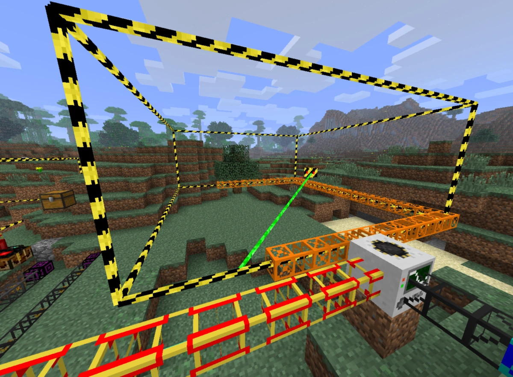

# Capture and build with blueprints

## Intent

Let a player save a valid arrangement of blocks as a reusable blueprint and apply it to a prepared site. Validate the completed design when creating the blueprint, so assembling many buildings later needs only constant-time local structural checks per placed block.

This specification is ready for review; this documentation session does not authorize runtime implementation. Requirements distinguish user-confirmed behavior, **DERIVED** correctness/performance consequences, and **ADOPTED DEFAULTS** chosen to complete routine UI details. Defaults may be revised without implying that the user explicitly selected them. No gameplay question remains blocking this iteration; concrete resource/latency limits must be selected and measured during implementation. Q20 defines one current ruleset and world-save version gates for incompatible changes. Use **blueprint** in code and documentation.

## Context

The voxel app has a one-block player inventory, timed manual placement/extraction, debug spectator tools, a main-thread streamed world cache, and an authoritative `WorldDataService` worker. Client and service currently run ordinary structural validation, including potentially affected constructions. Persistent saves include terrain, construction metadata, roads, block timers, player identity, and inventory; blueprints do not exist yet.

The selected capture design uses the player's current client view, including already-applied optimistic edits, then validates detached contents in isolation. The previous service-owned source-snapshot design is retained under [Rejected alternative: WorldDataService-owned capture](#rejected-alternative-worlddataservice-owned-capture) as decision history. It is superseded and is not a second implementation target. Authoritative destination checks still apply when applying a blueprint.

Relevant sources:

- [Construction rules](../../docs/block-placement.md), `src/voxel_app/block_rules.zig`, and `src/engine/voxel/voxel_chunk.zig`: foundations, material capabilities, height/span rules, mining conversions.
- `src/voxel_app/world.zig`, `world_data_service.zig`, and `chunk_metadata.zig`: predictions, authoritative admission, dependent validation, and mutation costs.
- [Input](../../docs/scenes.md), `src/voxel_app/main.zig`, `player_interaction.zig`, and `src/engine/engine.zig`: application overlays, timed interactions, Escape priority, and the existing B blur shortcut.
- [Persistence](../../docs/persistence.md), [streaming](../../docs/voxel-world.md), and [coordinates](../../docs/coordinates.md): ownership, unknown cells, finite Y/Z bounds, and wrapping X.
- [Game vision](../../docs/game-vision.md#blueprints-and-automated-construction): eventual player/NPC construction at scale.

The attached image is a reference for the selection frame only: thin square-section rails with black/yellow stripes along the twelve box edges. Its other game content does not define requirements.

## Requirements

### Definition, ownership, and scope

- R1: A blueprint is an immutable arrangement of logical block types at integer 3D cell offsets. Its completed normalized arrangement must satisfy construction rules under the foundation contract in R15–R18.
- R2: A private blueprint belongs to the player who created/received it and is stored in that world's save, keyed by player identity; no cross-world profile is introduced. A shared blueprint is available to all players on its multiplayer server. Capture and future interactive planning produce private blueprints by default; future progression rewards produce shared blueprints by default. Private-to-shared conversion is a future operation.
- R3: This iteration implements capture from existing structures and application/assembly. Interactive blueprint design, rewards, sharing, and multiplayer remain future acquisition/distribution paths.

### Capture and input

- R4: Z enters capture only with empty player hands. Otherwise show an on-screen error, for example `Cannot enter blueprint capture while holding a block.` Capture does not consume a block or mutate terrain.
- R5: While capturing, display `Blueprint capture` in the upper-right corner. A held low-poly blueprint model is deferred. **ADOPTED DEFAULT:** keep the existing empty hands visible this iteration.
- R6: Capture proceeds through three fresh Mouse1/E presses: anchor cell, XY extent, then Z extent. These are immediate presses rather than the normal timed place/mine interaction. Movement and looking remain available during selection; ordinary block actions are suppressed.
- R7: The first target uses ordinary placement-cell targeting. Initially the inclusive box is 1×1×1. During XY selection, use the cursor target's X/Y and the anchor's Z, ignoring target Z. During height selection freeze X/Y and derive cursor Z from the view ray's intersection with a vertical plane through the selection, so height can be selected in open air. Allow extension above or below the anchor. Dimensions are `abs(endpoint - anchor) + 1`, with no zero-size box or off-by-one loss at either end. Plane orientation and degenerate-ray handling follow Q12.
- R8: Throughout selection and after confirmation, draw the box with the frame described in Context. The three stages produce a cell, a one-cell-high rectangle, and a volume respectively. The frame/selection is noncolliding and does not alter voxel occupancy.
- R9: After the third press, begin client-owned preparation/validation and show loading or validating status. Obtain all selected cells in full block form, freeze the player's local logical view under R41, and validate that detached snapshot on a bounded helper. B/name entry remains disabled until the matching successful helper result arrives. Only a valid candidate enables B and the upper-right hint `Press B to create a blueprint.` Highlight invalid included blocks in red and explain the rejection. Empty selection, unknown source data, cancelled jobs, and stale results cannot be accepted as valid. The successful result certifies the frozen snapshot, not a continuing live view of its source.
- R10: B opens the name dialog only for a valid candidate. Require a nonempty name of at most 100 characters. Confirming saves a private blueprint; failure must report an error rather than claim success. Character counting, duplicates, and save durability are specified by Q8/Q9.
- R11: Escape cancels the entire draft capture, including from the name dialog before confirmation: discard box, candidate, diagnostics, and pending name, then return to capture's initial selection state. Invalidate the selection generation immediately, release capture-specific chunk retention, and cancel/release the associated client helper job/candidate; late results cannot restore it. Z exits capture and discards that state, except while entering a name: Z must be available as text and must not toggle the mode. After final save submission, apply Q9's save-owned payload semantics rather than promising draft cancellation.
- R12: Before final save confirmation, capture state is temporary and must not enter the saved library, autosave records, or gameplay simulation. The main thread owns UI, source capture, and candidate lifecycle; a bounded helper may temporarily own the detached validation input/output under Q16. Before Save, WorldDataService participates only through ordinary chunk loading/subscriptions, with no blueprint preparation job or candidate. Cancel/release unconfirmed jobs/candidates on reset, exit, or owner disconnection; never mistake one for a saved blueprint. Name entry requires a successful matching helper result. Confirming the name transfers the checked definition to the service for publication under Q9; disk durability is a separate state. After Save submission, cancellation of tool UI must not free or silently cancel the definition now owned by the save operation.
- R13: Capture the player's current merged logical view: real included cells with already-applied local pending edits, plus expected types from unfinished blueprint miniatures. Read the existing predicted cache rather than replaying pending commands a second time. A miniature means the same planned block as a completed real cell. Capturing does not modify or complete its source instance.
- R14: The saved definition must have all empty outer layers removed on all six sides and occupied cells translated to nonnegative offsets from the compact minimum corner. Keep internal empty cells. Normalization, compaction, and validation may occur during preparation before name entry; save exactly the certified immutable contents rather than trimming or changing them afterward. Empty contents have no valid compact form.

### Full validation and portability

- R15: Validate the complete normalized arrangement in isolation. Source blocks outside the selected box supply no structural support. Treat all included cells as construction, including cells copied from generated terrain; generated-terrain exemptions cannot certify a blueprint.
- R16: Let `z_min` be the globally lowest occupied layer after compaction. Assume a full stable platform beneath **each occupied cell at `z_min`**, not beneath every column's first occupied cell at a higher Z and not beneath every empty cell in the bounding rectangle. The virtual foundation is the union of these platforms; other external cells provide no support.
- R17: A platform beneath cell `(x,y,z)` consists of 27 qualifying cells at offsets `dx,dy ∈ {-1,0,1}`, `dz ∈ {-3,-2,-1}`. Use the current shared stable-platform material predicate. Platforms reset height counters; they do not remove the ordinary height/span limits above that reset. The ordinary isolated-deeprock shortcut does not replace this blueprint-specific 3×3×3 requirement.
- R18: Apply normal structural limits to the normalized isolated arrangement above that virtual foundation, including internal platforms and the existing fixed support window, after correcting the ordinary independent-support routes under R38. Keep the existing direct-support material rules: crushed_stone alone does not support rebar/reinforced_concrete; a qualifying platform or legal lateral route can still support them. R47 changes captured materials, not these rules. At application, verify actual real platforms under the translated/rotated bottom cells and composed compatibility under R39. Full platforms are an application precondition, not permanently locked geometry: later external extraction follows R37.
- R19: First normalize **every included** `stone → crushed_stone` and `grass/packed_dirt → dirt`, then validate the resulting isolated arrangement. R47 permits one narrowly scoped concrete-support fallback; otherwise reject invalid normalized contents and highlight the affected source cells. Preserve occupied-cell geometry apart from R14's empty-outer-layer compaction; do not remove cells, add supports, substitute other materials, or relax structural limits. A narrow seven-cell stone-only column without an intervening platform reset still becomes invalid crushed stone and rejects capture. This iteration supports dirt, sand, crushed stone, tree trunk, planks, rebar, reinforced concrete, and solid country road. Reject leaves, natural resource types, clay, deeprock, water, snow, adaptive roads, and unknown custom blocks rather than dropping them. Dirt/packed dirt/grass are one logical fulfillment material, so normal aging does not undo a completed target.
- R20: **DERIVED correctness safeguard:** a blueprint must be assemblable with the cheap rule in R28–R30. Certify creation-time reachability from the assumed bottom foundations; a structural certificate must not produce an uncompletable applied instance. Reject unreachable cells if found. Rebar/reinforced concrete form the approved XY support family; other materials use matching logical types. The compiler may fuse this check with structural certification if equivalence is proved for the allowed materials; do not add runtime searches.

### Selection, preview, and application

- R21: F opens blueprint selection. With no accessible blueprints, show `You do not have any blueprints yet.` Selecting one enters placement preview. Capture and placement preview must not run simultaneously.
- R22: Preview the complete building at the cursor with normal full-size block appearance. Preview blocks have no collision, support, mining, inventory, or world-mutation effects. R rotates 90° clockwise viewed from +Z; bare R must not consume Ctrl+R. Anchor/rotation details and cancellation are Q7.
- R23: A fresh Mouse1/E press submits application at the preview's current origin/rotation only if the destination is admissible. Freeze that proposed transform while asynchronous admission is pending and suppress duplicate tool submissions. **ADOPTED DEFAULT:** a submitted command owns its request independently of tool UI; Escape/F/Q may dismiss the tool but cannot cancel that command or an applied building. Show pending status and deliver its eventual success/failure even after dismissal. A failed apply keeps preview available for adjustment only if that preview remains open. Clear held/queued tool actions on entering/exiting tool states so a chooser click or old placement hold cannot apply it. Recheck current foundation, bounds, occupied-cell conflicts, dependency versions, and active-instance overlap before authoritative atomic publication under R44. Failure leaves no partial instance or changed terrain.
- R24: An unfinished blueprint's box must not overlap another unfinished blueprint's box. Every nonempty blueprint target cell must be physically empty when applying, including cells occupied by the correct material: existing blocks never count as prefulfilled targets. Blueprint-empty cells may contain existing real blocks; leave them untouched. Such contents must be compatible with the composed completed world under R39; do not require all cavities empty. Preview must explain application failures.
- R25: After application, show the compact rotated box with the same frame. Initially every target displays a matching block miniature, approximately one-quarter linear block size, centered within its full cell and apparently floating. Miniatures have no collision, voxel occlusion, or physical terrain occupancy and never count as real support for cheap fulfillment. Ordinary extraction validation treats them as completed logical blocks under R37.
- R26: A miniature must still be an interaction target: use the full planned cell for blueprint placement targeting, not only the miniature's visible geometry. Ordinary player reach and player-body collision checks remain applicable to the real block placement.

### Assembly and completion

- R27: A pending target accepts only its blueprint's required logical material. Successful placement consumes the normal carried block and replaces the miniature with a real block atomically; rejected placement preserves both inventory and miniature. Dirt aging, prediction, service rejection, and reload must not duplicate or lose fulfillment.
- R28: Structural approval for a blueprint-directed placement examines at most five immediate **physical** world neighbors: one below and four face neighbors in the same XY plane. If the below cell has any actual real block (`material != none`, never a miniature), accept without ordinary material-support, height/span/platform searches. If below is physically empty, require at least one already-real matching-logical-material XY neighbor. Rebar and reinforced concrete may support each other laterally; this does not allow substituting one for the other's target material. Count eligible real neighbors outside the instance too; do not restrict the rule to planned neighbors of this blueprint. Unknown data is not proof of occupancy or emptiness.
- R29: The five-neighbor bound is a hard requirement for the structural approval path, on both client and authority, including dependent checks invoked indirectly. Do not run ordinary recursive support searches, dependent collection/scans, or per-instance/per-building scans for each blueprint placement. Pay for completed-design validation during blueprint creation; platform/destination admission is paid once per application.
- R30: Temporary violations of ordinary construction rules during assembly are intentional. A six-cell beam may be assembled from one supported end while its other endpoint is still a miniature. Do not require a legal ordinary intermediate structure or re-run full validation when the last target is fulfilled.
- R31: Forbid extraction of **any real block inside the entire active box**, including preexisting nontarget cells. Enforce the restriction for player actions, debug tools, and simulation/service mutation paths. Outside the box, use ordinary extraction against the completed logical world under R37, without special foundation locks. New ordinary placements in blueprint-empty cells follow R40.
- R32: When every target is fulfilled, remove all miniatures, the frame, and instance-specific restrictions. Maintain a remaining-target counter so identifying completion is O(1). The completed real blocks then participate in ordinary construction/removal rules. Blueprint-directed fulfillment may intentionally have passed through invalid intermediate states.
- R33: **DERIVED persistence requirement:** persist saved blueprint definitions in the owning world's per-player library, and persist unfinished applied instances including their fulfillment state, consistently with real blocks and inventory. Unfinished buildings must survive restart; drafts must not. Persisted instances must retain their immutable definition even if library-management features are added later.
- R34: Future cancellation of an applied instance removes only its frame, miniatures, and instance restrictions; already placed real blocks remain. Cancellation UI/commands are not implemented here. A temporarily invalid remaining building after that future cancellation is an explicitly accepted gameplay compromise, including deliberate player exploitation.
- R35: All world-changing actors use the same authoritative blueprint placement contract. This iteration supplies the contract for future NPC construction; it does not implement NPC scheduling, transport, or material delivery.
- R36: **DERIVED progress invariant:** while an instance is active, forbid destructive/type/shape-changing overwrites of fulfilled targets, not just extraction. Permit certified equivalent transitions such as approved dirt aging. No timer, simulation, debug, or indirect write may leave a fulfilled bit representing a missing/different block. This protects progress bookkeeping; it is not a permanent foundation/support certificate.
- R37: For ordinary extraction outside active boxes, treat pending miniatures as already built blocks of their expected logical types. Validate the hypothetical removal exactly as if every active construction were complete, using ordinary structural rules, the same fixed support windows, and all affected real **and planned** constructions. Retain physical mining/occupancy/item checks so miniatures themselves cannot be mined. Reject a removal that invalidates the logical completed world; allow one that preserves it even if it dismantles part of an original 3×3×3 platform. Do not add a separate prohibition on foundation extraction or repeatedly require the original platform cube. This full check belongs to ordinary extraction, never cheap blueprint fulfillment.
- R38: Change ordinary construction rules before certifying blueprints: distinguish a block below being present from its eligibility to supply support. In particular, planks over dirt/packed dirt/grass may use a legal lateral plank support route even when the earth below is not a stable platform. The nonqualifying below block contributes no support and cannot veto an independently valid lateral route. A failed direct-support attempt must not suppress a valid existing lateral-support mechanism; materials still retain their own span, height, footprint, and crushed-column/bridge restrictions. Trunks gain no new lateral-support mechanism, and an unsupported or unknown below block does not itself become a foundation. Apply the same corrected validator to ordinary placement, existing-structure/removal checks, isolated blueprint certification, and composed admission.
- R39: Once per application, check compatibility of the complete new blueprint with the real destination and other active sites' completed logical blocks. Validate the new targets and all potentially affected existing real/planned constructions under the corrected ordinary rules. Reject an invalid composition atomically, with diagnostics; preserve harmless existing cavity contents. This is required because R38 does not remove all conflicts: joining a six-cell crushed-stone blueprint column to an existing one-cell crushed-stone bridge above creates a forbidden seven-cell run. Creation-time isolated validity cannot detect this site-specific interaction. Full structural work is paid here, never repeated for each fulfillment.
- R40: For ordinary placements in blueprint-empty cells or near active sites, keep physical-terrain target approval and use the completed logical view when protecting affected real/planned dependents. Thus a normal placement cannot introduce a conflict with the promised completed design. This does not allow ordinary construction to obtain physical support from miniatures. Blueprint-directed fulfillment is a separate operation and remains a structural no-op in the completed view with the five-neighbor bound.
- R41: The main thread freezes the player's current selected logical contents into an owned immutable snapshot once every selected cell is available. Capture need not match one authoritative world revision and does not wait for pending-edit acknowledgment. Subsequent source updates, prediction rebases, or rejection of a captured optimistic edit do not change/invalidate the snapshot; its isolated contents must still validate. The client retains the checked candidate until Save or cancellation. Save publishes **that same checked snapshot**, without recapturing the live box or retaining source chunks during naming. Validation and save payloads use local blueprint coordinates and require no source world location. The certificate applies to isolated contents under the running game's single current ruleset, not source revisions or a separately selected historical rules version.
- R42: Blueprint selection and name dialogs block gameplay movement/look input and terrain tools but **do not pause the world**. Player gravity/collision, simulation, NPC/service edits, block timers, streaming, preparation/helper replies, and persistence continue. Resuming input must clear queued/held tool actions so closing a dialog cannot accidentally place or mine.
- R43: Support approximately **100×100×32 selected cells** as the large first-iteration scenario, with most blueprints expected to be smaller. This is a required workload target, not an exact maximum dimension or a reason to reject a larger sparse design by shape alone. Technical limits derive from explicit memory/work/queue budgets and must accommodate the reference workload, including worst source-chunk alignment and wrapping-X cases. No benchmark result or fixed latency claim is implied.
- R44: **DERIVED responsiveness requirement:** large application/composed admission must use staged bounded preparation. Build a consistent dependency snapshot, validate and prepare instance/index resources off the mutation critical path, then recheck relevant versions, overlap, and target occupancy before one atomic publication. Retry or reject stale preparation without publishing partial state. Atomic apply means atomic visibility/commit, not an uninterrupted full-building validation on the sole service thread. Relaxed client-view capture semantics do not relax authoritative destination consistency.
- R45: **DERIVED memory requirement:** bound helper/compiler caches and diagnostic storage independently from the raw snapshot. Do not retain a full inline detailed failure record per successful validated cell across an entire large blueprint. Use compact cached states/evidence with separate failure details or a bounded cache lifecycle, while preserving shared structural semantics and useful diagnostics. Measure actual type sizes, allocator capacity/peaks, and cancellation cleanup.
- R46: **DERIVED throughput requirement:** account for mutation, metadata, response cloning, meshing, and persistence costs separately from the five-neighbor structural bound. Support coalesced/batched authority replies or revision-safe deltas for high-rate fulfillment rather than require a full 32 KiB chunk copy per target unconditionally. NPC scheduling remains out of scope; the fulfillment/protocol design must not prevent batching. Keep ordinary player acknowledgments and reconciliation responsive and correct.
- R47: **CONFIRMED concrete-support fallback, replacing the withdrawn general support change:** keep the ordinary direct-support rules unchanged. If initial normalization is valid, retain it without extra substitutions. Otherwise, only when the **original logical snapshot** already contains rebar or reinforced_concrete, allow `crushed_stone → reinforced_concrete` at a support directly below an invalid reinforced cell whose crushed-stone support is incompatible and which has no other legal support route. An existing qualifying platform or valid lateral route needs no replacement. The supporting crushed stone may be original or stone-derived. Continue down the same necessary support chain when a replacement concrete cell itself has this conflict, stopping at a legal support route; each replacement must be traceable to an original reinforced cell's conflict. Original reinforced material elsewhere is insufficient to repair an unrelated crushed column. The guard is computed before conversion, including miniature logical types; newly introduced concrete cannot establish eligibility. Fully validate the final arrangement and R20 assemblability under unchanged limits before certifying it. Change only the captured definition, never source terrain. Q21 specifies the cascade examples and implementation constraints.
- R48: **CONFIRMED compatibility policy:** the game uses one current construction/gameplay logic, shared by ordinary validation and the blueprint compiler; no world or blueprint selects a historical ruleset. For a sufficiently incompatible gameplay change, advance the world save's `current_write_version` and raise `minimum_readable_version` to exclude incompatible old worlds. Their entire saves, including blueprint libraries and unfinished instances, are rejected through the existing base/WAL version gates before gameplay starts. Do not add a per-blueprint rules version, old-rule execution, automatic recertification, or migration policy. Compatible older file encodings may remain readable when they map to the same current logic.
- R49: **CONFIRMED fallback failure diagnostics:** if the resulting support path exceeds the existing mineral-height limit of 20 levels, reject capture with an explicit error stating the mineral height and limit, for example `Blueprint mineral height 21 exceeds the limit of 20.`, and red source-cell highlights; do not offer B/name entry. A continuous vertical reinforced_concrete/rebar chain reaching level 21 without a reset or other valid route is invalid. Prioritize the lower included cells of the offending support chain, especially substituted supports, rather than highlighting only the upper cell where the limit was detected. Preserve these lower-cell diagnostics when limiting highlight storage and map them to the original selection. This is a height-path limit, not a global count of reinforced blocks in the blueprint; legal platforms and alternative support routes retain their usual semantics.

## Clarifications

Answers distinguish user-confirmed behavior, source-verified current rules, and adopted defaults. Resource tuning and internal representation choices are implementation work, not further gameplay approvals.

- Q1: Is a private library scoped to one saved world or shared across worlds?
  A1: **CONFIRMED:** store it in the world's save, separately for each player, keyed by `(world, player_id)`.
- Q2: Can application reuse existing blocks?
  A2: **CONFIRMED:** require every nonempty target cell to be free, including when its existing block has the correct type. Do not reuse blocks or create prefulfilled targets. Only blueprint-empty cells may retain existing contents.
- Q3: What is permitted in blueprint-empty cells of the bounding box?
  A3: **CONFIRMED:** these cells need not be cleared; keep their blocks untouched. They are still covered by the active box's extraction ban. Apply the corrected independent-support rule and composed admission/ordinary-edit checks in R38–R40/Q15 rather than a blanket empty-cavity requirement.
- Q4: May the external foundation change during assembly?
  A4: **CONFIRMED:** no additional foundation extraction locks. Update general extraction validation to include miniatures alongside ordinary blocks and evaluate outside-box removals as if construction were complete. Thus ordinary support checks reject invalid removals, while safe removals remain possible. The original complete platform is required only at application, not as an invariant throughout assembly. Every active instance participates in the logical completed view.
- Q5: Does cheap XY support mean identical type or compatible structural family?
  A5: **CONFIRMED:** allow the rebar/reinforced-concrete pair for XY support. Other XY neighbors match the logical material. Target fulfillment still requires the specified material; the compatibility exception applies only to support.
- Q6: Which captured material/state conversions are supported?
  A6: **CONFIRMED:** allow dirt, sand, crushed stone, tree trunk, planks, rebar, reinforced concrete, and solid country road; first normalize every included stone to crushed stone and grass/packed dirt to dirt, then validate. Only the reinforced-support fallback in R47/Q19/Q21 may change crushed stone to reinforced concrete. Treat dirt/packed dirt/grass as one fulfillment material after placement. Reject leaves, natural resource types, clay, deeprock, water, snow, adaptive roads, and unknown custom blocks with diagnostics. Adaptive-road slope/ownership capture is deferred.
- Q7: What anchors preview, rotates it, and cancels it?
  A7: **ADOPTED DEFAULT:** cursor targets the compact minimum corner, which stays fixed when rotating. Rotate local integer coordinates as `(x,y,z) → (y,width−1−x,z)` and exchange width/depth; rebase to nonnegative offsets. Four turns restore the original contents exactly. Escape/F cancels an unsubmitted preview; successful apply returns to ordinary play if that preview is still open. After submission, Escape/F/Q may dismiss its UI but the frozen application command remains pending, blocks another application submission until resolved, and reports its outcome without reopening dismissed UI. Tool dismissal never implies applied-building cancellation. Ignore F while capturing rather than discard its draft. Blueprints are player tools; Q switches control mode only after discarding temporary tool state, preserving any submitted command's ownership.
- Q8: What counts as 100 name characters, and are duplicate names allowed?
  A8: **ADOPTED DEFAULT:** trim outer whitespace, reject whitespace-only input, count at most 100 Unicode scalar values with at most 400 UTF-8 bytes, reject line breaks/control characters, allow duplicate display names, and use an independent stable ID. Z inside the dialog is text; Escape cancels capture under R11. Successful save clears selection and stays in capture mode.
- Q9: When does finalization transfer a definition to WorldDataService, and when is Save successful?
  A9: **CONFIRMED finalization boundary:** confirming the name authorizes transfer of the checked immutable definition to WorldDataService for publication. Earlier detached-buffer handoff to a pure validation helper is allowed; unconfirmed preparation remains client-owned, temporary, and never autosaved. After submission the save operation owns its payload and normal save/exit draining applies. **ADOPTED durability/UI default:** save asynchronously through the existing world transaction mechanism; show `Saving…` until durable commit, or clearly distinguish authoritative in-memory acceptance from durable success. On storage failure retain the finalized definition for Retry. Escape may dismiss status after submission but cannot promise to undo it; any cancellation would need authoritative acknowledgment before commit. A late commit remains visible in the library. Explicitly label session-only storage in ephemeral worlds. Do not keep movement blocked while waiting for disk durability after the name dialog closes.
- Q10: How does capture obtain all source cells and handle changes during selection/name entry?
  A10: **CONFIRMED client-view capture:** request/promote and retain all selected chunks in full block mode through ordinary WorldDataService subscriptions; capture is not limited to the normal resident neighborhood. Mesh-only data or missing cells are insufficient. Once data is available, copy the current predicted real+planned view at one main-thread point without processing world replies/edits midway. The initial implementation uses one copy pass; measure its frame cost before adding slicing or copy-on-write. If loading is required, the snapshot point is after loading, not a reconstruction of the historical third-click instant. Release capture-specific residency immediately after copying. No authoritative owner-operation fence, source-version barrier, or retry on later source churn is required. Q13 still bounds memory/work.
- Q11: Which real neighbors qualify, and how do external structures interact with the shortcut?
  A11: **CONFIRMED rule / DERIVED implementation consequence:** use the actual real block below or real matching/compatible XY world neighbors, including outside the instance. Since Q4 permits safe foundation changes, neither admission-time bottom-root flags nor instance-only planned-neighbor masks are sufficient runtime support proof. Probe at most five physical cells or equivalent coherently updated actual-presence/type data; never count a miniature. The logical completed overlay makes each successful fulfillment a structural no-op, so no ordinary dependent search is needed for that operation. Ordinary extraction uses the completed overlay instead of the earlier proposed active-cell exemption. Ordinary placements protect completed dependents under R40.
- Q12: How are height selection, missing targets, and overlay priorities handled?
  A12: **CONFIRMED:** choose height using a vertical plane; chooser/name dialogs block controls without pausing the world. **ADOPTED geometry/UI defaults:** at height-stage entry, choose a vertical plane through the XY selection center facing the camera horizontally and freeze it during the stage. Use `floor(intersection.z)` as endpoint Z. A parallel, behind-camera, or out-of-world intersection is invalid; retain the last valid box and disable confirmation until targeting returns. Name dialog/chooser consume input before capture/preview and existing map/menu handling; consume B before the engine blur toggle. Capture Escape resets without opening the menu. Losing focus clears held inputs but retains selection. Keep normal pause policy for the separate game menu.
- Q13: What are the supported capture/instance size and work limits?
  A13: **CONFIRMED workload:** approximately 100×100×32 cells is a large first-iteration blueprint; most are smaller. It is not a user-selected hard cap. **Implementation tuning:** choose explicit capture/helper/admission memory, retained-source, queue/candidate, work-slice, and cancellation budgets; demonstrate that the reference workload fits them. Use one current preparation/candidate per player as an adopted default, with bounded total helper concurrency/queueing. Reject budget exhaustion cleanly before publication; release abandoned candidates. The arithmetic and measurement plan below inform these choices; no unmeasured numerical SLO or unlimited-size promise is part of this spec.
- Q14: Does a stable platform eliminate all height restrictions?
  A14: **VERIFIED current rule; ADOPTED interpretation:** a stable platform resets height counters at that level. Wood/mineral/crushed-column limits and the support window still apply above it. Portability means source terrain elevation does not consume those counters. This feature does not introduce an unlimited-height construction exception.
- Q15: How are allowed existing cavity blocks and later ordinary placements reconciled with completed validity?
  A15: **CONFIRMED with the user's prerequisite:** first fix ordinary support eligibility under R38, especially planks over earth: unsuitable support below is not an obstruction to valid lateral support. The user authorized compatibility checks at application and ordinary edits if conflicts remain after this fix. Source audit confirms they do. Concrete fixture: an existing single crushed-stone bridge at `(0,0,16)` has natural-stone sides at `(±1,0,16)` supported by stone at `(±1,0,15)`, with air below the bridge center. A separately valid six-cell crushed-stone blueprint occupies `(0,0,10..15)` above a real platform at `z=7..9`. Applying it joins seven consecutive crushed cells (`z=10..16`), invalidating the existing bridge even after lateral-support fallback is corrected. Therefore use one-time composed validation and ordinary dependent protection as R39/R40 specify. The cheap fulfillment path does not change. A second direct-dependency example is placing a sand blueprint below existing constructed water/snow, which remains forbidden independently of the lateral-support fix; include these material classes in affected-dependent discovery.
- Q16: Who prepares and validates a blueprint: the main thread or WorldDataService?
  A16: **CONFIRMED, superseding the earlier service-owned design:** the client captures the player's view on the main thread and retains the checked candidate. A bounded helper runs the shared pure normalization/compaction/structural/assemblability compiler over owned immutable contents, never live world pointers. It needs local dimensions/types and selection generation, not source world coordinates or a rules-version selector. Results carry the matching generation and either a checked immutable candidate/summary or local-cell diagnostics; the client maps diagnostics to the original selection. Only a matching success enables B/name entry. Save transfers the checked definition, owner, name, and idempotency key to WorldDataService. Use a bounded reusable helper queue rather than a thread per capture. Acquisition and validation execution are independent choices. The [rejected alternative](#rejected-alternative-worlddataservice-owned-capture) preserves the previous service workflow and reasons for replacing it; implementing both workflows is not planned.
- Q17: Does Save preserve the validated snapshot or recapture the latest source contents?
  A17: **CONFIRMED:** save exactly the immutable client snapshot certified before name entry, even if the source changes or a captured pending edit is later rejected. This records the player's view at the local snapshot point. Save checks the trusted compiler output's ownership, name, and request identity, then publishes it without a second source scan/full validation or source locks. WorldDataService need not know where it was captured. An unchecked `is_valid` boolean is not a replacement for owned compiler-certified contents. A new capture deliberately obtains a new snapshot.
- Q18: Can crushed stone support rebar and reinforced concrete directly?
  A18: **CONFIRMED reversal:** the earlier proposed direct-support pairing is withdrawn. Keep the ordinary material rule: crushed stone alone cannot support rebar/concrete; an actual qualifying platform or legal lateral route remains available under R38. Ordinary placement, extraction, blueprint certification, and composed admission share that rule. Capture instead has the narrow material conversion in R47/Q19/Q21. The reverse crushed-on-reinforced relation, XY support families, mineral-height limit, and separate crushed-column limit remain unchanged.
- Q19: Should capture repair a design that becomes invalid after stone normalization?
  A19: **CONFIRMED exception replacing the blanket no-repair decision:** first try every stone as crushed stone. Only a reinforced-on-crushed support conflict permits replacing that crushed support with reinforced concrete, including the necessary downward cascade in Q21. The original logical snapshot must already contain rebar or reinforced concrete, including expected miniature types, so the compiler never introduces these materials into a design which originally contained neither. That guard is necessary but not sufficient: unrelated invalid crushed columns remain invalid even when reinforced material exists elsewhere. No other material/geometry repairs, new cells, removed cells, or relaxed limits are allowed. A narrow seven-cell stone-only column without a reset still rejects capture; this is a consecutive-run limit, not a limit of six crushed cells in the whole blueprint. Virtual bottom foundations and ordinary platform resets do not add saved blueprint blocks.

### Single ruleset and world-save compatibility

- Q20: What happens to saved blueprints and unfinished instances after a future construction-rule change?
  A20: **CONFIRMED, replacing the earlier deferred policy:** keep one current gameplay logic. A sufficiently incompatible change advances the world-save write version and minimum readable version so incompatible older worlds are rejected as a whole, including their libraries and unfinished instances. No parallel rulesets, per-blueprint rule versions, grandfathering, recertification, or migration are required. Increasing only the write version would still accept older saves within the readable range and is insufficient for breaking compatibility. Reading compatible old serialization, such as the current inventory-less format 1, does not imply executing old gameplay rules. This closes the previously open compatibility question.

### Conditional concrete-support conversion

- Q21: How far may the fallback replace supports, and what happens at the height limit?
  A21: **CONFIRMED:** cascade down the necessary supporting crushed-stone chain until the replacement concrete has a legal support route. With no lateral support or internal platform, seven stone below an original rebar cell can become seven concrete cells plus rebar and pass; the same seven stone without original rebar/concrete reject capture. A valid baseline is unchanged, and unrelated reinforced material cannot justify repairing another column. The fallback applies to conflicting supports whether originally crushed or converted from stone. **DERIVED implementation:** use a deterministic bounded worklist with conversion provenance and coherent validator-cache invalidation; each eligible cell changes at most once. Do not search alternative material assignments or a global minimum-replacement solution, or run full-design validation after each replacement. Before each queued replacement, recheck the conflict against the current candidate and skip it if another conversion has supplied a legal route. Recheck affected support routes as work proceeds, then perform final complete structural and cheap-rule assemblability validation. Any remaining or newly introduced error rejects the candidate. **CONFIRMED failure behavior:** a chain exceeding mineral height 20 produces an explicit error and red highlights prioritizing its lower included cells under R49; changing material does not reset height or suppress the error. Only existing platform/reset semantics can reset the path. Normalization and diagnostics stay on the capture helper, with no extra assembly-time checks.

Resource budgets, client-copy latency, helper-cache memory, fulfillment response costs, and existing-road/indirect-write integration are implementation measurements/audits under T3/T12/T13/T16. They require evidence during implementation rather than another gameplay decision now. Q7/Q8/Q12's adopted UI defaults remain concrete behavior for implementation and can be refined through playtesting under T9/T-val.

## Acceptance Criteria

Criteria cover the confirmed contract and explicitly adopted defaults. Performance/memory figures in Constraints are arithmetic for planning, not reported measurements; implementation validation must supply actual results.

- AC1: GIVEN empty player hands WHEN Z is pressed THEN capture starts with its upper-right mode indicator and no terrain edit.
- AC2: GIVEN a held block WHEN Z is pressed THEN capture does not start and an on-screen error explains why.
- AC3: GIVEN capture selection WHEN three fresh Mouse1/E presses select anchor, XY endpoint at a different Z, and a lower endpoint using the vertical drag plane THEN inclusive bounds preserve anchor Z during XY selection and extend down during height selection without requiring terrain at that height.
- AC4: GIVEN any capture stage WHEN the box changes THEN twelve black/yellow square-section rails represent its bounds without collision or voxel edits.
- AC5: GIVEN an empty, unknown, structurally invalid, or unassemblable candidate WHEN validation completes THEN B is disabled and the rejection is explained, with invalid included blocks highlighted red.
- AC6: GIVEN a matching successful client-helper validation result WHEN B is pressed THEN the name dialog opens and SSAO blur does not toggle; GIVEN validation is pending, invalid, cancelled, or for an older selection WHEN B is pressed THEN name entry does not open.
- AC7: GIVEN name input WHEN an empty/whitespace-only or over-limit name is submitted THEN no blueprint is saved; accepted Unicode/duplicate behavior follows Q8.
- AC8: GIVEN any draft capture stage including unconfirmed name entry WHEN Escape is pressed THEN all temporary capture data is discarded and capture awaits a new anchor without opening the game menu.
- AC9: GIVEN capture outside name entry WHEN Z is pressed THEN the draft and box disappear and ordinary play resumes; GIVEN name entry WHEN Z is typed THEN it does not exit capture.
- AC10: GIVEN an unconfirmed client capture job/candidate WHEN autosave or game exit occurs THEN no candidate enters persistent records, exit cancels/releases its temporary state, and reopening has no draft; generic service chunk requests and detached helper validation are permitted before Save, without a service-owned blueprint candidate.
- AC11: GIVEN a completed source relying on supports outside the selected box WHEN captured in isolation THEN it is rejected unless the normalized included arrangement and virtual bottom platforms alone prove support.
- AC12: GIVEN a two-cell source with stone below rebar or reinforced concrete, no lateral support, and a virtual platform under the lower cell WHEN capture first normalizes stone to crushed stone and detects the reinforced-support conflict THEN only that crushed support becomes reinforced concrete, and the final stack passes ordinary validation at mineral height two without changing the source world or general rules.
- AC13: GIVEN a blueprint with empty outer layers and internal cavities WHEN saved THEN outer layers are removed on six sides, internal offsets are rebased, and cavities remain.
- AC14: GIVEN a source unfinished instance WHEN its real cells and miniatures are captured THEN the new private blueprint contains all included expected logical blocks without changing source progress.
- AC15: GIVEN an isolated structurally valid arrangement WHEN the agreed cheap-rule reachability traversal cannot reach some cells from bottom roots THEN capture rejects those cells as unassemblable.
- AC16: GIVEN no accessible saved blueprints WHEN F is pressed THEN the empty-library error is displayed without entering placement preview.
- AC17: GIVEN a selected blueprint WHEN previewed and rotated four times THEN full-size noncolliding blocks follow the cursor and exactly restore the original integer cell arrangement.
- AC18: GIVEN any missing, nonqualifying, or unknown cell in a required 3×3×3 destination platform WHEN apply is attempted THEN the entire apply is rejected without reservations or miniatures.
- AC19: GIVEN a box overlapping an unfinished instance WHEN apply is attempted THEN it is rejected atomically even if occupied target cells themselves do not overlap.
- AC20: GIVEN an admissible destination WHEN apply succeeds THEN every target starts as a centered quarter-size miniature inside the frame, without physical collision, real support, terrain occlusion, or inventory consumption; extraction validation still sees its completed logical type.
- AC21: GIVEN a suspended pending cell WHEN aiming within ordinary reach at its full-cell bounds THEN the real block can target that planned cell even without terrain behind it.
- AC22: GIVEN a pending cell WHEN a wrong material is placed THEN target, inventory, and completion counter remain unchanged with a material-mismatch error.
- AC23: GIVEN the correct carried material and any known actual real block below WHEN placement commits THEN its miniature disappears with no ordinary material-support, height/span/platform, or dependent search.
- AC24: GIVEN air below and one matching real XY neighbor, including rebar/concrete cross-support or an eligible neighbor outside the instance, WHEN the correct target material commits THEN it is accepted; GIVEN only miniature neighbors WHEN attempted THEN placement is rejected.
- AC25: GIVEN a valid six-cell supported beam blueprint WHEN assembling outward from only one finished endpoint THEN cheap placements may temporarily exceed ordinary cantilever limits and are not rejected by indirect ordinary validation.
- AC26: GIVEN an unfinished instance WHEN any actor attempts extraction anywhere inside its box THEN the mutation is rejected, including a preexisting nontarget block.
- AC27: GIVEN one unfulfilled target WHEN its placement commits THEN remaining reaches zero, frame/reservations disappear, and subsequent operations use ordinary rules without a completion-time full-building validation.
- AC28: GIVEN a saved unfinished instance WHEN the world restarts or its chunks unload/reload THEN its definition, owner, transform, pending miniatures, locks, and exact progress agree with persisted terrain and inventory.
- AC29: GIVEN a finalized save that encounters a storage failure WHEN the UI receives the failure THEN it reports the failure and preserves the finalization/retry semantics agreed in Q9 without claiming success.
- AC30: GIVEN a validated immutable client snapshot WHEN the original source changes during name entry and Save is confirmed THEN exactly the checked snapshot is published without source coordinates, recapturing source data, or repeating full validation.
- AC31: GIVEN fulfilled dirt whose world state becomes packed dirt or grass WHEN rendering, saving, reloading, or checking completion THEN no miniature reappears and it retains the approved dirt fulfillment identity.
- AC32: GIVEN a capture or placement crossing the wrapped X seam WHEN bounds, rotation, platform lookups, and overlap are evaluated THEN the structure remains contiguous; crossing finite Y/Z bounds rejects application.
- AC33: GIVEN instrumented client and service fulfillment paths WHEN supported/unsupported placements are exercised across small and large instances THEN structural approval probes at most five neighbors, invokes no ordinary/dependent validators, and does not grow with blueprint volume or site count.
- AC34: GIVEN existing matching or different material in any required target cell WHEN apply is attempted THEN it is rejected atomically; GIVEN harmless real contents only in blueprint-empty cells WHEN apply succeeds THEN those contents remain untouched and every target still starts pending.
- AC35: GIVEN failed authority admission or replay of an already completed request WHEN reconciliation occurs THEN no duplicate inventory transfer, double decrement, or lost miniature occurs.
- AC36: GIVEN an active fulfilled target WHEN a timer or indirect write would remove it or change its required material/shape THEN R36's progress invariant prevents a false fulfillment bit; certified equivalent dirt aging remains permitted.
- AC37: GIVEN certification using synthetic natural-stone platform cells WHEN the same design is applied above a heterogeneous platform of qualifying materials THEN completed validity and height/crushed-column counters agree, including internal platforms overlapping the virtual foundation region.
- AC38: GIVEN an outside-box real support whose removal invalidates a still-miniature planned block WHEN ordinary extraction is attempted THEN ordinary validation rejects it exactly as for the completed building, with a diagnostic identifying the planned dependent.
- AC39: GIVEN an original platform cell outside the box whose removal preserves completed structural validity through another support route WHEN ordinary extraction is attempted THEN no special foundation lock prevents it.
- AC40: GIVEN an outside edit affecting several active sites WHEN ordinary dependent validation runs THEN pending targets of all affected sites participate as constructed cells within the normal support windows, even if none has a real construction marker yet.
- AC41: GIVEN a previously admitted lower support removed legally with a real compatible XY neighbor remaining outside the instance WHEN fulfilling the target THEN live neighbor checks permit it and no stale root/mask certificate grants unsupported placement.
- AC42: GIVEN one successful target fulfillment WHEN comparing the completed logical world before and after THEN it has the same logical material/occupancy and no dependent revalidation runs.
- AC43: GIVEN a composition or later ordinary placement that would invalidate a planned or existing construction WHEN attempted THEN completed-world dependent validation rejects it atomically; the cheap fulfillment path never absorbs a full search.
- AC44: GIVEN planks with a legal lateral support route and dirt/packed dirt/grass directly below without a stable platform WHEN ordinary placement or existing-structure validation runs THEN the planks remain valid through lateral support and the earth contributes no unsupported foundation claim.
- AC45: GIVEN the same earth-below setup without a legal lateral route WHEN validating planks THEN placement is rejected; GIVEN only a tree trunk in that setup WHEN validating THEN it gains no plank-style lateral exception.
- AC46: GIVEN the six-cell column and existing single bridge fixture in Q15 WHEN applying the individually valid blueprint THEN the composed seven-cell crushed run is rejected before any miniatures or box are published.
- AC47: GIVEN constructed water/snow directly above a free target of a valid sand blueprint WHEN composed admission or an ordinary sand placement runs THEN the existing direct dependent is found and the forbidden sand/water-or-snow composition is rejected.
- AC48: GIVEN harmless dirt below a laterally supported plank target WHEN applying the blueprint or making an ordinary edit below it THEN corrected support semantics preserve the valid composition rather than reject it solely for occupied incompatible support.
- AC49: GIVEN selected chunks absent or available only as meshes WHEN client preparation begins THEN capture-specific pins/full-block subscriptions obtain all selected data within the configured budget, B remains disabled while data is missing, and pins are released after copying or cancellation.
- AC50: GIVEN a cancelled/replaced selection WHEN an old validation result arrives THEN it cannot enable B, reopen name entry, publish a blueprint, or retain an abandoned candidate indefinitely.
- AC51: GIVEN a large client capture/validation job WHEN ordinary edits, streaming, persistence events, and cancellation are processed THEN source copying has a measured bounded frame cost, heavy validation reads only detached immutable data on a bounded helper, and world progress continues without persistence mutation-freezing source holds.
- AC52: GIVEN a compiler-certified immutable definition WHEN Save is retried with the same idempotency key THEN that definition is published at most once; invalid ownership or a conflicting payload under the same request identity is rejected without publishing another candidate's contents.
- AC53: GIVEN no terrain at a desired height WHEN the view ray intersects the height plane there THEN the player can select that height; GIVEN a degenerate intersection WHEN confirmation is attempted THEN no invalid Z is committed.
- AC54: GIVEN an optimistic placement/removal already applied to the client cache but not acknowledged by authority WHEN the fully loaded selection is frozen THEN capture includes its current local effect without waiting for acknowledgment or replaying it twice; later authority rejection does not alter the captured design if its contents validate in isolation.
- AC55: GIVEN a frozen client real+planned snapshot WHEN subsequent chunk replies, prediction rebases, or planned-overlay changes update the live source THEN helper input and checked candidate remain unchanged; no live-world pointers or authoritative source-version barrier participate in validation.
- AC56: GIVEN Save has been submitted with a checked candidate WHEN the player resets the tool or exits before disk completion THEN draft cleanup does not free/cancel the save-owned payload, and normal commit/failure/exit-drain handling preserves its outcome.
- AC57: GIVEN the blueprint chooser or name dialog remains open WHEN gameplay input and background world work arrive THEN controls/terrain actions are suppressed while player gravity/collision, ticks, NPC/service edits, timers, streaming, preparation replies, and persistence progress continue without a global pause.
- AC58: GIVEN valid representative sparse and high-occupancy designs within the 100×100×32 scenario, plus invalid dense input, WHEN capture/validation/application/rendering are exercised at worst source alignment and across wrapped X THEN the supported workload completes or reports the correct structural error within configured resource budgets, with measured latency/memory and no silent truncation.
- AC59: GIVEN a large apply preparation and concurrent relevant world edits WHEN final publication is attempted THEN changed dependency versions trigger retry/rejection and no partial instance appears; unrelated service work continues during preparation.
- AC60: GIVEN the large reference workload and varied active-site counts WHEN profiling fulfillment THEN the report separates ≤5-neighbor approval from construction metadata, reply cloning, meshing, persistence, and render costs and demonstrates no per-fill full-instance scan or unconditional whole-chunk-copy requirement.
- AC61: GIVEN an application command awaiting authoritative admission WHEN Escape/F/Q dismisses its tool UI THEN the frozen command remains owned and pending, another application cannot be submitted until it resolves, and its success/failure is reported without reopening dismissed UI or cancelling a published instance.
- AC62: GIVEN a reinforced block directly above crushed stone with no qualifying platform or legal lateral route WHEN ordinary construction validation checks that unchanged arrangement THEN it rejects the unsupported reinforced block; the blueprint fallback grants no new direct-support pairing and does not change lateral or reverse material compatibility.
- AC63: GIVEN an original logical snapshot containing neither rebar nor reinforced concrete, including miniature types WHEN normalization or subsequent validation finds errors THEN no cell becomes reinforced concrete, and newly proposed substitutions cannot satisfy the original-material guard.
- AC64: GIVEN a narrow stone-only column on the assumed bottom platform with no intermediate platform reset WHEN capture normalizes and validates it THEN six cells pass the column rule, while seven become seven crushed-stone cells and reject creation with B disabled and involved source cells highlighted, without alternative materials, cell removal, added supports, or a relaxed limit.
- AC65: GIVEN an update with incompatible gameplay semantics WHEN its world-save write/minimum-readable versions exclude an older save THEN loading rejects that world through the base/WAL version gates before its blueprint library or unfinished instances enter gameplay, without selecting old rules or migrating blueprints; accepted compatible file encodings all use the current rules.
- AC66: GIVEN initial normalized contents which already validate, including reinforced cells over crushed stone supported through qualifying platforms or legal lateral routes WHEN capture compiles the blueprint THEN it preserves those crushed cells and performs no concrete fallback.
- AC67: GIVEN seven stone cells below an original rebar cell on the assumed bottom platform, with no other support route or intermediate platform WHEN the reinforced-on-crushed fallback runs THEN it converts the necessary seven-cell support chain to reinforced concrete, validates the resulting eight-level path and assemblability, and leaves the source world unchanged.
- AC68: GIVEN an invalid seven-cell stone column with no reset and an unrelated supported rebar cell elsewhere in the selection WHEN capture normalizes and validates it THEN the rebar does not authorize converting that column to concrete, and capture rejects the unresolved crushed-column error.
- AC69: GIVEN a necessary support-chain conversion whose result reaches mineral height 21 or more with no reset or alternative valid route WHEN final validation runs THEN capture fails with an explicit mineral-height-limit error, keeps B/name entry disabled, and highlights lower source cells of the offending chain, prioritizing substituted supports even when diagnostics are capped.
- AC70: GIVEN a necessary support-chain conversion whose resulting reinforced_concrete/rebar path reaches mineral height exactly 20 with no intermediate reset WHEN final validation runs THEN the height check accepts it, preserves the inherited counter across both reinforced materials, and still requires all other structural and assemblability checks to pass.

## Constraints

- GPU operations, tool UI, and source copying remain on the main thread; authoritative real-world mutations and saved blueprint publication remain service-owned. Before Save, use only generic source-chunk subscriptions through WorldDataService. Never autosave a client capture job, candidate, diagnostics, or unfinished name.
- The main-thread copy reads the already-predicted cache plus locally known planned targets at one local snapshot point. Capture does not wait for authoritative pending-edit resolution or enforce cross-chunk authority revisions. Keep all selected chunks in full block mode during preparation; available display geometry or retained stale mesh-mode block data does not prove readiness.
- Run heavy pure compilation/validation on a bounded helper over detached immutable selected-cell data, without live world pointers or source coordinates. Keep the helper independent of WorldDataService's mutable source state. Preserve generation-safe results, bounded queue/memory, and cancellation/shutdown cleanup. Maintain one shared compiler for current and any future acquisition adapters; implementing two capture workflows is not required.
- Begin with a single main-thread copy pass, using preallocated storage and chunk/row copies where practical rather than repeated per-cell hash lookups. Measure frame cost for the reference workload before adding slicing/copy-on-write. Do not silently spread reads of a mutable client view across frames while claiming one snapshot point. Missing data is loaded first; no historical third-click reconstruction is required.
- Separate ordinary source residency retention from snapshot immutability and persistence `source_holds`. Do not reuse the latter: current holds stop simulation mutations and block timers. Copy selected logical contents once, release capture-specific pins/subscriptions, and retain only detached data/candidate during validation and naming. Preserve subscriptions still needed for rendering, player collision, or pending edits.
- Reuse structural semantics through a dedicated isolated blueprint reader/entry point rather than copy a second height/span rule implementation. All normalized blueprint cells are constructed cells. Represent virtual foundations as qualifying fixture cells below `z_min`; never use real outside source support.
- Implement the support-eligibility correction before generating a blueprint certificate. Separate failure to provide direct support from failure of the whole block: try available legal lateral routes without treating an occupied unsuitable below cell as an automatic veto. Preserve unknown-data/window diagnostics and material-specific intrinsic restrictions; do not globally replace real terrain reads with air.
- Implement R47 only as capture-time material normalization, preserving the existing reinforced/crushed direct-support compatibility rules. Compute the original-material guard before any replacements, keep conversion provenance, and use a deterministic bounded worklist with coherent cache invalidation. Each crushed cell may convert at most once; avoid per-replacement whole-design scans or combinatorial repair searches. Full final validation includes new side effects, unchanged height/span limits, and assemblability; R49 diagnostics prioritize lower source support cells on height failure. This adds no checks to fulfillment or application-time material rewriting.
- Keep physical and completed structural readers explicit. Physical queries supply collision, mining/item transfers, and the five real neighbors used by blueprint fulfillment. For ordinary extraction, the completed reader overlays pending target materials from every active site on physical terrain. Its dependent set is the deduplicated union of real construction markers and spatially indexed planned targets; changing only `Reader.get` without extending dependent enumeration is insufficient.
- Audit affected-dependent filtering across every existing world material, not only blueprint-allowed materials. The current `mayDependOnEdit` filter omits water/snow despite their explicit sand-below restriction; composed/ordinary edit checks must include this direct dependence. Generated-terrain exemptions remain ordinary policy, while new blueprint targets are always constructed cells.
- Full platforms are verified from real terrain at apply. Later foundation extraction uses normal completed-world validation; do not retain unconditional bottom-root support certificates, special platform locks, or an active-cell exemption in that validation path.
- Apply the cheap rule before ordinary edit dependency discovery, persistent-neighborhood loading, dependent collection, or road planning can accidentally invoke full construction validation. The ordinary path currently does more work than just `Validator.checkPlacement`.
- The hard bound covers structural support approval. Constant target/ownership/material/inventory/bounds checks are additional. Mesh rebuild, replication, storage encoding, timers, and rendering have separate costs; measure them separately rather than claiming the entire world update consists of five memory reads.
- Use an instance index/local-cell lookup and O(1) fulfillment updates; do not enumerate all buildings, scan an instance on each placement, or use a linear constructed-cell membership search to conceal size-dependent work in the supposedly cheap approval path.
- Last-cell completion deactivates the instance in O(1), immediately ending its frame/box-extraction restriction. Retire cell indexes and render resources through bounded deferred cleanup; inactive tokens must not keep enforcing box restrictions while cleanup is pending. Transfer each fulfilled target into real construction bookkeeping incrementally so completion does not need a full construction-marker scan.
- Record progress incrementally or by dirty range; do not rewrite an entire definition/fulfillment bitmap on each block placement and accidentally create O(N²) assembly work. Checkpoint/compaction can encode complete records separately under the existing persistence policy.
- Missing world/source data is unknown, never air. Use checked integer arithmetic, bounded allocations, signed unwrapped local coordinates across X, and the world's finite Y/Z bounds. Local offsets are independent of packed chunk IDs and source world elevation.
- No arbitrary total world scan per frame. Source extraction must be budgeted and cancellation-aware; helper compute, buffers, and outstanding jobs must be bounded independently. Render miniatures/frames through chunk/spatial visibility rather than one global per-frame scan of every site's cells.
- Use the world-save format's current-write/minimum-readable gates for incompatible gameplay changes under R48/Q20. Blueprint definitions have no independent rules-version field or historical validator dispatch. Compatible decoding may map several file encodings into the same current model; it does not preserve multiple game logics. Gate the whole world, including unfinished sites, before gameplay rather than running per-definition migrations or per-block compatibility work.
- Tests must enforce the five-neighbor and forbidden-call contracts deterministically, in addition to measuring CPU behavior. Wall-clock speed alone cannot prove the complexity bound.

### Reference workload and resource accounting

Use `V` for selected-box volume and `N` for occupied blueprint targets. At 100×100×32, `V = 320,000`; typical sparse buildings have `N < V`. The following are representation calculations, not measured peaks or promised storage layouts:

| Quantity | Reference arithmetic |
| --- | --- |
| Dense type snapshot at one byte/cell | 320,000 bytes = 312.5 KiB |
| Fulfillment bitset at `N = V` | 40,000 bytes ≈ 39.06 KiB |
| Separate reachability visited bitset | 40,000 bytes at `N = V` |
| `u32` reachability queue at `N = V` | 1,280,000 bytes ≈ 1.22 MiB |
| 32³ source chunks, aligned / worst alignment | 16 / 50 (worst case 5×5×2) |
| Fifty full raw chunk block arrays | 1,638,400 bytes = 1.5625 MiB; excludes metadata/headers/allocator overhead |
| Full 100×100 bottom layer's platform union | 102×102×3 = 31,212 unique cells, rather than 270,000 repeated per-root probes |

Use a dense byte-array baseline for detached selected contents, deriving coordinates from linear indices. Measure the one-pass main-thread copy separately from helper compilation and generic source loading. A sparse offset/type layout may help sparse definitions; `(u32 offset, u8 type)` costs `5N` packed bytes or commonly `8N` in memory before indexes, so sparsity alone does not justify it at high occupancy. Share immutable definitions between instances; progress/index/render state is per instance. Deduplicate foundation queries through the one-cell XY dilation of occupied bottom cells, not 27 coordinate records per root.

The current `block_rules.Validator` cache stores `Evaluation` by value, including `Failure.involved[32]` even for successful entries. If retained for 320,000 entries, those coordinates alone account for at least 245.76 MB before vector padding, evidence, and hash capacity. The small snapshot is not a bound on helper memory. Measure `@sizeOf` and actual allocation peaks; use compact cached state/failure references or a bounded cache lifecycle before claiming the reference workload is supported.

Likewise, 320,000 individual fills each copying one 32 KiB block payload would copy about 9.77 GiB before metadata/mesh work. This is an arithmetic warning about the existing chunk-reply path, not a benchmark or unavoidable blueprint cost. Measure and coalesce/batch replies or use revision-safe deltas. Keep player inventory/progress reconciliation atomic.

Validation reports must cover sparse/high-occupancy valid buildings and dense rejected input, the large reference and smaller ordinary buildings, one and multiple concurrent sites, worst chunk alignment/X seam, source changes/rebases after freezing, cancellation, and allocation failure. Report client block-loading/copy/frame cost, helper compile latency, apply latency, service edit latency, memory/retention peaks, reply-copy volume, and render cost separately. Select numerical budgets from measurements; deterministic tests still enforce the five-neighbor/forbidden-call bound. Miniatures use chunk-visible instancing, not one heavyweight scene object per target.

## Out of Scope

Runtime feature implementation in this documentation session; interactive blueprint planning; research/reward delivery; multiplayer; sharing or private-to-shared conversion UI; low-poly held blueprint artwork; NPC scheduling/logistics; automatic material creation/delivery; material/geometry repair beyond R47's narrowly gated concrete-support conversion; historical gameplay rulesets and per-blueprint migration/recertification; applied-instance cancellation UI; blueprint editing/deletion/renaming/export/import; cross-world private libraries; general physics/collapse; retroactive repair of intentionally invalid future-cancellation remnants; capture of adaptive roads/custom states, leaves, natural resources, clay, deeprock, water, and snow.

## Plan

Implementation plan for review. Gameplay decisions are specified; resource tuning and internal representations are resolved through the measurement tasks. This documentation session does not itself start implementation.

### Approach

1. Capture pipeline: main-thread box/UI state → client pins/promotes all selected chunks through ordinary full-block subscriptions → one main-thread pass copies the current predicted real+planned view into owned local-coordinate data → release capture-specific source retention → bounded helper records the original reinforced-material guard, performs initial normalization/compaction and isolated validation, runs R47's necessary support-chain fallback if eligible, then fully validates the final arrangement and cheap-rule assemblability → client retains the checked immutable candidate → matching successful result enables name entry. Preserve original-cell provenance for diagnostics, including lower-support highlights on a height failure. Loading may span frames; the snapshot point is the later copy pass. Do not wait for authoritative pending-edit acknowledgment or recapture after source updates. Measure the copy's frame cost before introducing a more elaborate snapshot mechanism. Save transfers and publishes exactly that checked definition.
2. For creation-time cheap-rule certification, start from bottom roots whose platform is assumed in the isolated design. Propagate readiness upward to planned cells with an eligible below cell and sideways to matching logical materials, allowing the reinforced pair. A queue/visited representation makes this O(N) with at most five candidate edges per occupied cell; same-level loops without a rooted route cannot certify themselves. This does not produce a permanent runtime foundation certificate.
3. At runtime, short-circuit over the actual real block below, then up to four real XY neighbors with the approved material/family predicate. Use direct physical cell reads as the initial implementation; any cached equivalent must remain coherent with outside edits. Do not use the completed overlay, an admission-time root flag, or instance-only neighbor masks to grant physical support.
4. Prepare large application asynchronously: capture relevant destination blocks, overlay/construction/shape dependencies, and local overlap-index state with coherent versions. Keep cavity contents and validate composed targets/affected dependents under corrected rules on a bounded helper. Prebuild instance/index resources, then recheck the complete read dependency set and target/overlap conditions on authority before atomic publication. Retry/reject changes without partial state. Source support outside the capture box is still ignored during creation; application may require a larger destination dependency region. Full admission cost is separate from individual fulfillment, and atomic publication does not authorize one large synchronous validation loop.
5. Use a dedicated blueprint fulfillment operation, shared pure admission helper, and atomic authority commit for world block + inventory + target state. Gate on required local data and persistence source pins without loading the ordinary 5×5×5 chunk edit neighborhood solely for structural searches. Predictions/reconciliation carry fulfillment metadata with the terrain transition.
6. Add a completed-world reader and a per-chunk planned-construction index to ordinary extraction validation. Merge/deduplicate virtual targets and real construction markers only in the existing affected windows, across all active instances. Validate their completed logical state rather than exempting active cells or inspecting their intentionally incomplete physical form. Safe outside foundation removals need no special reservation. Ordinary new placements use physical target validation plus completed-overlay dependent protection. Each blueprint fill transfers one cell from virtual to real indexing, leaving the completed overlay unchanged. The last fill only deactivates the frame/box restriction; reclaim per-cell resources in bounded deferred work.
7. Save accepts the client-owned compiler-certified immutable definition, owner, name, and idempotency key; it does not need a pre-save service token or capture location. Transfer candidate ownership to the submitted save so later draft/UI cleanup cannot destroy it, preserving a retryable payload on enqueue/storage failure. Check ownership, name, and idempotency without recapturing source cells or repeating full validation of trusted in-process compiler output. Persist definitions and instances through the existing transaction/checkpoint system; transient client preparation is excluded. Store owner, stable ID, logical types, compact dimensions, and, for applied instances, origin, quarter-turn transform, fulfillment state, and outstanding count. Save compatibility belongs to the enclosing world's format gates, with one current compiler/validator. Derived indexes/render buffers may rebuild on load; restored state must agree with terrain. Pin saved definitions while instances reference them.
8. Add input routing before engine debug actions, noncolliding instanced preview/miniature rendering, twelve-rail frame rendering, and a separate full-cell blueprint targeting path. Do not represent miniatures as physical voxel materials.

### Affected Components

- New pure blueprint definition/compiler/validator, client-owned capture/helper lifecycle, and authoritative instance/index modules under `src/voxel_app/`.
- `src/voxel_app/main.zig`, `player_interaction.zig`, `block_targeting.zig`: capture/preview/modal state, capture-specific full-block pins, snapshot copying, input ownership, status/errors, and target selection.
- `src/engine/engine.zig`: consumed-key routing around the existing B shortcut, with reusable presentation helpers only where needed.
- `src/voxel_app/world.zig`, `world_data_service.zig` (including its command protocol), `chunk_metadata.zig`: authoritative application/fulfillment, reservations, optimistic replay, construction status, and bounded lookup/mutation paths.
- `src/voxel_app/persistence/`: versioned definition/instance records and atomic save/recovery.
- Engine/application rendering and `build.zig`: nonphysical block instances/frames and acceptance-test/benchmark registration.

### Data Model Changes

Separate `BlueprintDefinition` (immutable saved recipe), `BlueprintCaptureDraft` (main-thread box/UI/name and diagnostic-to-source mapping), `BlueprintCaptureJob/Candidate` (transient client-owned lifecycle with detached helper input and certified output under Q16), and `BlueprintInstance` (authoritative applied progress). A job's generation identifies local UI ownership; there is no service candidate token before Save. The checked output owns immutable contents certified by the running compiler, rather than carrying a freely editable validity flag or a ruleset selector. Persistent definitions/instances inherit the enclosing world-save compatibility gate, with no separate rule-version field. The helper sees only local coordinates; source mapping stays in the client and is discarded with the draft. Miniatures derive from unfulfilled cells. Do not persist raw padded vectors/pointers or world-cache/chunk-layout IDs as local blueprint coordinates. Keep instance origin/rotation outside the immutable definition.

### API Changes

Client preparation uses generic full-block chunk subscriptions and a local helper API such as `compileBlueprint(snapshot, selection_generation)`, with cancellation and a polled generation-safe result. The result transfers a checked immutable definition or local-cell diagnostics and compact summary to the client. WorldDataService's save API is `saveBlueprint(validated_definition, owner, name, idempotency_key)`; it receives the owned compiled payload after name confirmation, with no capture bounds, operation watermark, pre-save candidate token, or ruleset version. Authority commands also atomically apply a saved definition at origin/rotation and fulfill instance targets using inventory transfers. A submitted apply has operation-owned lifetime and an outcome channel independent of preview UI, with at most one unresolved player application submission. Cancelling temporary client preparation differs from dismissing a submitted apply or cancelling an applied building; applied-building cancellation remains out of scope. Rejected commands carry actionable errors without partial publication. Exact names/encoding follow architecture review.

### Rejected alternative: WorldDataService-owned capture

**REJECTED / SUPERSEDED by client-side capture.** This section preserves the earlier design at the user's request. It is decision history, not an active requirement, implementation task, or second workflow to build and benchmark. R9/R12/R41 and Q10/Q16/Q17 specify the selected design.

The earlier design placed source acquisition, candidate ownership, and finalization in WorldDataService:

1. The main thread sent selected bounds, owner, selection generation, and an earlier-owner-operation watermark through `prepareBlueprint(bounds, selection_generation, after_operation_id)`.
2. The service waited for those relevant owner edits to resolve, loaded/retained intersecting source chunks, and copied authoritative real blocks plus planned miniature types. Source copying was budgeted across service turns.
3. A final all-source real-content/planned-overlay version barrier, or equivalent mutation-driven invalidation, established one coherent authority snapshot. Checking each chunk only at its individual copy time would have permitted mixed source versions. Changed sources triggered bounded retries/rejection. Ordinary read queries bypass the deferred mutation FIFO, so an explicit owner-operation fence was part of this design.
4. The service released source residency after freezing and dispatched a bounded helper over owned immutable data. It retained the successfully checked candidate and returned an owner-scoped transient token/summary or source-coordinate diagnostics. No candidate entered autosave; stale generations, cancellation, disconnection, and shutdown released jobs/tokens.
5. Only a matching successful service response enabled name entry. `saveBlueprint(candidate_token, name, idempotency_key)` promoted that exact checked buffer, even if its source subsequently changed. Submitted saves owned their payload independently of tool cleanup. The design avoided sending all source block chunks to the UI solely for capture.

Source residency in that alternative did not imply immutability, and persistence `source_holds` were unsuitable because they freeze simulation/timers. Keeping heavy validation off the sole service worker, bounding source churn retries/cache memory, and managing both service candidate and helper lifetimes were necessary parts of the previous plan.

It was rejected because the user confirmed that a blueprint records the player's current view, including effective pending edits, and its validity depends only on detached contents under virtual foundations. Matching one authoritative source state adds no required gameplay guarantee. Client capture reuses the existing predicted cache and removes capture-specific owner fences, service source-version barriers/retries, and pre-save service token lifetime. Both acquisition approaches could feed the same pure compiler; implementing both now would add maintenance cost without settling a needed product question. Measure the selected client's source loading/copy/frame cost and helper cost first.

This decision applies to **source capture only**. Destination admission changes the authoritative world, so R44/AC59's dependency snapshots, final version checks, and atomic publication remain active requirements. A future server-side acquisition adapter, if a concrete use case arises, can supply the same immutable compiler input without duplicating construction rules.

### Risks

Correcting support eligibility removes false rejections such as side-supported planks over dirt, but not merged crushed-stone runs or sand below water/snow; composed admission remains required. Completed-world checks need planned-dependent indexes and complete material filtering. Client capture needs full-block residency, a measured main-thread copy, bounded helper/cache memory, and cancellation/shutdown cleanup. Large application admission additionally needs a coherent authority dependency snapshot and final version checks. Capturing a pending edit that is later rejected is intentional player-view semantics. A small raw snapshot does not bound validator-cache, mesh, or response-copy costs. The supported size and no-pause dialog behavior are fixed; actual performance/resource settings require implementation measurements. Adaptive-road capture is deferred, while nearby existing custom-road side effects and indirect writes require the explicit T16 audit. Product details are specified or have explicit adopted defaults; Q20 closes rule-change compatibility through world-save version gates instead of historical rules or migrations.

## Tasks

Implementation dependency order; unchecked items do not authorize starting runtime code in this documentation session.

### Phase 1 — settle and validate the contract

- [x] T1: Record confirmed gameplay decisions and explicit defaults in Q1–Q21, including the single-ruleset/world-save compatibility policy, while preserving stable R/AC IDs. This completes the specification decisions, not runtime acceptance verification.
- [ ] T2: Turn the reviewed validity/assemblability argument into implementation fixtures for initial stone conversion, unchanged six-versus-seven stone-only column rejection, narrowly gated concrete-support cascades and height-failure diagnostics, mixed reinforced spans, elevated islands, soil aging, cavity contents, external foundation removal, and ordinary neighbors; verify them with the implemented compiler/overlay.
- [ ] T3: Define measurement hooks and initial configurable resource/work/cancellation budgets using the reference arithmetic and existing-validator baselines. Measure/refine them against actual capture/apply/multiple-site workloads in T10/T-val, separating client source loading, one-pass copy/frame cost, and helper compilation; record observed peaks/latency without treating the workload target as a hard dimension cap.

### Phase 2 — pure definitions and capture

- [ ] T11: Correct general direct-versus-lateral support eligibility under R38; add regressions for planks above earth, missing lateral support, unchanged material limits, and affected-dependent discovery including water/snow.
- [ ] T14: Implement R47's capture-only concrete-support fallback and R49 diagnostics with the original-material guard, deterministic bounded downward worklist, conversion provenance, and coherent cache invalidation. Verify the two-cell conversion, valid-baseline no-op, necessary cascade, unrelated-column rejection, no reinforced introduction without original reinforced types, final 20/21-level boundary, and lower-source-cell height highlights; retain ordinary direct/lateral/reverse support rules and the five-neighbor fulfillment bound.
- [ ] T12: Measure validator type/cache sizes and refactor cached evaluation/diagnostics or cache lifetime so helper working memory is bounded for large blueprints; preserve support-window semantics.
- [ ] T4: Implement immutable normalized definitions, final isolated validation after R47 if needed, and cheap-rule reachability using the single current compiler, without per-definition rule versions.
- [ ] T5: Implement client-owned selection/name UI, capture-specific full-block pins/subscriptions, one-pass predicted real+planned snapshot copying, bounded pure helper validation, polled generation-safe results, and checked-payload transfer to Save. Cover pending-edit rejection after capture and cleanup without authority source fences/tokens.

### Phase 3 — authoritative sites and persistence

- [ ] T6: Implement budgeted snapshot/helper destination/platform/composed admission with dependency-version rechecks and atomic publication, plus active-box/planned-dependent indexes for ordinary edits.
- [ ] T7: Add dedicated five-physical-neighbor fulfillment, inventory/progress reconciliation, logical no-op transfer from planned to real indexing, and O(1) completion detection.
- [ ] T8: Persist/recover definitions and instances atomically with terrain/inventory and rebuild derived indexes on load.
- [ ] T15: Integrate blueprint definitions/instances with the enclosing world-save version gates under R48/Q20; verify that excluding an incompatible old save prevents its library/sites from loading into gameplay. Do not implement historical ruleset dispatch or per-blueprint migration.
- [ ] T16: Audit existing custom/adaptive-road effects, timers, simulation/debug writes, and other indirect mutations near active sites against R31/R36/R39/R40. Add focused integration regressions for extraction/progress protection and completed-world compatibility; keep the five-neighbor fulfillment path free of full structural searches. This audit does not add adaptive-road capture support.

### Phase 4 — presentation and validation

- [ ] T9: Add chooser, preview/rotation, frames, miniature rendering/targeting, and input-priority integration; playtest the explicit Q7/Q8/Q12 UI defaults and record any adjustments.
- [ ] T10: Add deterministic neighbor-read/forbidden-path instrumentation and benchmark many concurrent sites; separately report support, metadata, meshing, and persistence cost.
- [ ] T13: Audit/coalesce fulfillment response cloning or introduce revision-safe deltas; report copied bytes, metadata costs, and reconciliation correctness independently of the five-neighbor check.
- [ ] T-val: Verify AC1–AC70, complete measurement/audit tasks including T3/T12/T13/T14/T15/T16, run relevant existing construction/persistence regressions, and playtest geometry, asynchronous preparation/cancellation, support-conversion height errors and lower-cell highlights, unpaused dialogs, names, preview, pending-application dismissal, miniatures, restart behavior, and Q7/Q8/Q12's adopted UI defaults. No implementation acceptance test or benchmark is claimed by this documentation session.
